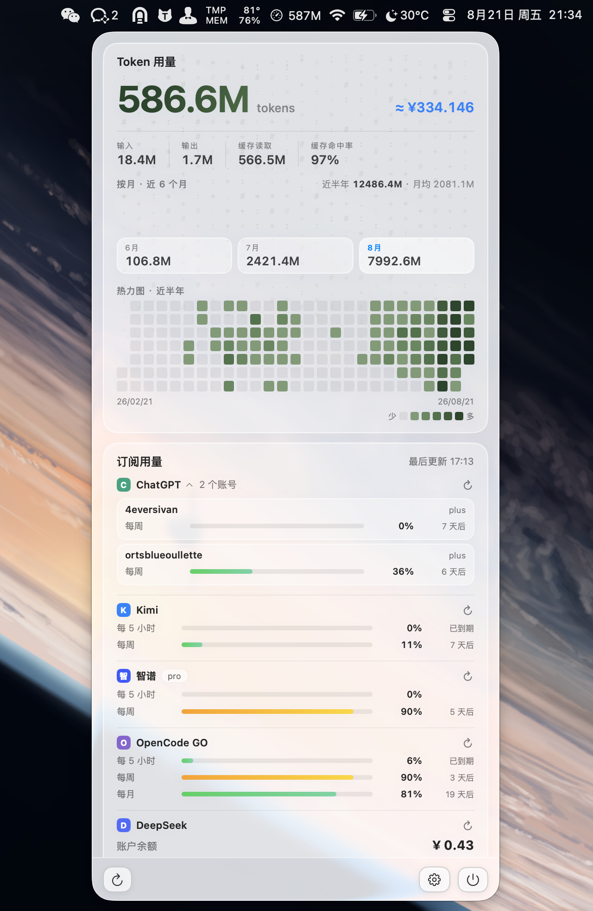
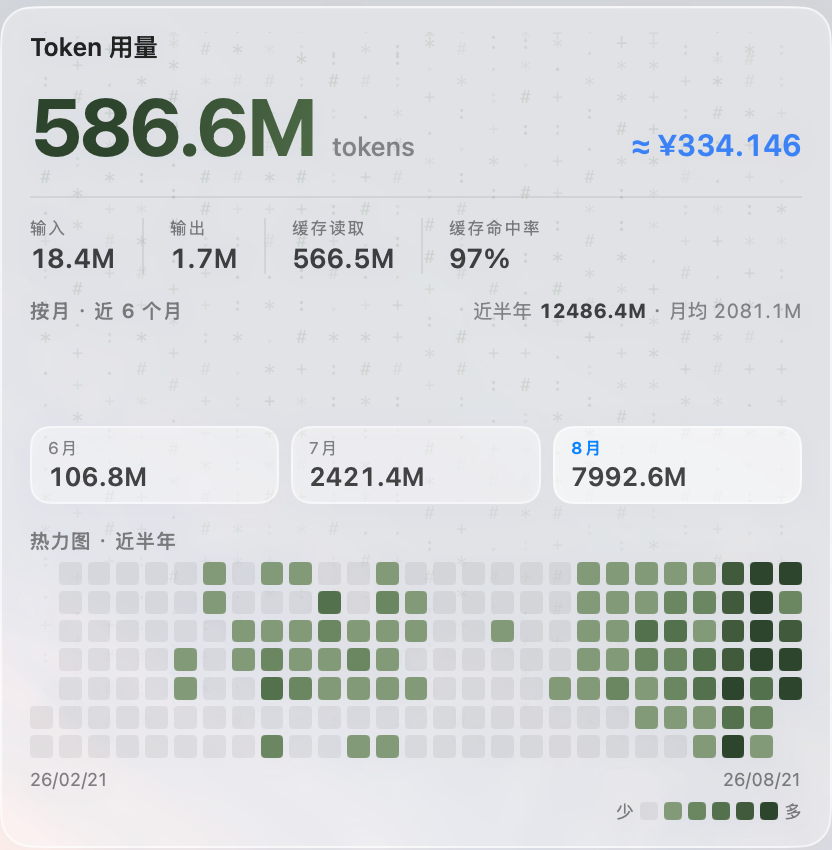
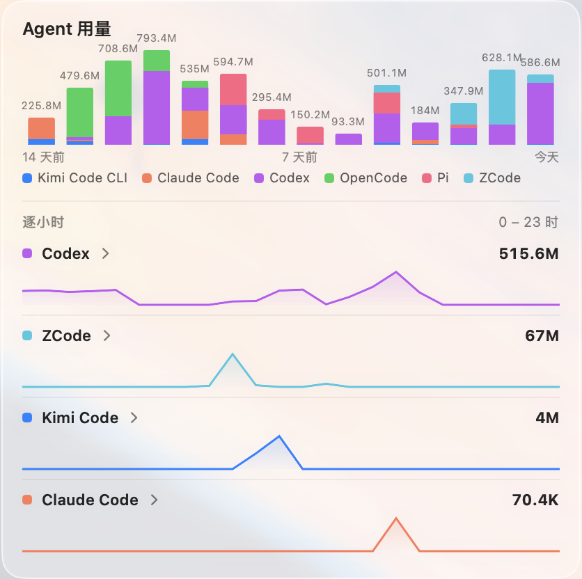
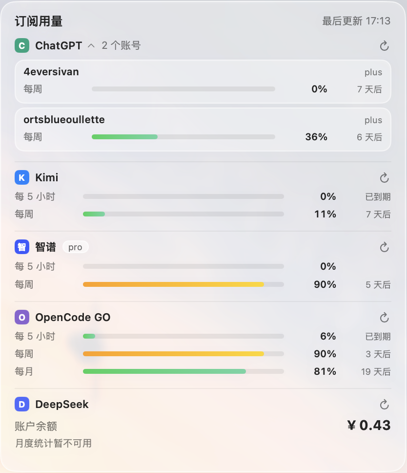

<div align="center">
  
  <h1>Bruce</h1>
  <p><strong>macOS 菜单栏里的 AI Agent 用量与订阅额度看板</strong></p>
  <p>一条帮你看住每个 token 的本地小狗 🐶</p>
  <p>
    <a href="https://github.com/4everSivan/Bruce/actions/workflows/ci.yml"></a>
    <a href="https://github.com/4everSivan/Bruce/releases"></a>
    <a href="#环境要求"></a>
    <a href="#windows-平台-appswin"></a>
    <a href="LICENSE"></a>
    <a href="apps/macos/Package.swift"></a>
    <a href="core/collector/Cargo.toml"></a>
    <a href="https://linux.do/"></a>
  </p>
</div>

Bruce 把本机 AI Agent 的 token 用量、成本估算和订阅额度集中到一个原生 macOS 菜单栏应用里。原生层负责依赖扫描、授权门控、凭证管理、定时刷新与故障恢复，Rust Collector 负责采集，弹出面板以原生 SwiftUI 渲染。**全程本地优先，没有自有服务端。**

> **当前版本 v0.12.2**。最低支持 macOS 14，液态玻璃主题需 macOS 26。发布 Universal 2 通用二进制，Apple Silicon 与 Intel Mac 均原生运行。测试版由 `scripts/build-test-app.sh` 本地打包；推送 `v*` tag 后 CI 先建未签名的 Preview 草稿 Release（附 mac 产物与发布说明），待 Windows 安装包补齐后转为公开并标记 latest。正式版（Developer ID 签名 + 公证）尚未纳入 CI/CD，`scripts/build-release-app.sh` 仅作手工预留。

## 核心特性

- **菜单栏看板**：常驻菜单栏（`LSUIElement`），原生状态项 + SwiftUI 弹出面板，高度随内容自适应、无滚动条。
- **Token 用量卡**：hero 区累计总量与估算成本、四格细分（输入 / 输出 / 缓存读取 / 缓存命中率）、按月聚合、26 周用量热力图，以及可切换窗口档位并与月卡联动的模型用量区块。
- **逐小时卡**：24 点折线与 Agent 堆叠柱状图，点击展开模型与项目明细；内置 Nothing 点阵控制台、P4 风格六格 LCD 迷你仪表与极光绿趋势线三套风格。
- **订阅用量卡**：多 Provider 计费窗口量条与重置倒计时、Codex 多账号子卡；以余额计费的 Provider（如 DeepSeek）渲染为双槽对称流；Provider 身份统一为品牌图形徽章。
- **菜单栏指示器**：纯图标模式、环形仪表与订阅配额弧线，指标可拖拽排序，设置中心提供实时模拟预览；原生自适应浅色 / 深色桌面。
- **计费引擎**：内置 43 款主流模型基准定价，精确核算模型级与全局成本；设置内提供全量价格表与单模型自定义价格覆盖。
- **凭证安全存储**：订阅凭证落盘 `~/Library/Application Support/Bruce/credentials.json`（POSIX `0600`、父目录 `0700`、临时文件 + 原子替换 + 写后重读校验），旧 Keychain 凭证首次启动静默迁移；探测外部 CLI 凭据时跳过鉴权弹窗。
- **主题**：经典与液态玻璃两档；液态玻璃仅 macOS 26+ 可选，含标准 / 通透 / 哑光三档模糊，低版本系统自动回落经典材质。
- **调度与可靠性**：默认每 30 分钟刷新（可选 5 / 15 / 30 / 60），支持手动刷新、防重入、超时、退避与系统唤醒补采；优先展示最后成功快照，单模块失败不阻塞其他模块，快照损坏自动回退 previous。
- **门控、隐私与可访问性**：首次启动引导 + 本机只读依赖扫描 + 统一授权摘要，未确认授权不启动任何 Collector；诊断包为白名单字段的最小 ZIP，不含 Artifact 与账号活动数据；支持键盘导航、VoiceOver 状态语义与「减少动态效果」。

## 支持的数据源

| 类别 | 覆盖 |
|---|---|
| 本机会话扫描 | Kimi Work、Kimi Code CLI、Claude Code、Codex、Grok、OpenCode、Orca、Pi、ZCode、CodeBuddy |
| 订阅额度 | Kimi、DeepSeek、火山引擎、Codex（OAuth 多账号）、Claude、Grok、OpenCode Go、Z.ai（智谱 GLM）、阶跃星辰 StepFun、Cline / ClinePass |

> Cline 的 5 小时 / 7 天 / 30 天三窗口直读服务端权威端点，不在本地为窗口建模。`apps/widget/` 下的单文件 Widget 仅服务 Daimon / Kimi Work Blueprint 场景，不属于 App 组成部分。

## 界面预览

菜单栏面板以原生 SwiftUI 渲染，下图为液态玻璃主题（macOS 26）实机运行效果。截图取自 2026-08，界面细节此后持续演进，面板结构与卡片层级沿用至今。

| 说明 | 截图 |
|---|---|
| **仪表盘全貌**：面板自上而下由 Token 用量卡、订阅用量卡与底部操作栏（刷新 / 设置 / 退出）组成，高度随内容自适应，无滚动条。 |  |
| **Token 用量卡**：Hero 总量与估算成本、输入 / 输出 / 缓存读取 / 命中率四格细分，按月聚合与 26 周热力图呈现使用节奏。 |  |
| **逐小时卡**：14 日堆叠柱状图按 Agent 分色，逐小时折线展开 0–23 时分布，可下钻到模型与项目。 |  |
| **订阅用量卡**：多 Provider 窗口量条按原生计费窗口展示用量百分比与重置倒计时；余额型 Provider 展示可用余额与本月消费。 |  |

## 快速开始

### 环境要求

- macOS 14 或更高（`LSMinimumSystemVersion` 14.0）；液态玻璃主题需 macOS 26 或更高。
- Swift 6.2 工具链（`swift-tools-version: 6.2`）；仅装 Command Line Tools 即可完成 SwiftPM 构建。
- Rust toolchain（rustc / cargo）；Collector 编译为 macOS 原生 Rust 二进制。
- Agent 用量模块需要至少一个受支持的本机会话数据源。
- 签名、归档与公证需要完整 Xcode 与 Developer ID 证书。

### 构建并运行

```bash
swift build --package-path apps/macos
swift run   --package-path apps/macos BruceApp
```

首次运行流程：

1. 在设置页检查 Rust Collector、本机会话与可选 SQLite 数据源。
2. 按引导完成 Bruce 凭据存储初始化；跳过时应用保持不读取凭证且不自动刷新。
3. 勾选需要启用的 Agent 用量模块。
4. 在「订阅额度」分区按需配置或导入订阅凭证；未配置任何 Provider 时订阅卡不渲染。
5. 阅读并确认统一授权摘要后，应用才会启动对应 Collector 与自动刷新。

真实账号访问与外部请求只应在个人 Mac 上、经用户明确授权后执行。

### 构建与发布

```bash
zsh scripts/build-test-app.sh --universal --install  # 构建 Universal 2 并安装到 /Applications/Bruce.app
zsh scripts/build-test-app.sh                        # 仅产出 dist/Bruce.app 与 dist/Bruce.zip（不入库）
zsh scripts/release-notes.sh                         # 从 CHANGELOG 提取当前版本生成 Release 说明
zsh scripts/build-release-app.sh                     # 手工正式版：Developer ID 签名 + Hardened Runtime + 公证
```

在 macOS 27 配合菜单栏管理器使用时，请从 `/Applications/Bruce.app` 启动：`dist/Bruce.app` 是构建产物目录，直接启动的开发包可能没有稳定的 LaunchServices 注册，菜单栏重排后会被系统隐藏。正式版手工打包要求 Git tag `v<major>.<minor>.<patch>`、Developer ID Application 证书与 App Store Connect API Key；该流程未接入 CI/CD，前置缺失时脚本在对应阶段清晰失败，不产出半成品。

## Windows 平台 (apps/win)

Windows 版基于 **Tauri 2**（Rust 后端 + WebView2）构建，与 macOS 版共享同一套 `core/collector` 引擎与 Artifact 契约，视图模型行为由双端 fixture 对拍逐字段锁定（设计基线：[05-Windows平台适配.md](docs/devel/design/05-Windows平台适配.md)）。托盘常驻、弹出看板、全局热键、配额 Toast、凭证引导、设置中心与 NSIS 安装包产线均已实现；托盘交互细节与安装冒烟仍待 Windows 真机验收。

```powershell
powershell -ExecutionPolicy Bypass -File scripts/build-win-app.ps1   # 产物收拢 local/dist
```

数据位置：凭证 `%APPDATA%\Bruce\credentials.json`（仅当前用户 SID 的受保护 ACL）、设置 `%APPDATA%\Bruce\config\settings.json`、快照 `%APPDATA%\Bruce\snapshot.json`、月度账本 `%APPDATA%\Bruce\usage-ledger\`、采集缓存 `%LOCALAPPDATA%\Bruce\collector-cache-v1`。首次使用需在设置中明确允许订阅查询；保存凭证不会自动授予联网同意。在 macOS 上调试 Windows 壳时数据目录为 `~/Library/Application Support/Bruce-Windows-Dev`，与原生 App 完全隔离。

## 应用架构

```text
macOS 菜单栏应用 (LSUIElement, 最低 macOS 14)
  ├─ Onboarding + 设置中心
  │    ├─ 本机只读依赖扫描
  │    └─ 订阅凭证 (credentials.json, POSIX 0600)
  ├─ RefreshScheduler (默认 30 分钟 / 手动 / 唤醒补采)
  │    └─ CollectorRunner
  │         └─ Rust Collector (stdin/stdout JSON)
  │              └─ 本机会话扫描 + 订阅额度出站查询
  └─ ArtifactStore (最后成功快照 + previous)
       └─ AppModel + PanelViewModelMapper
            └─ 原生状态项 + AppKit/SwiftUI 看板 (经典 / 液态玻璃)
```

原生层按 Onboarding 结果与用户授权决定允许启动的模块，由 Scheduler 为每个模块创建受控任务，经 Bridge 的 stdin 传入最小 context 与凭证；Collector 返回 `{"artifact": ...}`，Bridge 校验 schema、错误语义与凭证更新后由 ArtifactStore 原子保存最后成功快照，同一份 Artifact 分别映射为面板 view model（SwiftUI 卡片）与 `DaimonWidget.data.main`（Widget 场景）。可测试业务逻辑位于 `BruceAppCore` library target，`BruceApp` executable 只保留入口、界面装配与 `Views/` 卡片组件；Collector 另保留独立 CLI 入口，用于开发与故障排查。

```text
Bruce/
├── apps/
│   ├── macos/                   # SwiftPM 原生菜单栏应用 + 15 个 Harness
│   │   ├── Sources/BruceApp/             # 入口、状态项、设置中心、Views/ 卡片
│   │   ├── Sources/BruceAppCore/         # AppModel、调度、PanelViewModel 映射
│   │   ├── Sources/BruceOnboardingCore/  # 扫描、授权、Gate、凭证、主题解析
│   │   ├── Sources/BruceGlassSurfaceCore/# 液态玻璃材质
│   │   ├── Assets/                       # AppIcon.icns
│   │   └── Tests/                        # Harness targets
│   ├── win/                     # Tauri 2 壳：Rust 后端 + WebView2 前端 + 视图模型 crate
│   └── widget/                  # Daimon / Kimi Blueprint 单文件 Widget
├── core/collector/              # Rust Collector workspace (8 crates + Bruce-collector 二进制 + schemas)
├── docs/                        # ad-flow 文档中心 (guide / devel / assets / archive)
├── scripts/                     # 验证、打包、发布与前端回归脚本
├── tests/                       # JSON fixture、视觉基线与基准
├── local/                       # 本地构建产物与运行数据（不入库）
└── dist/                        # Release / Preview 打包产物（不入库）
```

关键入口：应用 `apps/macos/Sources/BruceApp/BruceApp.swift`；卡片组件 `apps/macos/Sources/BruceApp/Views/`；Collector `core/collector/bin/Bruce-collector/src/main.rs`；协议字段参考 `core/collector/schemas/`（运行时强制力在 collector-bridge 的白名单与 `BRIDGE_SCHEMA_VERSION` 比对）；Widget 源文件 `apps/widget/index.html`。

## 数据与隐私

应用自有数据位于（macOS，Windows 见上一节）：

| 路径 | 内容 |
|---|---|
| `~/Library/Application Support/Bruce/config/onboarding-v1.json` | 非敏感配置、授权版本与系统通知开关 |
| `~/Library/Application Support/Bruce/credentials.json` | 订阅凭证（POSIX `0600`，父目录 `0700`） |
| `~/Library/Application Support/Bruce/snapshots/` | 当前与 previous Artifact 快照 |
| `~/Library/Application Support/Bruce/metadata/modules.json` | 最近成功、尝试时间与错误分类 |
| `~/Library/Application Support/Bruce/collector-cache-v1/` | 采集增量缓存 |

- 本地优先，无项目自有服务端，不默认同步活动数据。
- 凭证经 Bridge stdin 的单次请求传递，不进入命令行参数、Artifact 或日志。
- 凭证文件损坏时读路径保留现场副本并显式报错，不会静默清空；写入走临时文件 + 原子替换 + 重读校验。
- Collector 不写 Keychain、不写第三方认证文件，令牌轮换仅经 `credentialUpdates` 写回应用自有存储。
- 读取外部应用 SQLite 强制 `mode=ro` 只读连接，扫描目录零写入。
- 诊断包采用白名单字段，生成后解压复核文件清单并再次扫描敏感形态；菜单栏指标仅显示聚合数字，不含账号或 token 明细。

**清理**：先退出应用，在设置页「撤销全部授权」停止全部调度；需要完全重置时，再通过 Finder 删除 `~/Library/Application Support/Bruce/`。删除快照与凭证不可由应用自动恢复，操作前请确认不再需要最后成功数据与现有授权。出现回归时可先撤销受影响模块并继续使用其他模块；回退到兼容 Bridge v1 / Artifact v1 的旧构建不会改写第三方数据库。**不要通过修改 CC Switch 数据库来修复 Bruce。**

## 开发与验证

```bash
zsh scripts/verify-local.sh   # 标准全量验证（推荐入口）
zsh scripts/verify-rust.sh    # 跨平台 Rust 入口：fixture 扫描 + fmt + test + clippy
```

`verify-local.sh` 覆盖 Rust workspace 的 fmt / test / clippy、fixture 语法与敏感扫描、Windows 前端结构冒烟、Swift 构建与全部 15 个 Harness、Widget 像素动画性能 Harness，以及 Provider 品牌图形产物与源文件的一致性校验。隔离集成只在随机临时 HOME 中运行 Rust Collector，关闭外部额度能力，不访问真实账号、凭证或第三方数据库。

按需运行子集：

```bash
cargo test --manifest-path core/collector/Cargo.toml --workspace
zsh scripts/check-collector-fixtures.sh
swift run --package-path apps/macos BruceOnboardingCoreHarness
swift run --package-path apps/macos PanelParityHarness "$PWD"
```

CI（`.github/workflows/ci.yml`）在 push / PR 时执行 macOS 侧 `verify-local.sh`、Windows 侧 Rust 与前端验证、以及测试版 App 构建；tag `v*` 额外触发发布流水线：先建未签名 Preview 草稿 Release（`Bruce.zip` + SHA256SUMS + 从 CHANGELOG 提取的发布说明），随后 Windows 作业构建 NSIS 安装包并上传，两端产物齐备后自动转为公开 Release 并标记 latest。正式签名、公证与 Gatekeeper 校验不属于当前 CI/CD 规划；真实 Collector、OAuth 与 `.app` 发布验证需单独授权和环境，不在默认测试流程内。

## 当前限制

- 正式签名与公证发布链路未纳入 CI/CD，Windows 安装包签名（signtool）同为占位，需在仓库配置证书后启用。
- Windows 版托盘交互与安装冒烟仍需 Windows 真机验收。
- 真实 Agent Provider 登录验收需要用户在个人 Mac 上明确授权后执行。
- 30 分钟自动刷新、睡眠补偿、凭证续期与撤销等长时行为，以及 VoiceOver、增加对比度与全键盘流程，仍需在发布构建上完成人工验收。

## 更多文档

- [文档中心](docs/README.md) — 全库结构、编写契约与机器索引
- [系统总体设计](docs/devel/design/00-系统总体设计.md) — 现行设计基线 00~05
- [变更总账](docs/devel/change/index.json) — 全量变更卡与 Topic 映射
- [本地部署指南](docs/guide/01-本地部署指南.md) — 环境准备、构建与联调
- [设计资源库](docs/assets/README.md) — 架构图、截图与视觉素材

## 社区与致谢

感谢 [LINUX DO](https://linux.do/) 社区为开发者交流和开源分享提供平台。

## License

[MIT](LICENSE)
