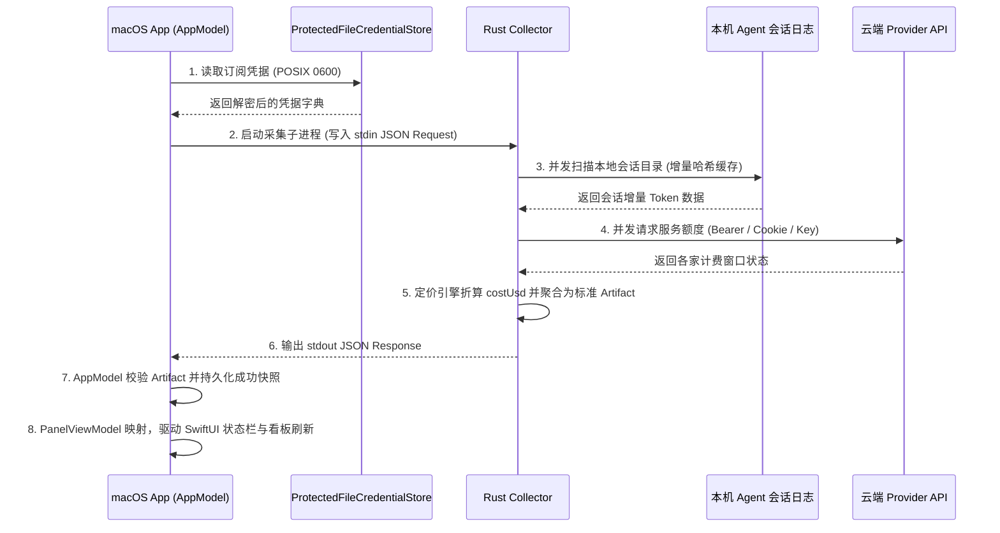

# 00-系统总体设计

<!-- @topic: SystemOverview -->
> **文档ID**: DESIGN-SYS ｜ **状态**: 现行基线
> **最后更新**: 2026-10-27 ｜ **对应 Topic**: `SystemOverview`

---

## 1. 简介 (Introduction)

`Bruce` 是一款运行在 macOS 菜单栏环境中的本地优先（Local-First）AI Agent 研发用量与订阅额度看板。

- **核心动因**：随着开发者在本机同时运行多个 AI 编程与研究 Agent（Claude Code, Codex, Kimi Code, OpenCode 等），Token 消耗速度极快、各家云端额度计费窗口各异（5小时滑动、自然周、月度等），传统开发者必须频繁切换网页查询账单或面临突发断配。
- **系统定位**：作为轻量级常驻系统的系统托盘指示器与下拉控制台，向下通过高性能 Rust 引擎安全扫描本机 Agent 运行痕迹与出站查询配额，向上以原生 SwiftUI 提供高保真、沉浸式状态监控。

---

## 2. 目标与非目标 (Goals & Non-Goals)

### 2.1 目标 (Goals)
1. **多端应用与引擎解耦**：采用现代 Monorepo 分层架构（`apps/` + `core/`），数据采集核心与 UI 交互层完全隔离，天然支持向 Windows/Linux 跨平台扩展；
2. **纯本地安全闭环**：无自有云端服务端，用户所有 Token 账单、凭证密钥与会话元数据 100% 闭环在用户本机；
3. **精准用量与成本感知**：内建主流大模型基准价卡与计费引擎（价卡单一事实源 `pricing-catalog.json`），提供精确到模型级与 Agent 级的费用核算与小时级趋势；
4. **零干扰交互体验**：脱离 Ad-hoc 签名导致的频繁系统钥匙串密码弹窗，外部 CLI 探测静默回退，菜单栏自适应浅色/深色桌面壁纸。

### 2.2 非目标 (Non-Goals)
1. **不充当 AI 网关或代理**：本项目不代理任何实际的大模型对话流量，仅旁路只读分析会话日志；
2. **不执行写操作或修改外部会话**：读取外部应用 SQLite 数据库（如 CC Switch 等）严格限定 `mode=ro`，绝不修改、迁移或修复外部数据库；
3. **不做云端数据同步**：不建设远程中心化用户系统，所有订阅配置统一保存在本地受保护存储中。

---

## 3. 全局架构与领域模型 (Architecture & Domain Models)

### 3.1 总体逻辑分层架构

```text
┌────────────────────────────────────────────────────────────────────────┐
│                       应用呈现层 (apps/)                                │
│  ┌───────────────────────────────────┐  ┌───────────────────────────┐  │
│  │    macOS 原生常驻应用 (apps/macos) │  │  Web 小组件 (apps/widget) │  │
│  │   SwiftUI / MenuBar / Glass Panel │  │  Daimon / Blueprint 卡片  │  │
│  └─────────────────┬─────────────────┘  └─────────────┬─────────────┘  │
└────────────────────┼──────────────────────────────────┼────────────────┘
                     │ (调用与解析)                      │ (映射 data.main)
                     ▼                                  ▼
┌────────────────────────────────────────────────────────────────────────┐
│        协议字段参考 (core/collector/schemas/, 非运行时强制)            │
│   强制力在 collector-bridge 白名单 + schemaVersion 整数比对 (C052)     │
└────────────────────────────────────┬───────────────────────────────────┘
                                     │ (JSON over stdio)
┌────────────────────────────────────┼───────────────────────────────────┐
│                       核心引擎层 (core/)                                │
│  ┌─────────────────────────────────┴─────────────────────────────────┐  │
│  │                  Rust Core Collector (core/collector)             │  │
│  │  - collector-application: 调度执行、上下文装配与多模型聚合          │  │
│  │  - collector-local: 本机会话扫描、目录防环保护与 SQLite 只读适配     │  │
│  │  - collector-provider: 云端 10 家 Provider 额度出站查询与 OAuth 轮换│  │
│  │  - collector-domain: 领域模型、基准价卡 (单一事实源) 与成本核算引擎 │  │
│  │  - collector-bridge: 跨进程 IPC 协议编解码与 Schema 版本校验        │  │
│  └───────────────────────────────────────────────────────────────────┘  │
└────────────────────────────────────────────────────────────────────────┘
```

- **单文件内聚与规模边界 (C053)**：单文件超过约 **1,500 行**（或同时承载 3 个以上独立职责簇）时，应按单一职责切分为子模块或同模块扩展文件（如 `collector-local/src/sources/`、`collector-provider` 的 `seroval.rs` / `protobuf.rs` / `signing.rs` / `quota_parsers.rs` / `providers.rs`，以及 macOS 端 `SettingsView+SubscriptionPane.swift`、`SubscriptionService+VerificationAndCodex.swift`，Windows 端 `runtime_core/` 的 `activity.rs` / `geometry.rs` / `status.rs`（C128，父模块 `pub use` 保持 `runtime_core::*` 路径不变））；纯结构重构须保持对外 API 与可观测行为 100% 等价，并以既有全量测试（Rust workspace + Swift Harness + 双端对拍）全绿及无新增 `#[allow(clippy::too_many_arguments)]` 为验收。

### 3.2 数据流转管线



---

### 3.3 发布产物规格 (Release Artifacts)

<!-- @topic: SystemOverview -->

项目对外发布只经由 `v*` tag 触发的 CI 流水线，产物规格如下（**平台内部的打包细节**见 design/05 §6.4；本节只规定跨端必须满足的硬性约束）：

- **macOS 产物**：`dist/Bruce.app`、`dist/Bruce.zip`（供应用内软件更新 T10 与免挂载解包运行）以及附加安装镜像 `dist/Bruce-<version>.dmg`（C114，内含 `/Applications` 软链接供初装拖拽使用）；**必须为 Universal 2**（同时含 `arm64` 与 `x86_64`），依据是项目声明 Intel Mac 原生可用。因 App 本体（Swift）与内置 Rust Collector 是**分别构建再组装**的两个二进制，任一退化为单架构都会让对应平台无法启动，故 CI 对**两个二进制分别断言**双架构（`lipo -archs`）；T16 起 App 本体还静态链接共享策略库 `libbruce_policy.a`（`collector-policy-ffi`，design/08 第二期），打包脚本按与 Collector 相同的架构集合构建并 `lipo` 合并到 `local/build/policy-ffi/`，缺任一架构切片 App 链接即失败，并显式 `rustup target add x86_64-apple-darwin`（该 target 是否预装随 runner 镜像而变）。
- **Windows 产物**：NSIS 安装包与 SHA256 校验和，命名与版本规则见 design/05 §6.4。
- **版本号**：仓库根 `VERSION` 是唯一权威值。macOS 侧由 `scripts/build-test-app.sh` 读取并注入 `CFBundleShortVersionString`；Windows 侧见 design/05 §6.4「应用版本号单一事实源」。
- **发布可见性**：tag 触发后先建未签名 Preview **草稿** Release 并附 macOS 产物，待 Windows 作业补齐安装包后由该作业转为公开并标记 latest —— 即最终呈现给用户的是**已发布**的 Release，而非草稿。

> **纪律**：凡「只在 tag 场景被消费」的产物属性（版本号、架构、文件名），都必须在 push 级门禁或流水线内附带断言 —— 否则漂移会静默存活整个版本周期，直到发版后才可见（C056 的版本号漂移与 C057 的架构退化即两类实例）。

---

### 3.4 本地全量验证门禁架构 (Verification Pipeline Architecture)

<!-- @topic: SystemOverview -->

`scripts/verify-local.sh` 是全项目核心本地质量门禁，覆盖 Rust 工作区、Node 前端冒烟及 macOS 17 项 Harness 测试：
1. **高性能单次并行构建 (Single-pass Parallel Build)**：针对 SwiftPM 多 Harness 场景，统一使用 `swift build --package-path apps/macos --build-tests` 一次性完成全核并行编译，随后直接从 `--show-bin-path` 产物目录调用 Harness 原生二进制，严禁使用多次串行 `swift run` 重复规划依赖图与无效重编；
2. **深度缓存剪枝 (Strict Prune)**：遗留 Python 扫描严格排除 `*/.build` 与 `*/node_modules`，防止遍历深层衍生目标文件产生磁盘 I/O 震荡；
3. **门禁 SLA 与基线契约**：全量热重跑需保证在 1 分钟内完成（~30s 级），全绿退出码为 0，17 项 Harness 行为与输出契约 100% 保持一致。

---

## 4. 功能模块矩阵与 Topic 映射

系统核心业务按主题（`@topic`）实施中枢解耦，所有任务卡与变更卡均锚定对应主题：

| 模块序号 | 设计方案文档 | 核心 Topic | 领域职责 | 关键实现目录 |
|---|---|---|---|---|
| **01** | [01-数据采集与多模型计费引擎.md](01-数据采集与多模型计费引擎.md) | `TokenUsage` | 9 个 Agent 会话源扫描（Orca 内置 Codex 计入 Codex）、增量缓存、内置价卡与 Token 费用核算 | `core/collector/crates/` |
| **02** | [02-订阅额度与凭据安全存储.md](02-订阅额度与凭据安全存储.md) | `SubscriptionQuota` | 10 家 Provider 额度适配（Jev 于 UI 屏蔽）、POSIX 0600 凭据存储、原子落盘与防扰 | `apps/macos/Sources/BruceOnboardingCore/` |
| **05** | [05-Windows平台适配.md](05-Windows平台适配.md) | `WindowsCompat` | Windows 托盘常驻看板（Tauri 2）、collector 单引擎双平台、Rust 视图模型与双端 fixture 对拍 | `apps/win/` |
| **03** | [03-菜单栏状态与多风格原生渲染.md](03-菜单栏状态与多风格原生渲染.md) | `MenuBarIndicator` | 赛博精密环形仪表、纯图标模式、液态玻璃与 Nothing 风格点阵控制台 | `apps/macos/Sources/BruceApp/Views/` |
| **04** | [04-设置中心与价格校准交互.md](04-设置中心与价格校准交互.md) | `PricingEngine` | 菜单栏实时预览条、卡片排序拖拽、全模型价格表与自定义覆盖校准 | `apps/macos/Sources/BruceApp/Settings/` |
| **06** | [06-Agent用量分析与Token统计工作台.md](06-Agent用量分析与Token统计工作台.md) | `AgentAnalytics` | 设置中心全景工作台、时序分析、多源模型归一化与多 Agent 对比 | `apps/macos/Sources/BruceAppCore/WorkbenchAnalytics.swift`、`apps/win/viewmodel/src/analytics.rs` |
| **07** | [07-软件更新.md](07-软件更新.md) | `SoftwareUpdate` | 应用内检查更新与自动升级：latest.json 清单、双端维护页更新卡、mac 自替换安装器与 Windows updater | `apps/macos/Sources/BruceAppCore/SoftwareUpdate*.swift`、`apps/win/src-tauri/src/software_update.rs` |
| **08** | [08-跨端共享策略核心.md](08-跨端共享策略核心.md) | `SharedPolicyCore` | 两端重复实现的额度门禁与回填收敛为一份 Rust 实现（T13–T16 已实现，待人工确认）：Windows 进程内调用 crate，mac 静态链接 C ABI 库进程内调用 | `core/collector/crates/collector-policy`、`collector-policy-ffi`；`apps/macos/Sources/BrucePolicyFFI` |

---

## 5. 调度、容灾与快照持久化机制

1. **自动刷新节拍**：
   - 默认调度周期为 **30 分钟**；
   - 支持防重入门禁（若上次采集正在执行，自动跳过新一轮调度）；
   - 支持系统休眠唤醒感知（Wake-up Catch-up）：系统唤醒后若距离上次刷新超过设定周期，立即启动补偿采集。
2. **三级快照容灾**（快照按采集模块分文件，当前唯一模块为 `agent-usage`）：
   - **内存态 (`AppModel.snapshot`)**：响应 UI 即时渲染；
   - **当前持久化快照 (`snapshots/<module>.json`，如 `snapshots/agent-usage.json`)**：最近一次成功采集的完整快照，下次冷启动秒开呈现；
   - **灾备回退快照 (`snapshots/<module>.previous.json`)**：若当前快照文件在系统异常断电中出现解析损坏，自动无感回退至前一次健康快照，杜绝界面出现空数据白屏。
   - 另有旧 schema 迁移备份 `snapshots/<module>.schema-v0.backup.json`（不参与回退）。C121 起发布不再写 `snapshots/<module>.json.backup.json`（其内容与 previous 相同），旧版本遗留的一份在下次发布时清理（读取 current 与 previous 均损坏时的回滚路径保留，仅在遗留备份清理前生效）。
3. **快照读写只解析一次（C121）**：`ArtifactStore` 在内存中保留最近一次发布或读取成功的当前快照（字节 + 解码结果），磁盘字节与之**逐字节相同**才复用，任何外部改写或损坏都会触发重新读取与回退判定；发布时内存校验一次，写后重读只比对字节，轮换 previous 前对非缓存字节仍做完整校验（不合格的当前快照不得成为 previous）。`ArtifactValidator.validate(_:encoded:for:)` 复用调用方已有的 JSON 字节免去整树再编码，敏感键判定按键名缓存。快照读写仍在主线程（@MainActor），改为后台需调整调度链路的隔离，单独评估。

---

## 6. 变更与演进记录

| 变更编号 | 关联版本 | 核心演进要点 |
|---|---|---|
| `C001` | `0.9.0+` | 重构项目工程目录为 Monorepo `apps/` 与 `core/` 分层架构，清理 4.4GB 缓存与幽灵目录 |
| `C002` | `0.9.0+` | 隔离历史文档与旧设计目录至 `_adflow_backup/original_docs/`，纯化现行设计基线与资源索引 |
| `C052` | `0.12.0+` | 基线失真回写：provider 计数统一为 10 家、定价表 26→43 款、补 Windows 平台模块矩阵、schemas 契约表述改为「Rust 侧白名单校验」、单文件规模与结构重构纪律（C053 范围） |
| `C053` | `0.12.0+` | 按单一职责切分四处巨型文件（`sources.rs`、`collector-provider/src/lib.rs`、`SettingsView.swift`、`SubscriptionService.swift`），保持全部对外 API 与测试行为 100% 等价且单文件均控制在 1,500 行以内 |
| `C104` | `0.14.0` | 优化本地验证脚本 verify-local.sh 执行耗时：单次并行构建全部 Harness 替换 17 次串行 swift run 并修复 find 剪枝，验证耗时由 11m39s 降至 30s 级 |
| `C121` | `0.14.0` | macOS 快照持久化去重复解析：已校验快照按字节缓存，发布 / 读取不再重复整树解码校验，校验复用已有字节并缓存敏感键判定，停写与 previous 同内容的 `.backup.json`（真实 181 KB artifact：发布 192 → 17 ms、热读取 71 → 0.2 ms） |
| `C125` | `0.14.0` | 全景文档核对：README 版本 v0.12.2 → v0.13.0、Harness 15 → 17 个、设计基线 00~05 → 00~07，补软件更新与用量分析工作台特性及 `updates/` 数据目录；设计中心索引各文档「最后更新」与正文头同步；design/02 刷新间隔可选值按实现更正为 5/15/30/60 |
| `C128` | `0.14.0` | Windows `runtime_core.rs`（1,639 行，四个职责簇）按 C053 纪律拆出 `activity.rs`（窗口激活与快捷键状态机）/ `geometry.rs`（看板与预览卡几何）/ `status.rs`（四色状态灯），纯移动、公开路径不变 |
