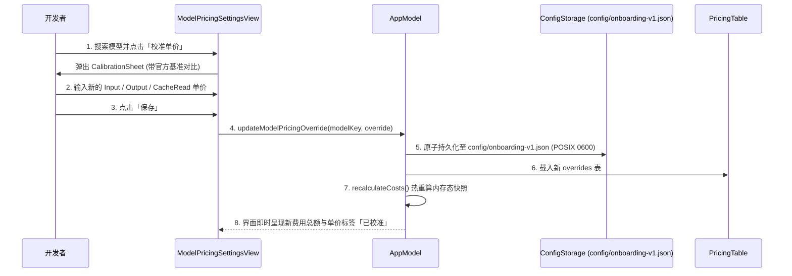

# 设置中心与价格校准交互设计方案

<!-- @topic: PricingEngine -->
> **文档ID**: DESIGN-SETTINGS ｜ **状态**: 现行基线
> **最后更新**: 2026-10-26 ｜ **所属总体**: [00-系统总体设计.md](00-系统总体设计.md) ｜ **对应 Topic**: `PricingEngine`
> 📌 **变更总账**: 参见 [变更总账 (PricingEngine)](../change/index.json#PricingEngine)

---

## 1. 简介 (Introduction)

本方案定义 `Bruce` 的原生设置中心（Settings Window）及大模型单价自定义校准（Model Pricing Overrides）交互系统。

- **业务动因**：随着大模型市场竞争与厂商定价动态调整（例如夜间折扣、企业级专有折扣、自定义代理中转折扣），默认静态基准单价可能与用户的真实采购账单存在偏差。此外，用户需要精细控制菜单栏展示风格、调度节拍、卡片显隐顺序，并安全录入 Provider 凭据。
- **系统定位**：位于 `apps/macos/Sources/BruceApp/Settings/`，提供多 Tab 分区卡片式设置面板与模型单价校准工作台，直接操作 `config/onboarding-v1.json`、`credentials.json` 并实时反哺 `AppModel` 费用重算。

---

## 2. 目标与非目标 (Goals & Non-Goals)

### 2.1 目标 (Goals)
1. **模块化卡片式布局 (Cardification)**：6 个功能分区全部采用独立圆角卡片（`SettingsCard`），配备专属彩色色标，无论切换经典或液态玻璃主题均保持视觉一致性；
2. **多模型定价与校准工作台**：
   - 完整罗列内置价卡（Input / Output / Cache Read 单价），行集与单价和采集端计费同源（C108，见规则「价卡单一事实源」）；
   - 支持多维筛选（全部 / 已有用量 / 已人工校准）；
   - 交互式弹窗修改单价，支持一键重置单模型或重置全量；
   - 单价变更后即刻触发内存态用量与历史费用动态重算（Hot Recalculation），无需重新触发全盘 I/O 扫描；
3. **菜单栏动态实时预览**：设置面板顶部内嵌高保真模拟菜单栏，滑块或选项变动即时反馈真实尺寸与视觉效果；
4. **凭据与账号管理工作台**：针对 10 家 Provider 提供连接测试、分账号管理、一键从本机 CLI 发现导入。

### 2.2 非目标 (Non-Goals)
1. **不提供在线价格爬虫**：模型价格以本地官方基准表及用户自定义为准，不发起外部未经许可的网络价格嗅探；
2. **不接管系统系统偏好设置**：开机自启动严格使用 macOS 标准 `SMAppService` API，不安装隐式 LaunchDaemons。

---

## 3. 需求分析 (Requirements)

### 3.1 功能需求清单
- **FR-1 分区卡片体系**：
  - **通用 (General)**：开机启动切换、自动刷新频率（15m / 30m / 60m）、版本号显示（读取自 `VERSION`）；
  - **菜单栏定制 (MenuBar)**：实时预览条、显示模式（纯图标 / 数值 / 组合）、刘海屏折叠阈值；
  - **模型单价与计费 (Pricing)**：多模型价格表、搜索栏、状态过滤、校准弹窗、重置确认；
  - **订阅额度 (Subscription)**：10 家 Provider 状态指示、API Key 输入、连通性测试；
  - **卡片管理 (Cards)**：卡片显隐开关与拖拽重排（Drag-and-Drop）；
  - **数据与诊断 (Diagnostics)**：缓存清理、导出完整诊断 JSON。
- **FR-2 单价即时热重算**：当保存模型覆盖项后，`AppModel` 遍历已解码的 `AgentUsageArtifact`，重新执行纯函数换算并广播 `@Published` 变更，驱动面板刷新。

### 3.2 非功能需求 (NFR)
- **界面响应**：过滤筛选和搜索需在 16ms 内无卡顿完成（内存纯数组过滤）；
- **配置落盘**：用户偏好保存到 `~/Library/Application Support/Bruce/config/onboarding-v1.json`，采用 POSIX 0600 文件权限（父目录 0700）与原子替换。

---

## 4. 功能设计 (Functional Design)

### 4.1 模型价格校准交互流程



---

## 5. 详细设计 (Detailed Technical Design)

### 5.1 核心业务规则 (Core Rules)
<!-- @topic: PricingEngine -->

#### 变更演进索引
| 变更编号 | 类型 | 简介 | 规则演进 |
|---|---|---|---|
| `C001` | 重构 | Monorepo 目录分层与设置组件收拢 | 设置组件收拢至 `apps/macos/Sources/BruceApp/Settings/` |
| `C108` | BugFix | 价卡单一事实源：设置页展示单价与采集端计费同源，消除 deepseek-v4.1-flash 展示 $0.15/$0.60 而按 $0.30/$1.20 计费的漂移 | 新增规则「价卡单一事实源」；覆盖项匹配改与采集端 `PricingTable::resolve` 同序 |
| `C111` | BugFix | 设置窗口统一错误提示方案：悬浮高斯胶囊浮岛 (8pt 卡片级圆角 + 环形倒计时关闭体 + 42pt高 + 420pt固定宽)，彻底根治页面抖动下沉、跨 Tab 污染与信息重叠 | 新增规则「设置窗口统一悬浮错误胶囊交互与消噪契约」：剥离 ScrollView 文档流采用 overlay 居中悬浮；支持 4s 环形微圆环倒计时与悬停暂停；带 ✕ 一键关闭；Tab 切换自动失效；卡片内已有状态区就地收敛不向全局上报 |

#### 现行设计规则

##### 0. 价卡单一事实源 (C108)
- 内置价卡只维护一份：`core/collector/crates/collector-domain/pricing-catalog.json`（模型键、显示名、厂商、Input / Output / Cache Read 单价、缓存写入 TTL 倍率、备注、`listed`）。采集端 `PricingTable` 直接加载；Windows `apps/win/viewmodel` 的 `model_catalog::catalog()` 派生 `listed` 行；mac `BuiltinModelPricingCatalog.allModels` 由 `node scripts/gen-pricing-catalog.mjs` 生成至 `BuiltinModelPricingCatalog+Data.swift`，`verify-local` 以 `--check` 拦截未重新生成的漂移。**禁止在任一端手写价卡副本**；新增或调价只改该 JSON 并重新生成。
- `listed: false` 的行（版本别名、受限型号）参与计费但不在设置页单列。
- 设置页覆盖项匹配与采集端同序：原样键 → 规范键 → 前缀候选中「目录键是模型名前缀」者取最长、否则「模型名是目录键前缀」者取最短，同长取字典序最小，保证展示的覆盖单价即实际计费单价。

##### 1. 设置分区卡片容器规范 (`SettingsCard`)
设置页 6 个分区全部包裹在 `SettingsCard` 中，不跟随桌面主题变动：
```swift
struct SettingsCard<Content: View>: View {
    let title: String
    let accentColor: Color
    @ViewBuilder let content: Content

    var body: some View {
        VStack(alignment: .leading, spacing: 12) {
            HStack(spacing: 8) {
                RoundedRectangle(cornerRadius: 2)
                    .fill(accentColor)
                    .frame(width: 4, height: 16)
                Text(title)
                    .font(.headline)
                    .fontWeight(.bold)
            }
            content
        }
        .padding(16)
        .background(Color(nsColor: .controlBackgroundColor))
        .clipShape(RoundedRectangle(cornerRadius: 12))
        .overlay(
            RoundedRectangle(cornerRadius: 12)
                .strokeBorder(Color.primary.opacity(0.08), lineWidth: 1)
        )
        .shadow(color: Color.black.opacity(0.04), radius: 4, x: 0, y: 2)
    }
}
```

##### 2. 分区色标规范
| 分区名称 | 色标代码 | 色彩语义 |
|---|---|---|
| 通用 (General) | `#0A84FF` | 系统蓝 |
| 菜单栏 (MenuBar) | `#30D158` | 状态绿 |
| 订阅额度 (Subscription) | `#FF9F0A` | 警示橙 |
| 模型计费 (Pricing) | `#BF5AF2` | 算力紫 |
| 卡片排序 (Cards) | `#8E8E93` | 中性灰 |
| 数据与诊断 (Diagnostics) | `#40C8E0` | 极客青 |

##### 3. 单价覆盖契约 (`ModelPricingOverride`)
落盘于 `config/onboarding-v1.json` 中的 `pricingOverrides` 字典：
```json
{
  "pricingOverrides": {
    "claude-3-7-sonnet": {
      "inputPricePerMillion": 2.50,
      "outputPricePerMillion": 12.00,
      "cacheReadPricePerMillion": 0.25,
      "note": "企业级 8 折通道"
    }
  }
}
```
- 若字段为 `null`，自动回退到内置基准单价；
- 提供「恢复默认」按钮，点击后从字典物理移除该模型键并重算。

##### 4. 设置窗口统一悬浮错误胶囊 (Floating Frosted Toast) 交互与消噪契约 (C111)
- **挂载与布局剥离（彻底消除布局抖动 CLS）**：
  - 错误与状态提示完全从主 `ScrollView` 内部的文档流（`VStack` 顶格）剥离；
  - 改为在主内容视口通过 `.overlay(alignment: .top)` 悬浮浮岛层挂载，下落 `top: 16pt`，页面正文与卡片绝对 **0px 位移抖动（CLS = 0）**；
- **几何与视觉规格**：
  - **外框圆角**：统一为 **`8pt`** 连续圆角（与 Fluent 设置卡片、Bruce C103 8pt 呼吸感圆角体系 1:1 呼应）；
  - **尺寸与排版**：高度 **`42pt`** 标准舒适高（满足 Apple HIG 最小点击靶区），宽度 **`420pt`** 固定规整宽，在大标题上方居中对齐；
  - **材质底板**：高透高斯毛玻璃（浅色 `rgba(255, 255, 255, 0.92)` 配合 28px blur，深色 `rgba(38, 38, 38, 0.88)`），配有环境微阴影与 0.5px 精密描边；
- **倒计时与手动清除交互引擎**：
  - **环形微圆环 + ✕ 关闭按钮融合体**：关闭按钮外圈绘制 `24×24pt`、线宽 `1.8pt` 的环形进度弧（呼应菜单栏 `PrecisionRingGaugeView` 品牌符号）；
  - 触发后启动 4.0 秒平滑倒计时闭合淡出；
  - **鼠标悬停暂停**：用户 Hover 悬停在 Toast 上时，自动暂停倒计时并亮起 Accent 蓝光高亮；
  - **一键手动清除**：点击中心 ✕ 随时手动关闭；
- **作用域隔离与消噪**：
  - **Tab 切换清理**：用户在侧边栏切换分类时，自动清除上一个页面的瞬时提示，杜绝跨 Tab 污染；
  - **就地隔离消噪**：针对卡片内已具备独立状态区的业务（如维护页的「软件更新」卡），错误信息仅就地在卡片状态槽内显示，`SoftwareUpdateService` 不再向全局 `model.setSettingsError` 派发重复告警，彻底消除上下屏重叠噪音。

---

## 6. 扩展设计 (Additional Technical Design)

### 6.1 实时预览条 (Live MenuBar Preview)
- 设置面板中内嵌 1:1 尺寸的模拟菜单栏控件；
- 实时响应用户在设置中对「是否显示美元开销」、「是否显示 Token 缩写」、「进度环色彩」等切换，消除用户在设置与实际菜单栏之间的认知差。

### 6.2 诊断与导出 (Diagnostics Export)
- 诊断模块负责聚合：操作系统版本、Bruce 版本、各 Agent 目录探测状态、Rust Collector 退出状态与内存快照；
- 一键导出 `bruce-diagnostics-<timestamp>.json`，自动对敏感凭据执行脱敏剔除。

---

## 7. 参考资料 (References)

- `_adflow_backup/original_docs/development/11-settings-cardification-design.md`：卡片化设置历史规范（已隔离归档）
- `apps/macos/Sources/BruceApp/Settings/ModelPricingSettingsView.swift`：价格校准交互面板
- `core/collector/crates/collector-domain/src/pricing.rs`：Rust 端单价解析与覆盖合并

---

## 8. 变更历史 (Change History)

| 变更卡 | 类型 | 简述 | 日期 | 状态 |
|---|---|---|---|---|
| [C108](../change/C108.json) | BugFix | 价卡单一事实源：设置页展示单价与采集端计费同源 | 2026-10-26 | Closed |
| [C111](../change/C111.json) | BugFix | 设置窗口统一错误提示方案：悬浮高斯胶囊浮岛 (8pt 卡片级圆角 + 环形倒计时关闭体 + 42pt高 + 420pt固定宽) | 2026-10-26 | In Progress |
