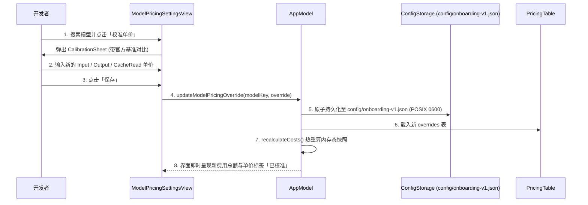

# 设置中心与价格校准交互设计方案

<!-- @topic: PricingEngine -->
> **文档ID**: DESIGN-SETTINGS ｜ **状态**: 现行基线
> **最后更新**: 2026-10-30 ｜ **所属总体**: [00-系统总体设计.md](00-系统总体设计.md) ｜ **对应 Topic**: `PricingEngine`
> 📌 **变更总账**: 参见 [变更总账 (PricingEngine)](../change/index.json#PricingEngine)

---

## 1. 简介 (Introduction)

本方案定义 `Bruce` 的原生设置中心（Settings Window）及大模型单价自定义校准（Model Pricing Overrides）交互系统。

- **业务动因**：随着大模型市场竞争与厂商定价动态调整（例如夜间折扣、企业级专有折扣、自定义代理中转折扣），默认静态基准单价可能与用户的真实采购账单存在偏差。此外，用户需要精细控制菜单栏展示风格、调度节拍、卡片显隐顺序，并安全录入 Provider 凭据。
- **系统定位**：位于 `apps/macos/Sources/BruceApp/Settings/`，提供多 Tab 分区卡片式设置面板与模型单价校准工作台，直接操作 `config/onboarding-v1.json`、`credentials.json` 并实时反哺 `AppModel` 费用重算。

---

## 2. 目标与非目标 (Goals & Non-Goals)

### 2.1 目标 (Goals)
1. **模块化卡片式布局 (Cardification)**：6 个功能分区全部采用独立圆角卡片（`SettingsCard`），配备专属彩色色标，无论切换经典或液态玻璃主题均保持视觉一致性；
2. **多模型定价与校准工作台**：
   - 完整罗列内置价卡（Input / Output / Cache Read 单价），行集与单价和采集端计费同源（C108，见规则「价卡单一事实源」）；
   - 支持多维筛选（全部 / 已有用量 / 已人工校准）；
   - 交互式弹窗修改单价，支持一键重置单模型或重置全量；
   - 单价变更后即刻触发内存态用量与历史费用动态重算（Hot Recalculation），无需重新触发全盘 I/O 扫描；
3. **菜单栏动态实时预览**：设置面板顶部内嵌高保真模拟菜单栏，滑块或选项变动即时反馈真实尺寸与视觉效果；
4. **凭据与账号管理工作台**：针对 10 家 Provider 提供连接测试、分账号管理、一键从本机 CLI 发现导入。

### 2.2 非目标 (Non-Goals)
1. **不提供在线价格爬虫**：模型价格以本地官方基准表及用户自定义为准，不发起外部未经许可的网络价格嗅探；
2. **不接管系统系统偏好设置**：开机自启动严格使用 macOS 标准 `SMAppService` API，不安装隐式 LaunchDaemons。

---

## 3. 需求分析 (Requirements)

### 3.1 功能需求清单
- **FR-1 分区卡片体系**：
  - **通用 (General)**：开机启动切换、自动刷新频率（3 分钟 / 6 分钟预设 + 自定义 1–1440 分钟）、版本号显示（读取自 `VERSION`）；
  - **菜单栏定制 (MenuBar)**：实时预览条、显示模式（纯图标 / 数值 / 组合）、刘海屏折叠阈值；
  - **模型单价与计费 (Pricing)**：多模型价格表、搜索栏、状态过滤、校准弹窗、重置确认；
  - **订阅额度 (Subscription)**：10 家 Provider 状态指示、API Key 输入、连通性测试；
  - **卡片管理 (Cards)**：卡片显隐开关与拖拽重排（Drag-and-Drop）；
  - **数据与诊断 (Diagnostics)**：缓存清理、导出完整诊断 JSON。
- **FR-2 单价即时热重算**：当保存模型覆盖项后，`AppModel` 遍历已解码的 `AgentUsageArtifact`，重新执行纯函数换算并广播 `@Published` 变更，驱动面板刷新。

### 3.2 非功能需求 (NFR)
- **界面响应**：过滤筛选和搜索需在 16ms 内无卡顿完成（内存纯数组过滤）；
- **配置落盘**：用户偏好保存到 `~/Library/Application Support/Bruce/config/onboarding-v1.json`，采用 POSIX 0600 文件权限（父目录 0700）与原子替换。

---

## 4. 功能设计 (Functional Design)

### 4.1 模型价格校准交互流程



---

## 5. 详细设计 (Detailed Technical Design)

### 5.1 核心业务规则 (Core Rules)
<!-- @topic: PricingEngine -->

#### 变更演进索引
| 变更编号 | 类型 | 简介 | 规则演进 |
|---|---|---|---|
| `C001` | 重构 | Monorepo 目录分层与设置组件收拢 | 设置组件收拢至 `apps/macos/Sources/BruceApp/Settings/` |
| `C108` | BugFix | 价卡单一事实源：设置页展示单价与采集端计费同源，消除 deepseek-v4.1-flash 展示 $0.15/$0.60 而按 $0.30/$1.20 计费的漂移 | 新增规则「价卡单一事实源」；覆盖项匹配改与采集端 `PricingTable::resolve` 同序 |
| `C111` | BugFix | 设置窗口统一错误提示方案：悬浮高斯胶囊浮岛 (8pt 卡片级圆角 + 环形倒计时关闭体 + 42pt高 + 420pt固定宽)，彻底根治页面抖动下沉、跨 Tab 污染与信息重叠 | 新增规则「设置窗口统一悬浮错误胶囊交互与消噪契约」：剥离 ScrollView 文档流采用 overlay 居中悬浮；支持 4s 环形微圆环倒计时与悬停暂停；带 ✕ 一键关闭；Tab 切换自动失效；卡片内已有状态区就地收敛不向全局上报 |
| `C145` | Enhancement | 设置页去除开关状态文字与软件更新卡冗余小字 | 取消「已开启 / 已关闭」状态文字与「当前版本」行频道副标题：开关开合位置即唯一状态表达，版本行只保留等宽版本值 |
| `C152` | BugFix | 设置窗口侧栏改为按窗口宽度锁定比例并收窄默认宽度 | 新增规则「设置窗口左右比例锁定」：侧栏 = 窗口内容宽度 × 17.6%（可读性下限 160pt），窗口缩放时比例不变；默认内容区 1000×680，仍可自由缩放 |
| `C153` | Enhancement | 设置通用页配置项按外观/呈现/刷新/通知/安全分组重排 | 新增规则「通用页配置项分组顺序」：外观（配色/风格/模糊/动效）→ 看板呈现 → 刷新 → 通知 → 凭据与来源，双端同构且行序由前端断言守护 |
| `C154` | Enhancement | 凭据存储行按钮统一为「配置」并去掉「已配置」状态描述 | 新增规则「凭据存储行状态表达」：已配置态静默，三态共用「配置」按钮，警示文字只在未配置/被阻断时出现 |
| `C155` | Enhancement | 设置窗口行内按钮统一中性样式与最小宽度 | 新增规则「行内按钮统一中性样式与尺寸」：行内操作用次按钮、danger 限销毁性、primary 只给区块级主动作与对话框确认；非 link 按钮统一 64pt 最小宽 |
| `C156` | BugFix | 凭据存储行「配置」打开可复用的凭据存储面板 | 补「凭据存储行状态表达」入口条款：点击必须打开面板展示状态与存储位置，写操作在面板内确认；禁止只写状态、无可见反馈的入口 |
| `C160` | Enhancement | 刷新间隔预设收敛为 3 / 6 分钟并支持自定义分钟 | 新增规则「刷新间隔预设与自定义」：预设 3/6，自定义 1–1440 整数分钟；历史值回显为自定义不静默改写；默认仍 30 分钟 |
| `C167` | BugFix | mac 自定义刷新间隔焦点离开即提交（此前只认回车，点别处后输入值未保存却仍显示） | 规则 10 补「提交时机」：回车或焦点离开即提交，与 Windows `change` 同语义；非法值回到当前生效值，值未变不重写配置 |

#### 现行设计规则

##### 0. 价卡单一事实源 (C108)
- 内置价卡只维护一份：`core/collector/crates/collector-domain/pricing-catalog.json`（模型键、显示名、厂商、Input / Output / Cache Read 单价、缓存写入 TTL 倍率、备注、`listed`）。采集端 `PricingTable` 直接加载；Windows `apps/win/viewmodel` 的 `model_catalog::catalog()` 派生 `listed` 行；mac `BuiltinModelPricingCatalog.allModels` 由 `node scripts/gen-pricing-catalog.mjs` 生成至 `BuiltinModelPricingCatalog+Data.swift`，`verify-local` 以 `--check` 拦截未重新生成的漂移。**禁止在任一端手写价卡副本**；新增或调价只改该 JSON 并重新生成。
- `listed: false` 的行（版本别名、受限型号）参与计费但不在设置页单列。
- 设置页覆盖项匹配与采集端同序：原样键 → 规范键 → 前缀候选中「目录键是模型名前缀」者取最长、否则「模型名是目录键前缀」者取最短，同长取字典序最小，保证展示的覆盖单价即实际计费单价。

##### 1. 设置分区卡片容器规范 (`SettingsCard`)
设置页 6 个分区全部包裹在 `SettingsCard` 中，不跟随桌面主题变动：
```swift
struct SettingsCard<Content: View>: View {
    let title: String
    let accentColor: Color
    @ViewBuilder let content: Content

    var body: some View {
        VStack(alignment: .leading, spacing: 12) {
            HStack(spacing: 8) {
                RoundedRectangle(cornerRadius: 2)
                    .fill(accentColor)
                    .frame(width: 4, height: 16)
                Text(title)
                    .font(.headline)
                    .fontWeight(.bold)
            }
            content
        }
        .padding(16)
        .background(Color(nsColor: .controlBackgroundColor))
        .clipShape(RoundedRectangle(cornerRadius: 12))
        .overlay(
            RoundedRectangle(cornerRadius: 12)
                .strokeBorder(Color.primary.opacity(0.08), lineWidth: 1)
        )
        .shadow(color: Color.black.opacity(0.04), radius: 4, x: 0, y: 2)
    }
}
```

##### 2. 分区色标规范
| 分区名称 | 色标代码 | 色彩语义 |
|---|---|---|
| 通用 (General) | `#0A84FF` | 系统蓝 |
| 菜单栏 (MenuBar) | `#30D158` | 状态绿 |
| 订阅额度 (Subscription) | `#FF9F0A` | 警示橙 |
| 模型计费 (Pricing) | `#BF5AF2` | 算力紫 |
| 卡片排序 (Cards) | `#8E8E93` | 中性灰 |
| 数据与诊断 (Diagnostics) | `#40C8E0` | 极客青 |

##### 3. 单价覆盖契约 (`ModelPricingOverride`)
落盘于 `config/onboarding-v1.json` 中的 `pricingOverrides` 字典：
```json
{
  "pricingOverrides": {
    "claude-3-7-sonnet": {
      "inputPricePerMillion": 2.50,
      "outputPricePerMillion": 12.00,
      "cacheReadPricePerMillion": 0.25,
      "note": "企业级 8 折通道"
    }
  }
}
```
- 若字段为 `null`，自动回退到内置基准单价；
- 提供「恢复默认」按钮，点击后从字典物理移除该模型键并重算。

##### 4. 设置窗口统一悬浮错误胶囊 (Floating Frosted Toast) 交互与消噪契约 (C111)
- **挂载与布局剥离（彻底消除布局抖动 CLS）**：
  - 错误与状态提示完全从主 `ScrollView` 内部的文档流（`VStack` 顶格）剥离；
  - 改为在主内容视口通过 `.overlay(alignment: .top)` 悬浮浮岛层挂载，下落 `top: 16pt`，页面正文与卡片绝对 **0px 位移抖动（CLS = 0）**；
- **几何与视觉规格**：
  - **外框圆角**：统一为 **`8pt`** 连续圆角（与 Fluent 设置卡片、Bruce C103 8pt 呼吸感圆角体系 1:1 呼应）；
  - **尺寸与排版**：高度 **`42pt`** 标准舒适高（满足 Apple HIG 最小点击靶区），宽度 **`420pt`** 固定规整宽，在大标题上方居中对齐；
  - **材质底板**：高透高斯毛玻璃（浅色 `rgba(255, 255, 255, 0.92)` 配合 28px blur，深色 `rgba(38, 38, 38, 0.88)`），配有环境微阴影与 0.5px 精密描边；
- **倒计时与手动清除交互引擎**：
  - **环形微圆环 + ✕ 关闭按钮融合体**：关闭按钮外圈绘制 `24×24pt`、线宽 `1.8pt` 的环形进度弧（呼应菜单栏 `PrecisionRingGaugeView` 品牌符号）；
  - 触发后启动 4.0 秒平滑倒计时闭合淡出；
  - **鼠标悬停暂停**：用户 Hover 悬停在 Toast 上时，自动暂停倒计时并亮起 Accent 蓝光高亮；
  - **一键手动清除**：点击中心 ✕ 随时手动关闭；
- **作用域隔离与消噪**：
  - **Tab 切换清理**：用户在侧边栏切换分类时，自动清除上一个页面的瞬时提示，杜绝跨 Tab 污染；
  - **就地隔离消噪**：针对卡片内已具备独立状态区的业务（如维护页的「软件更新」卡），错误信息仅就地在卡片状态槽内显示，`SoftwareUpdateService` 不再向全局 `model.setSettingsError` 派发重复告警，彻底消除上下屏重叠噪音。

##### 5. 设置分段选择器选中态对比度、开关状态文字居左与模型用量命名规范 (C112)
- **分段选择器 (`FluentSegmentedPicker` / `.fluent-seg`) 选中态高亮**：
  - 彻底改变以往选中项与轨道色差过小（浅色 `#EFEFEF` vs `#F0F0F0`）导致难以辨识的缺陷；
  - **浅色模式**：轨道槽位底色为 `#EAEAEA`，选中项采用纯白微浮岛 `#FFFFFF`，配合 `Color.black.opacity(0.06)` 精密微边框与轻柔软阴影（`shadow radius: 2, y: 1`），文字为高对比深黑 `#111827`（font-weight: 600）；
  - **深色模式**：轨道槽位底色为 `#181A1F`，选中项采用明亮灰阶 `#383D48`，配合 `Color.white.opacity(0.12)` 亮边与阴影，文字为纯白 `#FFFFFF`（font-weight: 600）；
  - 覆盖「配色模式」、「界面风格」、「仪表盘卡片布局」、「刷新间隔」等所有分段选择器；
- **开关与状态文字排布统一 (C112 / C145 修订)**：
  - ~~「锁屏暂停订阅刷新」、「系统通知」等配置项的「已开启 / 已关闭」状态文字统一置于 `Toggle` 开关的**左侧**~~ → **C145 起取消状态文字**：开关自身的开合位置即为唯一状态表达，行内不再重复渲染「已开启 / 已关闭」；布局为 `[行标题 + 副标题] …… [Toggle 开关]`，右端只保留控件本身；
  - 适用范围为设置中心全部开关行（macOS 通用页「锁屏暂停订阅刷新」「系统通知」；Windows 维护页「系统通知」及后续同类行）；例外说明文字（如通知权限被拒时的「前往系统设置」按钮）不受影响；
- **概念命名更名统一**：
  - 侧栏导航分类与面板标题统一由「Agent 用量」更名为「**模型用量**」，准确反映其作为各模型 Token 用量、费用与占比统计的核心定位。

##### 6. 设置窗口左右比例锁定 (C152)
- **侧栏宽度按比例而非像素**：侧栏宽度 = 窗口内容宽度 × **17.6%**（1000pt 窗口下 176pt、右侧面板 823pt），窗口缩放时左右比例保持不变；此前写死 216pt，1040pt 窗口下左侧留白占 20.8%、右侧被挤压，且固定像素无法随窗口等比变化。
- **单一裁决源**：macOS 由 `BruceAppCore.SettingsWindowMetrics` 的 `sidebarWidth(forContentWidth:)` 计算（`sidebarWidthRatio` / `sidebarMinimumWidth` / `separatorWidth` 常量），`SettingsView` 仅通过 `GeometryReader` 取宽度并渲染；Windows 由 `.sidenav { width: 17.6%; min-width: 160px }` 同比例表达。**禁止任一端再写死侧栏像素宽度**。
- **可读性下限**：侧栏宽度不得低于 **160pt**（导航项自身约需 143pt + 侧栏内边距 16pt），低于下限时按 160pt 兜底；计算面板宽度始终扣除 1pt 平面分隔线。
- **默认尺寸**：设置窗口内容区默认 **1000×680**（mac `setContentSize` / Windows `tauri.conf.json` 的 `settings` 窗口），最小 980×620 不变；**比例锁定不等于固定尺寸**，窗口仍可自由缩放，缩放时侧栏与面板按同一比例变化。
- **回归护栏**：mac `SettingsWindowMetricsHarness` 覆盖默认尺寸、8 个宽度点的比例恒定、比旧 216pt 收窄、单调增长与非法输入兜底；Windows `frontend.test.mjs` 断言 `.sidenav` 为 17.6% 且设置窗口仍 `resizable`。

##### 7. 通用页配置项分组顺序 (C153)
- **五段固定顺序**：外观（配色模式 → 界面风格 → 模糊风格〔液态玻璃可用时〕→ 界面动效）→ 看板呈现（仪表盘卡片布局）→ 刷新（刷新间隔 → 锁屏暂停订阅刷新）→ 通知（系统通知）→ 凭据与来源（凭据存储 → 外部 CLI 来源）。
- **归类依据**：改变「看起来怎样」的（配色、风格、玻璃、动效）聚在最前；改变「看板怎么组织」的紧随其后；改变「多久取一次数据 / 何时暂停」的成对相邻；通知与凭据安全收尾。此前界面动效排在系统通知之后，造成外观类被拆散、阅读在「外观—行为—外观—安全」间来回跳。
- **双端同构**：Windows 去掉平台独占行（配色模式、模糊风格、锁屏暂停订阅刷新、凭据存储、外部 CLI 来源）后保持同一相对顺序：界面风格 → 界面动效 → 看板布局 → 刷新间隔 → 系统通知；`settings-maintenance.js` 的 `buildGeneral` 行序由 `frontend.test.mjs` 源码顺序断言守护，前端用例按控件 id 而非行序下标取元素。
- **行序即契约**：新增通用页配置项须按上述分段插入，不得直接追加到卡片末尾；分隔线沿用 `FluentRow(divided:)`（首行无分隔线）。

##### 8. 凭据存储行状态表达 (C154)
- **已配置保持静默**：`coordinator.keychainAccessState == .allowed` 时行内不渲染任何状态文字，只保留 primary「配置」按钮；状态本身由「凭证可正常读写」的既成事实表达，与 C145「开关开合位置即唯一状态表达」同一消噪原则。
- **按钮文案统一「配置」**：allowed / notConfigured / blocked 三种状态共用同一按钮与同一处置入口 `configureKeychainAccess()`，不再在「重新配置 / 配置 / 修复」之间随状态跳变。
- **警示只在需要处置时出现**：`notConfigured` 渲染「未配置」、`blocked` 渲染「访问被阻断」，均为 `warn` 黄字且紧邻按钮；已配置态不得出现无信息增量的绿色标注。
- **入口必须可打开 (C156)**：点击「配置」不得静默执行写入再无声返回，必须打开「凭据存储」面板——展示当前状态（已配置 / 未配置 / 访问被阻断）、存储位置 `~/Library/Application Support/Bruce/credentials.json` 与 0600 权限说明，写操作只在面板内点「重新配置」后发生；首次未配置的自动引导复用同一面板的解释文案（`keychainGuideShowsStatus` 区分两种用途）。**任何"只写状态、无可见反馈"的入口都算缺陷。**

##### 9. 行内按钮统一中性样式与尺寸 (C155)
- **颜色按语义分级**：行内操作（配置 / 管理 / 预览 / 导出…）一律中性次按钮（`surface` 底 + `borderStrong` 描边）；`danger` 仅用于销毁性操作（撤销授权、清理缓存）；`primary` 只用于区块级主动作（「添加…」「确认授权」）与对话框确认按钮。此前同名「配置」在凭据存储行为主按钮、在订阅额度行为次按钮。
- **尺寸统一**：`FluentButtonStyle.minimumWidth = 64`，非 link 角色统一最小宽度并居中，短标签按钮等宽、行尾控件成列对齐；`link` 角色（展开/收起等无框文字入口）不受影响。
- **不按位置特例**：新增行内操作自动继承该样式，不得为单个按钮单独指定 `primary` 以求醒目；需要强调时用文案与位置表达，而不是换色。

##### 10. 刷新间隔预设与自定义 (C160)
- **预设收敛为 3 / 6 分钟**：分段选择器只保留「3 分钟」「6 分钟」「自定义」三项，不再并列 5/15/30/60；`OnboardingConfiguration.presetRefreshIntervalMinutes`（mac）与 `REFRESH_PRESETS`（Windows）是预设的唯一来源。
- **自定义区间**：其余合法值为 **1–1440 的整数分钟**，由「自定义」分段的数字输入提交；mac 以 `refreshIntervalRange` 判定，Windows 前端以 `REFRESH_CUSTOM_RANGE` 判定，后端 `refresh_interval_secs` 仍钳制 60–86400 秒（1–1440 分钟），三处口径一致。
- **历史值不静默改写**：已落盘的 5/15/30/60 等非预设值在设置页回显为「自定义」并填入原值，提交前不改变运行周期；越界或非整数输入还原为当前生效值并给出提示，不写盘。
- **打开不聚焦 (C160 修订)**：自定义值默认只以「X 分钟 + 编辑」只读呈现，只有用户点击「自定义」分段或「编辑」后才渲染并聚焦数字输入；输入提交成功后回到只读展示。**禁止任何未点击就展开或聚焦的输入框**——设置窗口打开时系统会把首个可聚焦控件当作初始焦点，常驻输入框会被误认为「自动进入编辑态」。
- **默认值不变**：未配置（缺键 / 显式 null / 越界）仍回落 **30 分钟**，因此首装用户看到的是「自定义 30 分钟」，而非某个预设。
- **提交时机 (C167)**：回车或焦点离开（点击别处、切走窗口）即提交，与 Windows 数字输入的 `change` 事件同语义；mac 输入解析统一走 `OnboardingConfiguration.customRefreshIntervalMinutes(from:)`（去首尾空白、仅 ASCII 数字、落在 1–1440）。非法值回到当前生效值：回车时留在输入框便于改正，焦点离开时收起为只读展示，**不得留下看似已保存的未保存数字**；值未变化不重写配置，避免无谓重启刷新计时。选择预设分段时输入框先收起，不重复提交。
- **双端同构**：mac `RefreshIntervalControl` 与 Windows `setting-interval` + `setting-interval-current` / `setting-interval-edit` / `setting-interval-edit-group` 的分段集合、只读回显、编辑入口与提交语义一致；Windows 由 `frontend.test.mjs` 断言预设标签、只读回显、编辑态切换与越界不写盘。

<!-- @topic: AgentBrandIdentity -->
##### 11. Agent 身份图形 (C161)
- **身份与数据分层**：Agent 系列色（mac `PanelAgentColor` / Windows `apps/win/viewmodel/src/color.rs`）继续只表示「数据量」，用于折线、堆叠柱与占比条；新增的品牌徽章只表示「这是谁」。**禁止把图表配色改成品牌色**，也禁止用徽章颜色编码用量。
- **三档尺寸纪律**：`size ≥ 14pt` 走真彩档——有官方位图用位图，否则品牌底色 + 品牌图形，并在外围加 1.2pt 系列色环把图标与图表色对上；`size < 14pt`（模型 chip）走系列色瓷砖 + 白色图形，避免位图缩糊；Nothing 主题一律单色——1px 方角描边 + 绿阶档色图形（`nothingRampHex`），不引入真彩。
- **素材纪律**：只登记确认过官方来源的图形/位图，逐条记入 `docs/assets/provider-icons/SOURCES.json`（订阅 Provider 与 Agent 同为指示性识别，徽章旁恒有名称文字）；无图形时用字标（`π` / 名称首字符），**禁止猜测或重绘来路不明的品牌**。位图由 `scripts/gen-provider-glyphs.mjs` 原样投放到 `apps/macos/Assets/AgentIcons` 与 `apps/win/src/assets/agent-icons`，并纳入 `--check` 字节比对。
- **覆盖点与尺寸**：设置「Agent 表现」行首 20pt、展开后模型 chip 12pt、归并模型行 18pt、时间线图例 13pt；仪表盘「Agent 用量」图例 14pt、逐小时行首 14pt（Nothing 9pt）。
- **设置窗口不跟随看板主题**：设置中心恒用 Fluent 视觉（C067），其中所有 Agent / 模型徽章固定走真彩档，**即使看板切到 Nothing 也不得转成绿色扁平图标**；单色档只作用于仪表盘面板（由 `followsTheme` 显式关闭）。
- **设置与看板的主题边界**：任何设置页内的品牌徽章不得读取 `theme.interfaceStyle` 做形态切换；主题相关分支只允许出现在仪表盘视图。
- **模型厂商映射**：按 `canonicalKey` 子串识别（claude / deepseek / glm·zhipu / gpt·openai / kimi / grok / cline），未登记厂商保留原色点，不新增猜测项；该映射与 `ModelNormalizer.brandColors` 同序。
- **双端同构**：mac `AgentBrandBadge` 与 Windows `.ab-badge`（`agent-brand.js`）共享同一张品牌表与同一套尺寸/降级规则；Windows 由 `frontend.test.mjs` 断言 20px 带环、12px 不带环、徽章必有图形或字标。两端品牌表以 `tests/fixtures/agent-brand-parity/cases.json` 逐字段对拍（mac SubscriptionBrandGlyphHarness / Windows frontend.test.mjs），新增或修改 Agent / 厂商须先改 fixture（C166：C161 两端手抄同一张表，Windows 漏登记 cline）。
- **位图失败降级（C166）**：真彩档位图缺失或加载失败时退回同档矢量图形，无图形时退字标；mac 由 `AgentBrandIconStore` 返回 nil 触发，Windows 在 `` 的 `error` 事件中移除位图并去掉 `ab-badge--img`（该类会隐藏矢量图形，C161 未处理加载失败，徽章留空）。

---

## 6. 扩展设计 (Additional Technical Design)

### 6.1 实时预览条 (Live MenuBar Preview)
- 设置面板中内嵌 1:1 尺寸的模拟菜单栏控件；
- 实时响应用户在设置中对「是否显示美元开销」、「是否显示 Token 缩写」、「进度环色彩」等切换，消除用户在设置与实际菜单栏之间的认知差。

### 6.2 诊断与导出 (Diagnostics Export)
- 诊断模块负责聚合：操作系统版本、Bruce 版本、各 Agent 目录探测状态、Rust Collector 退出状态与内存快照；
- 一键导出 `bruce-diagnostics-<timestamp>.json`，自动对敏感凭据执行脱敏剔除。

---

## 7. 参考资料 (References)

- `_adflow_backup/original_docs/development/11-settings-cardification-design.md`：卡片化设置历史规范（已隔离归档）
- `apps/macos/Sources/BruceApp/Settings/ModelPricingSettingsView.swift`：价格校准交互面板
- `core/collector/crates/collector-domain/src/pricing.rs`：Rust 端单价解析与覆盖合并

---

## 8. 变更历史 (Change History)

| 变更卡 | 类型 | 简述 | 日期 | 状态 |
|---|---|---|---|---|
| [C108](../../archive/0.14.0/change/C108.json) | BugFix | 价卡单一事实源：设置页展示单价与采集端计费同源 | 2026-10-26 | Closed |
| [C111](../../archive/0.14.0/change/C111.json) | BugFix | 设置窗口统一错误提示方案：悬浮高斯胶囊浮岛 (8pt 卡片级圆角 + 环形倒计时关闭体 + 42pt高 + 420pt固定宽) | 2026-10-26 | Closed |
| [C112](../../archive/0.14.0/change/C112.json) | BugFix | 设置窗口分段选择器选中态对比度高亮、开关状态文字居左与模型用量命名规范 | 2026-10-26 | In Progress |
| [C161](../change/C161.json) | Enhancement | Agent / 模型身份图形：色点升级为品牌徽章（真彩优先，逐档降级），设置与仪表盘双端同构，设置页不跟随看板主题 | 2026-10-30 | Closed |
| [C166](../change/C166.json) | BugFix | 品牌身份表双端对拍（Windows 补登记 cline）、Windows 位图加载失败降级、`AgentBrandBadge` 补导入 `BruceOnboardingCore` 消除编译告警 | 2026-10-30 | In Progress |
