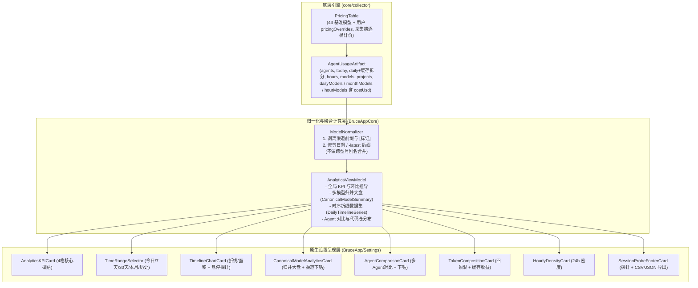

# Agent 用量分析与 Token 统计工作台设计方案

<!-- @topic: AgentAnalytics -->
> **文档ID**: DESIGN-ANALYTICS ｜ **状态**: 现行基线
> **最后更新**: 2026-10-30 ｜ **所属总体**: [00-系统总体设计.md](00-系统总体设计.md) ｜ **对应 Topic**: `AgentAnalytics`

---

## 1. 简介 (Introduction)

本方案定义 `Bruce` 设置中心中的 **Agent 用量深度分析、Token 统计与多模型跨源归并工作台**。

- **业务动因**：
  1. 菜单栏下拉弹窗（`UsageHeroCard` / `HourlyLineCard`）宽度受限于 ~380pt 紧凑尺寸，仅能承载概览与速览指标，无法展开进行长周期时序复盘、横向对比与工程下钻；
  2. 原设置中心中 `agentUsage` 分区仅有一张粗糙的“会话来源”探针卡片，没有实际用量数据报表，白白浪费了宽屏桌面窗口的展示空间；
  3. 多 Agent、多中转代理并行开发导致模型名称严重碎片化（如 `cline-pass/deepseek-v4.1-flash`、`zhipu/glm-5.3`、`openrouter/glm-5.3`、`claude-3-7-sonnet-20250219`），导致模型账单碎裂，亟需系统级的**自动归一化与跨源合并统计**。
- **系统定位**：
  - 位于 `apps/macos/Sources/BruceApp/Settings/` 与 `BruceAppCore`，重构现有 `agentUsagePane`；
  - 向上提供包含全局 KPI、时序折线分析、多 Agent 矩阵、多模型归并大盘与代码仓下钻的现代化工作台；
  - 向下联动 Rust Collector 核心产出的 `AgentUsageArtifact`、增量指纹与 `PricingTable` 价格引擎。

---

## 2. 目标与非目标 (Goals & Non-Goals)

### 2.1 目标 (Goals)
1. **全局核心 KPI 与时间切片**：
   - 支持「今日 (Today)」、「近 7 天 (7d)」、「近 30 天 (30d)」、「本月 (This Month)」、「全部历史 (All-time)」5 档时间跨度切换；
   - 4 格高保真 KPI 磁贴：总 Token、折算估算费用、Prompt Cache 命中率与节约金额、活跃 Agent 数与会话轮次。
2. **专业级时序趋势折线分析 (Swift Charts)**：
   - 采用原生 macOS 13+ `Charts`（`LineMark`, `AreaMark`）绘制平滑曲线（Bézier Spline）；
   - 支持多维度切换：**按 Agent 拆分**、**按归一化主模型**、**按 Token 构成**、**费用走势 ($)**；
   - 支持**平滑折线**与**堆叠面积图**形态切换；
   - 支持十字准线（Crosshair）与浮动 Tooltip 数据泡、MA7 7日移动平均线。
3. **多模型智能归一化与跨源合并统计 (Canonical Normalization)**：
   - 自动剥离渠道/代理前缀（如 `cline-pass/`, `zhipu/`, `openrouter/`, `anthropic/`）；
   - 自动修剪版本与运行变体（如 `-20250219`, `[thinking]`）；
   - 将异构多源同一模型合并为一个主模型条目，同时支持点击展开查看底层各个来源渠道的独立贡献树；
   - 自动继承基准单价与用户自定义覆盖项，无需用户重复录入单价；
   - 提供「已合并」与「原始渠道名」一键切换对照。
4. **多 Agent 矩阵对比与下钻**：
   - 横向对比各 Agent 的总 Token、费用、请求次数与 输入/输出/缓存 堆叠比例；
   - 联动下钻单 Agent 的模型消耗比与 Top 3 代码仓工程消耗（`projects` 字段）。
5. **Token 构成四象限与 24 小时密度**：
   - 明确拆解 Prompt Input、Model Output、Cache Read、Cache Creation；
   - 呈现 24 小时活跃时段热力密度图。
6. **探针管理与数据导出**：
   - 原有会话目录探针健康度下沉为底部状态组，保留「重新检查」；
   - 支持导出 CSV 账单与 JSON 原始明细。

### 2.2 非目标 (Non-Goals)
1. **不引入重型第三方图表库**：严格基于 Apple 原生 SwiftUI 与 Swift Charts 构建，保持轻量与零三方包膨胀；
2. **不修改底层会话原始日志**：所有归一化与合并聚合均在内存态与展示视图模型完成，绝不向第三方日志文件执行篡改或重写。

---

## 3. 功能架构与数据流 (Architecture & Data Flow)



---

## 4. 详细技术规范 (Detailed Technical Design)

### 4.1 模型智能归一化算法规范 (`ModelNormalizer`)

#### 1. 规范键 (Canonical Key) —— C070 修订
归一化只做「同一型号的不同写法」收敛, **不做跨型号别名合并** (C070 前的子串别名表会把 `glm-4.5` 记为 GLM 5.3、把任何含 `opus` 的模型记为 Claude Opus 5.5、把 `deepseek-chat` 并入 `deepseek-v4.1-flash`, 不同单价的模型被混算):
1. 转小写、去首尾空白;
2. 截去第一个 `[` 起的标记 (如 `[thinking]`);
3. 以最后一个 `/` 为界剥离渠道 / 厂商前缀 (如 `cline-pass/`, `zhipu/`, `anthropic/`);
4. 剥离尾部快照日期 `-YYYYMMDD` (8 位), 其次 `-MMDD` (4 位); 剥离尾部 `-latest`;
5. `-preview` / `-flash` / `-pro` / `-chat` 等为不同型号, 保留。

#### 2. 展示元数据
- **展示名 / 厂商**: 规范键与内置价格目录 (`BuiltinModelPricingCatalog` / Windows `model_catalog.rs`, 与采集端 `PricingTable` 同表) 的模型名**按同一规则归一后精确相等**时取目录的展示名与厂商; 否则展示名即规范键, 厂商按前缀表推断 (`claude`→Anthropic, `gpt`/`o`→OpenAI, `deepseek`→DeepSeek, `glm`→智谱, `kimi`/`k`→Moonshot …), 未知为「其他」;
- **配色**: 按规范键前缀取品牌色 (纯展示, 不参与统计)。

#### 3. 费用归属
费用不在客户端估算: 采集端对每个 `dailyModels` / `monthModels` / `hourModels` 桶以 `PricingTable` (内置 + 用户 `pricingOverrides`) 计价并写入 `costUsd` / `cacheSavingsUsd`; 渠道前缀与 `[标记]` 由 `PricingTable` 自身剥离 (`cline-pass/deepseek-v4.1-flash` 命中 `deepseek-v4.1-flash`)。前缀匹配存在多个候选时取**最长**的目录键 (最具体), 结果与进程无关 (C070 前遍历 HashMap 取首个命中, 跨进程可能落到不同单价)。无匹配单价的桶 `costUsd` 为 null, 工作台计为「未定价 tokens」而不是按平均单价折算。

#### 4. 双层数据结构契约
```swift
/// 单个规范模型的归并汇总
public struct CanonicalModelSummary: Identifiable, Equatable, Sendable {
    public var id: String { canonicalKey }
    public let canonicalKey: String
    public let displayName: String
    public let vendor: String
    public let colorHex: String
    public let totalTokens: Int
    public let totalTokensText: String
    public let estimatedCostUsd: Double?
    public let sharePercent: Double
    /// 各原始渠道的细分贡献
    public let sources: [ModelSourceContribution]
}

/// 原始渠道来源明细
public struct ModelSourceContribution: Identifiable, Equatable, Sendable {
    public var id: String { rawModelName + agentID }
    public let rawModelName: String
    public let agentID: String
    public let agentDisplayName: String
    public let tokens: Int
    public let tokensText: String
    public let costUsd: Double?
    public let shareOfModelPercent: Double
}
```

---

### 4.2 真实数据口径 (C070)

C070 前工作台多处数值为估算 (今日逐小时固定按 42/18/40 拆输入/输出/缓存; 时序费用 tokens × $2.8/1M; KPI 无定价时同样平价兜底; 「轮交互」= 活跃 Agent × 12; 缓存节省按 90% 折扣 + $3/1M 兜底; 7/30 天模型构成由当月构成按比例缩放; Token 构成四象限「输出」= 总量 / 5、「缓存写入」= 缓存读取 / 4; 多日缓存命中恒为 0 —— `daily.input` 已含缓存, 再以 `total − input − output` 求缓存必为 0)。C070 起所有数值只取自采集端真实聚合, 采集端缺数据的指标显示「—」而不是估算。

**artifact 契约 (agent 层, 均为可选字段, 旧快照缺失时工作台对应指标显示「—」直至下次采集)**:

| 字段 | 粒度 / 范围 | 内容 |
|---|---|---|
| `daily[].cacheRead` / `daily[].cacheCreation` | 逐日, 采集窗口全部天 | 原始缓存读取 / 写入 token (`daily[].input` 仍为含缓存的展示口径, 原始输入 = `input − cacheRead − cacheCreation`) |
| `dailyModels[]` | 逐日 × 模型, 截至今日的最近 31 天 | `{date, model, input, output, cacheRead, cacheCreation, total, costUsd, cacheSavingsUsd}` (token 为原始口径, 与 `today` 同) |
| `monthModels[]` | 自然月 × 模型, 采集窗口内全部月份 | `{month, model, …同上}` |
| `hourModels[]` | 今日逐小时 × 模型 | `{hour, model, …同上}` |

非零桶才输出; 不过滤任何模型 (含 `unknown`), 因此任一范围内「模型桶合计 = 该范围 token 合计」恒等。增量缓存新增逐日×模型与今日小时×模型桶, `AGGREGATION_VERSION` 升级, 首次升级后全量重扫一次。

**各时间范围的数据来源**:

| 范围 | 日期集合 | token / Agent / 构成 | 模型与费用 | 时序点 |
|---|---|---|---|---|
| 今日 | 今日 | `today` 桶 / `hours` | `dailyModels` (今日) | 24 个小时点, 来自 `hours` 与 `hourModels` |
| 近 7 天 / 近 30 天 | 窗口日序列末尾 7 / 30 天 | `daily` | `dailyModels` | 逐日 |
| 本月 | 窗口内本自然月各天 | `daily` | `dailyModels` (31 天覆盖整月) | 逐日 |
| 全部历史 | 窗口全部天 (约半年) | `daily` | `monthModels` | **逐月** (逐日模型数据只保留 31 天, 故全部历史改以月为粒度, 不再按周估算) |

**指标定义**: 输入 (原始输入 + 缓存写入, 即按输入计价的部分) / 输出 / 缓存读取 / 缓存写入 四象限直接取聚合值; 缓存命中率 = 缓存读取 ÷ (原始输入 + 缓存读取 + 缓存写入); 费用 = 范围内各模型桶 `costUsd` 之和, 另报「未定价 tokens」; 每 1M 均价 = 费用 ÷ 已定价 tokens; 缓存收益 = 范围内 `cacheSavingsUsd` 之和 (缓存读取 × (输入单价 − 缓存读取单价)); 活跃 Agent = 范围内 token > 0 的 Agent 数, 副标题为最活跃 Agent 及其占比 (不再展示无数据来源的「轮交互」); Agent 矩阵的代码工程分布只有今日数据, 仅在「今日」范围展示; 24 小时密度为今日数据, 标题注明「今日」。

**缺数据与边界语义**:
- 费用 / 缓存收益: 范围内无明细桶 (无用量) 为 `$0.00`; 有桶但全部未定价为「—」; 旧 artifact 无明细数组为「—」, 费用标签为「无明细」(有未定价桶时标签为「X 未定价」, 否则「单价表计价」);
- 旧 artifact 的多日范围缺 `daily` 缓存拆分时, 输入 / 缓存读取 / 缓存写入 / 命中率显示「—」(输出照常), 时序不出 Token 构成序列; 「今日」恒取 `today` 桶 (自带拆分);
- 次序键全部显式: 模型按 token 降序 → 规范键; 来源按 token 降序 → 原始模型名 → Agent 在 artifact 中的位置; Agent 按 token 降序 → artifact 位置; 峰值取首个最大点, 全 0 时为「—」; 均值为整数除法;
- 浮点累加顺序固定 (按 artifact 中 Agent 顺序、各明细数组原序左累加), 保证双端逐位相同。

**双端一致性**: mac `BruceAppCore/WorkbenchAnalytics.swift` 为计算事实源; Windows 在 `apps/win/viewmodel/src/analytics.rs` 逐条镜像, 经 Tauri 命令 `get_usage_analytics(range)` 下发, 前端只做呈现。mac `PanelParityHarness` 对共享 fixture (`workbench.json` 新版 / `valid.json` 旧版) 逐范围产出 `tests/fixtures/viewmodel-parity/agent-usage-*.analytics.json`, 由 `apps/win/viewmodel/tests/analytics_parity.rs` 逐字段 (含浮点位) 对拍锁定 (与面板视图模型同一机制)。工作台「导出 CSV 账单」双端列一致 (未定价模型费用列留空)。

### 4.3 时序趋势折线图设计 (`TimelineChartCard`)

#### 1. 维度支持
1. **按 Agent 拆分**（四色曲线：Claude Code 橙、Codex 绿、Kimi 蓝、OpenCode 紫）；
2. **按主模型拆分**（范围内 token 前 5 的规范模型, 数据来自 `dailyModels` / `hourModels` / `monthModels`）；
3. **按 Token 构成拆分**（输入 [含缓存写入] 蓝、输出 紫、缓存读取 绿, 三者之和等于该点总量）；
4. **按费用走势 ($)**（各点模型桶 `costUsd` 之和; 未定价桶计 0, 未定价 token 量见费用 KPI 标签）。

#### 2. 实现参数 (mac Swift Charts; Windows SVG 等价实现)
- 曲线平滑：`.interpolationMethod(.catmullRom)`；折线 / 面积可切换，面积为 `LinearGradient(color.opacity(0.35) → 0.04)`；点数 ≤ 14 时绘制点标记；
- x 轴刻度抽稀与峰值胶囊高亮（C162）：
  - **显式刻度抽稀（方案 A1）**：Swift Charts 对字符串分类轴忽略 `.automatic(desiredCount:)`，必须显式传入 `AxisMarks(values: xAxisTicks.map(\.label))`。点数 $\le 8$ 时全量显示；今日 24 小时固定取 3 小时严格等步长 `[00:00, 03:00, 06:00, 09:00, 12:00, 15:00, 18:00, 21:00]`（最小防撞间距 `minGap = 1`）；其余长跨度（如近 30 天 / 本月）按步长 `step = max(2, ceil((N-1)/6))` 采样并收口末位点，`minGap = max(1, step/2)`；
  - **峰值防撞合入与 S2 胶囊高亮**：峰值点（`totalTokens > 0` 的首个最大点，与底部 `peakSummary` 同口径）若不在基准刻度中，当与最近基准刻度距离 $\le \text{minGap}$ 时自动替换该最近刻度以杜绝文字重叠，否则直接追加。峰值刻度在 X 轴以 S2 胶囊徽章渲染：文案加前缀 `🔥 <label>`（如 `🔥 15:00`），字色、16% 透明底与 42% 细描边自动跟随该峰值时刻数值最大的主导曲线系列色（`WorkbenchAnalytics.peakDominantColorHex` / Windows `peakDominantColor`）；
- x 轴手势缩放与动态步长平移（C163）：
  - **手势与视口控制**：支持滚轮（或触控板双指捏合）缩放时间轴（1.0x 全景 ~ 4.0x 局部），支持鼠标拖拽平移（Pan）与触控板水平滑动查看不同时段；双击空白区域或点击复位按钮一键恢复 1.0x 全景；
  - **动态分级刻度 (LOD)**：刻度步长随当前视口跨度 $\text{span} = \text{viewEnd} - \text{viewStart}$ 自动自适应（今日 24h：$\text{span} > 18$ 保持 3h 步长；$10 < \text{span} \le 18$ 自动转为 2h 步长；$\text{span} \le 10$ 时自动展开为逐 1 小时全量刻度）；峰值胶囊在视口内全态跟随；
  - **悬停解耦**：拖拽平移过程中抑制竖线探针，松手后恢复；双端（macOS Swift Charts + Windows SVG）行为与刻度计算同构。
- y 轴刻度在左（费用 `$x.xx`，token `x.xM` / `xK`）；
- 悬停选点：`chartXSelection` 选中最近点，画虚线 RuleMark，底部概览条改为「📍 标签 + 合计 + 前 3 项细分」，未选中时显示峰值 / 均值摘要；
- （C070 校正：此前文档所列 7 日均线 mac 端从未实现，已删除。）

---

## 5. 验收标准与测试契约 (Acceptance & Test Contract)

1. **归一化算法幂等性**：输入已归一化的模型名，输出不变；各种前缀（带斜杠、无斜杠）和日期后缀均能精准收敛；
2. **合并统计数值恒等**：所有合并后的模型总 Token 之和，必须严格等于底层对应各 Agent 原始日志的总 Token，零溢出、零丢弃；
3. **定价自动继承**：带有前缀的 `cline-pass/deepseek-v4.1-flash` 由采集端自动命中 `deepseek-v4.1-flash` 的价格，无需手动补充单价；前缀匹配多候选时取最长键, 结果确定；
4. **UI 性能与流畅度**：切换时间维度（今日/7天/30天/历史）与切换归并模式时，视图响应延迟 $\le 16\text{ms}$，Swift Charts 缩放平滑无撕裂；
5. **零估算**（C070）：工作台任何数值都可追溯到 artifact 字段或采集端计价结果, 不存在固定比例拆分、平均单价兜底或常数乘数; 数据缺失显示「—」；
6. **双端对拍**（C070）：同一 fixture 下 mac 与 Windows 各范围的 KPI、模型归并、时序点与 Agent 矩阵逐字段一致。
