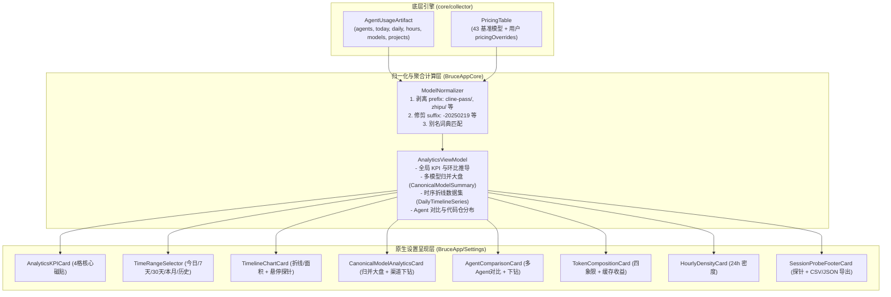

# Agent 用量分析与 Token 统计工作台设计方案

<!-- @topic: AgentAnalytics -->
> **文档ID**: DESIGN-ANALYTICS ｜ **状态**: 现行基线
> **最后更新**: 2026-10-19 ｜ **所属总体**: [00-系统总体设计.md](00-系统总体设计.md) ｜ **对应 Topic**: `AgentAnalytics`

---

## 1. 简介 (Introduction)

本方案定义 `Bruce` 设置中心中的 **Agent 用量深度分析、Token 统计与多模型跨源归并工作台**。

- **业务动因**：
  1. 菜单栏下拉弹窗（`UsageHeroCard` / `HourlyLineCard`）宽度受限于 ~380pt 紧凑尺寸，仅能承载概览与速览指标，无法展开进行长周期时序复盘、横向对比与工程下钻；
  2. 原设置中心中 `agentUsage` 分区仅有一张粗糙的“会话来源”探针卡片，没有实际用量数据报表，白白浪费了宽屏桌面窗口的展示空间；
  3. 多 Agent、多中转代理并行开发导致模型名称严重碎片化（如 `cline-pass/deepseek-v4.1-flash`、`zhipu/glm-5.3`、`openrouter/glm-5.3`、`claude-3-7-sonnet-20250219`），导致模型账单碎裂，亟需系统级的**自动归一化与跨源合并统计**。
- **系统定位**：
  - 位于 `apps/macos/Sources/BruceApp/Settings/` 与 `BruceAppCore`，重构现有 `agentUsagePane`；
  - 向上提供包含全局 KPI、时序折线分析、多 Agent 矩阵、多模型归并大盘与代码仓下钻的现代化工作台；
  - 向下联动 Rust Collector 核心产出的 `AgentUsageArtifact`、增量指纹与 `PricingTable` 价格引擎。

---

## 2. 目标与非目标 (Goals & Non-Goals)

### 2.1 目标 (Goals)
1. **全局核心 KPI 与时间切片**：
   - 支持「今日 (Today)」、「近 7 天 (7d)」、「近 30 天 (30d)」、「本月 (This Month)」、「全部历史 (All-time)」5 档时间跨度切换；
   - 4 格高保真 KPI 磁贴：总 Token、折算估算费用、Prompt Cache 命中率与节约金额、活跃 Agent 数与会话轮次。
2. **专业级时序趋势折线分析 (Swift Charts)**：
   - 采用原生 macOS 13+ `Charts`（`LineMark`, `AreaMark`）绘制平滑曲线（Bézier Spline）；
   - 支持多维度切换：**按 Agent 拆分**、**按归一化主模型**、**按 Token 构成**、**费用走势 ($)**；
   - 支持**平滑折线**与**堆叠面积图**形态切换；
   - 支持十字准线（Crosshair）与浮动 Tooltip 数据泡、MA7 7日移动平均线。
3. **多模型智能归一化与跨源合并统计 (Canonical Normalization)**：
   - 自动剥离渠道/代理前缀（如 `cline-pass/`, `zhipu/`, `openrouter/`, `anthropic/`）；
   - 自动修剪版本与运行变体（如 `-20250219`, `[thinking]`）；
   - 将异构多源同一模型合并为一个主模型条目，同时支持点击展开查看底层各个来源渠道的独立贡献树；
   - 自动继承基准单价与用户自定义覆盖项，无需用户重复录入单价；
   - 提供「已合并」与「原始渠道名」一键切换对照。
4. **多 Agent 矩阵对比与下钻**：
   - 横向对比各 Agent 的总 Token、费用、请求次数与 输入/输出/缓存 堆叠比例；
   - 联动下钻单 Agent 的模型消耗比与 Top 3 代码仓工程消耗（`projects` 字段）。
5. **Token 构成四象限与 24 小时密度**：
   - 明确拆解 Prompt Input、Model Output、Cache Read、Cache Creation；
   - 呈现 24 小时活跃时段热力密度图。
6. **探针管理与数据导出**：
   - 原有会话目录探针健康度下沉为底部状态组，保留「重新检查」；
   - 支持导出 CSV 账单与 JSON 原始明细。

### 2.2 非目标 (Non-Goals)
1. **不引入重型第三方图表库**：严格基于 Apple 原生 SwiftUI 与 Swift Charts 构建，保持轻量与零三方包膨胀；
2. **不修改底层会话原始日志**：所有归一化与合并聚合均在内存态与展示视图模型完成，绝不向第三方日志文件执行篡改或重写。

---

## 3. 功能架构与数据流 (Architecture & Data Flow)



---

## 4. 详细技术规范 (Detailed Technical Design)

### 4.1 模型智能归一化算法规范 (`ModelNormalizer`)

#### 1. 前缀剥离规则 (Prefix Stripping)
识别字符串中首个或最后一个 `/`：
- 若包含已知厂商或渠道前缀（如 `cline-pass/`, `zhipu/`, `zhipuai/`, `openrouter/`, `anthropic/`, `openai/`, `deepseek/`, `google/`, `moonshot/`, `minimax/`），剥离前缀，仅保留后缀；
- 若无 `/`，保留原字符串。

#### 2. 变体与标记清理 (Variant Trimming)
1. 剥离方括号标记：如 `[thinking]`, `[online]`, `[stream]`, `[contributor]`；
2. 剥离版本后缀：
   - 匹配尾部日期格式（如 `-\d{8}`，例如 `-20250219`, `-20241022`）；
   - 匹配 `-latest`, `-preview`, `-chat`（若主干已有型号）；
3. 规范化统一转为小写，空格转连字符。

#### 3. 规范主键归集表 (Canonical Key Resolution)
| 原始多源示例 | 归一化规范键 (Canonical Key) | 规范呈现名称 (Display Name) | 厂商归属 (Vendor) |
|---|---|---|---|
| `zhipu/glm-5.3`<br/>`cline-pass/glm-5.3`<br/>`glm-5.3-flash` | `glm-5.3` | **GLM 5.3** | 智谱 AI / Zhipu |
| `cline-pass/deepseek-v4.1-flash`<br/>`deepseek/deepseek-v4.1-flash`<br/>`deepseek-chat` | `deepseek-v4.1-flash` | **DeepSeek V4.1 Flash** | DeepSeek |
| `claude-3-7-sonnet`<br/>`anthropic/claude-3-7-sonnet-20250219` | `claude-3-7-sonnet` | **Claude 3.7 Sonnet** | Anthropic |
| `gpt-5.4`<br/>`openai/gpt-5.4-preview`<br/>`gpt-5.4-0414` | `gpt-5.4` | **GPT 5.4** | OpenAI |
| `kimi-k2.5`<br/>`moonshot/kimi-k2.5` | `kimi-k2.5` | **Kimi K2.5** | Moonshot |

#### 4. 双层数据结构契约
```swift
/// 单个规范模型的归并汇总
public struct CanonicalModelSummary: Identifiable, Equatable, Sendable {
    public var id: String { canonicalKey }
    public let canonicalKey: String
    public let displayName: String
    public let vendor: String
    public let colorHex: String
    public let totalTokens: Int
    public let totalTokensText: String
    public let estimatedCostUsd: Double?
    public let sharePercent: Double
    /// 各原始渠道的细分贡献
    public let sources: [ModelSourceContribution]
}

/// 原始渠道来源明细
public struct ModelSourceContribution: Identifiable, Equatable, Sendable {
    public var id: String { rawModelName + agentID }
    public let rawModelName: String
    public let agentID: String
    public let agentDisplayName: String
    public let tokens: Int
    public let tokensText: String
    public let costUsd: Double?
    public let shareOfModelPercent: Double
}
```

---

### 4.2 时序趋势折线图设计 (`TimelineChartCard`)

#### 1. 维度支持
1. **按 Agent 拆分**（四色曲线：Claude Code 橙、Codex 绿、Kimi 蓝、OpenCode 紫）；
2. **按主模型拆分**（多源合并后的主模型：Claude 3.7、GLM 5.3、DeepSeek V4.1 等）；
3. **按 Token 构成拆分**（Prompt Input 蓝、Model Output 紫、Cache Read 绿）；
4. **按费用走势 ($)**（每日折算美元金额与光晕面积）。

#### 2. Swift Charts 实现参数
- 曲线平滑：`.interpolationMethod(.catmullRom)`；
- 面积填充：`AreaMark` + `LinearGradient(colors: [color.opacity(0.18), .clear], startPoint: .top, endPoint: .bottom)`；
- 均线绘制：`StrokeStyle(lineWidth: 1.5, dash: [4, 4])`，计算公式为滑动窗口 7 日加权；
- 十字准线交互：使用 `chartOverlay` 监听指针悬停，通过 `proxy.value(atX:)` 映射离散索引，驱动原生浮动 Tooltip。

---

## 5. 验收标准与测试契约 (Acceptance & Test Contract)

1. **归一化算法幂等性**：输入已归一化的模型名，输出不变；各种前缀（带斜杠、无斜杠）和日期后缀均能精准收敛；
2. **合并统计数值恒等**：所有合并后的模型总 Token 之和，必须严格等于底层对应各 Agent 原始日志的总 Token，零溢出、零丢弃；
3. **定价自动继承**：带有前缀的 `cline-pass/deepseek-v4.1-flash` 能自动命中 `deepseek-v4.1-flash` 的价格，无需手动补充单价；
4. **UI 性能与流畅度**：切换时间维度（今日/7天/30天/历史）与切换归并模式时，视图响应延迟 $\le 16\text{ms}$，Swift Charts 缩放平滑无撕裂。
