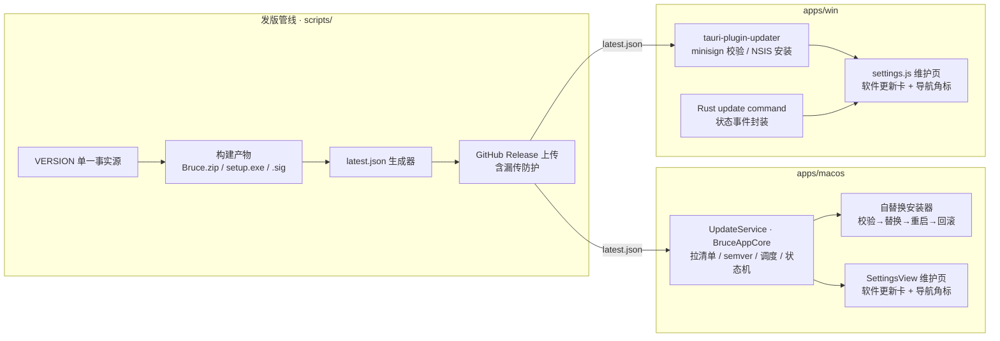
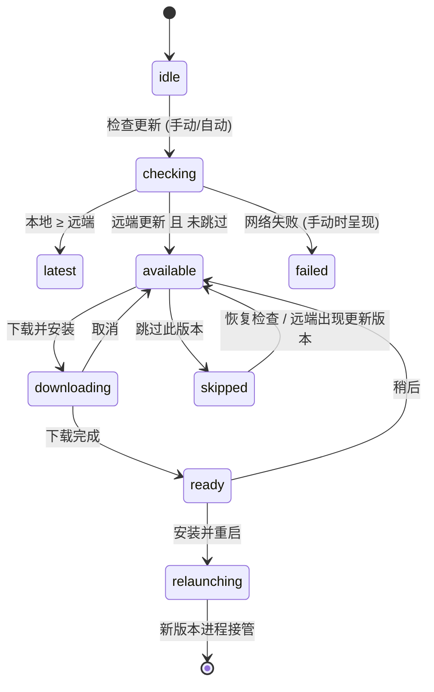

# 软件更新设计方案

<!-- @topic: SoftwareUpdate -->
> **文档ID**: DESIGN-UPDATE ｜ **状态**: 现行基线
> **最后更新**: 2026-10-26 ｜ **所属总体**: [00-系统总体设计.md](00-系统总体设计.md) ｜ **对应 Topic**: `SoftwareUpdate`
> 📌 **变更总账**: 参见 [变更总账 (SoftwareUpdate)](../change/index.json#SoftwareUpdate)

---

## 1. 简介 (Introduction)

本方案定义 `Bruce` 的应用内软件更新体系：设置中心「软件更新」卡（检查更新、自动检查开关、下载与自动升级）、跨平台更新清单 `latest.json` 契约、以及发版管线产出清单资产的规则。

- **业务动因**：项目已在 GitHub Releases 稳定发版（`Bruce.zip` + NSIS `setup.exe` + SHA256SUMS），但用户只能手动比对版本并重新下载安装。设置中心 Windows 侧已有「版本」行占位（`settings.js` `setting-version`，当前显示"—"），具备承接更新 UI 的天然位置。
- **设计来源**：2026-10-23 会话内两轮设计讨论定稿 —— 更新链路（清单契约 / 状态机 / 安装器 / 限制面）经用户确认，布局方案在三项候选中由用户选定 **方案 B（维护页顶部）**，状态机与刷新口径一并批准。**视觉与交互规格基准为高保真 demo：[apps/win/demo/win-settings-update-flow-demo.html](../../../apps/win/demo/win-settings-update-flow-demo.html)**（已入库，实现效果必须与其一致，见 §4.2 R3）。
- **系统定位**：macOS 侧落在 `apps/macos`（`BruceAppCore` 更新服务 + `SettingsView` 维护页）；Windows 侧落在 `apps/win`（Tauri updater 插件 + `settings.js` 维护页）；清单资产由发版管线（`scripts/`）产出并随 Release 上传。

---

## 2. 目标与非目标 (Goals & Non-Goals)

### 2.1 目标 (Goals)

1. **检查更新**：设置中心手动触发检查，拉取 GitHub Releases 的 `latest.json` 清单并与本地版本做语义化比较；
2. **自动检查开关**：默认开启；启动 30 秒后静默检查一次，此后每 24 小时一次；自动检查失败完全静默；
3. **下载与自动升级**：发现新版本后可下载（含进度与取消）并自动安装升级 —— macOS 为自替换安装器（校验 → 原子替换 → 重启 → 回滚），Windows 为 `tauri-plugin-updater` 标准链路（minisign 签名校验 → NSIS 静默安装 → 重启）；
4. **设置页体验与 demo 一致**：维护页顶部「软件更新」卡、8 态状态机、导航角标、跳过版本、行内展开更新说明，全部逐字逐 token 对齐 demo；
5. **发版管线闭环**：每次发版自动产出并上传 `latest.json`（双平台 URL + sha256 + Windows 签名），带漏传防护。

### 2.2 非目标 (Non-Goals)

1. **不做增量/差量更新**：每次全量下载安装包；
2. **不做强制更新与系统级弹窗**：新版本仅在设置页状态区与导航角标静默提示；
3. **不引入 Sparkle**：当前发布物为 ad-hoc 签名，Sparkle 2 要求更新包与已装应用签名身份一致（Developer ID），校验必然失败（限制详见 §4.2 R8）；待启用 Developer ID 签名后再评估是否迁移；
4. **不自建更新服务器**：信任根即 GitHub 账号与 TLS，不引入自有云端（遵循本地优先架构约束）。

---

## 3. 规范 (Requirements)

### 3.1 功能需求清单

- **FR-1 更新清单契约**：`https://github.com/4everSivan/Bruce/releases/latest/download/latest.json`（Releases latest-download 直链，302 到下载 CDN，无 GitHub API 匿名限流问题）；schema 见 §4.2 R1；
- **FR-2 版本比较**：本地 `CFBundleShortVersionString`（mac，单一事实源为仓库根 `VERSION` 文件）/ Tauri `package_info`（win，`tauri.conf.json` 同步 `VERSION`）与清单 `version` 做 semver 纯函数比较；本地 ≥ 远端判「已是最新」；
- **FR-3 设置页 UI（方案 B）**：见 §4.2 R3；
- **FR-4 状态机**：见 §4.2 R4（8 态与逐字文案）；
- **FR-5 自动检查**：见 §4.2 R5；
- **FR-6 macOS 安装流**：见 §4.2 R6；
- **FR-7 Windows 升级流**：见 §4.2 R7；
- **FR-8 发版管线**：见 §4.2 R1.3。

### 3.2 非功能约束

- **网络**：仅 HTTPS；请求超时 10–15 秒；失败不阻塞任何 UI 流程；
- **安全**：下载产物必须校验（mac: SHA256 + 解压后 Info.plist 版本复核；win: minisign 签名）；私钥与密钥材料绝不入仓库（AGENTS.md 第七节）；
- **测试**：不访问任何真实外网端点（项目红线「严禁官网实测」）；清单解析、semver、状态机、安装器替换/回滚均以 fixture/临时夹具驱动单测。

---

## 4. 设计详情 (Design Details)

### 4.1 架构与行为 (Architecture & Behavior)



**状态机（8 态，双端同口径）**：



**自动检查时序**：应用启动后延迟 30 秒触发首次检查 → 之后每 24 小时一次（上次成功检查时间戳持久化）；手动「检查更新」不受间隔限制。自动检查任何失败不改变 UI 主态、不写告警状态行；仅手动检查失败才在状态行显示 warn 文案。

### 4.2 核心业务规则 (Core Rules)

<!-- @topic: SoftwareUpdate -->

#### R1 更新清单契约（latest.json）

**R1.1 Schema**（单文件双端共用；字段为 Tauri updater 兼容格式 + macOS 自研扩展）：

```json
{
  "version": "0.13.0",
  "pub_date": "2026-10-30T00:00:00Z",
  "notes": "从 release-notes-<ver>.md 生成的摘要（要点列表以「; 」连接的纯文本）",
  "platforms": {
    "darwin-universal": {
      "url": "https://github.com/4everSivan/Bruce/releases/download/v0.13.0/Bruce.zip",
      "sha256": "<Bruce.zip 的 SHA256，与 SHA256SUMS 一致>",
      "signature": "<Bruce.zip 的 minisign 签名，与 Bruce.zip.sig 资产一致>"
    },
    "windows-x86_64": {
      "url": "https://github.com/4everSivan/Bruce/releases/download/v0.13.0/Bruce_0.13.0_x64-setup.exe",
      "signature": "<minisign 签名，与 .sig 资产一致>"
    }
  }
}
```

- **`platforms` 下每个条目都必须同时带 `url` 与 `signature`**：Windows 端 `tauri-plugin-updater` 反序列化整张 `platforms` 表（每个条目的 `url`、`signature` 均为必填），任一条目缺 `signature` 即整份清单解析失败、Windows 客户端每次检查都报错。初版 schema 的 darwin 条目只有 `sha256`，2026-10-24 T09 对抗审查发现后补齐（见 §4.4）；
- `sha256` 是 macOS 自研扩展字段（Tauri 忽略未知字段）；两个 `signature` 为同一 minisign 密钥对对相应资产的签名，取值即 `.sig` 文件内容（base64 文本）。
- **清单不含包体尺寸**：横幅尾随的 `7.1 MB` 由客户端在检查发现新版本后对下载地址发一次 `HEAD` 取 `Content-Length`（十进制 MB 一位小数），取不到即不显示尺寸，下载进度总量随之改用响应头（T10 定稿，避免为纯展示字段改动 T09 契约）；
- **macOS 客户端校验口径（T10）**：仅接受 `version` 为纯 `X.Y.Z`、`darwin-universal.url` 为 `https://github.com/…`、`sha256` 为 64 位十六进制的清单，任一不符按「更新信息无效」处理，绝不带病进入下载。

**R1.2 拉取**：客户端仅请求 latest-download 直链（`/releases/latest/download/latest.json`），不调用 GitHub API（避开匿名 60 次/时/IP 限流）；24 小时一次的频率下该直链无观测到的限流。

**R1.3 发版管线产出**：

- 版本号唯一来源为仓库根 `VERSION`（与 `build-test-app.sh` 注入 `CFBundleShortVersionString`、`tauri.conf.json` 的既有口径一致）；发版 tag 必须等于 `v<VERSION>`，生成器校验不一致即失败（否则清单会指向另一个 Release）；
- 生成器为 Node 脚本 `scripts/generate-update-manifest.mjs`（仓库禁 Python，唯一例外为 `adflow_verify.py`），由 `scripts/upload-win-release.ps1` 在 release-windows 作业内调用，产出 `latest.json` 随 Release 上传；
- **与发布目标同源**：macOS 侧输入（`Bruce.zip`、`SHA256SUMS`、`release-notes-<ver>.md`）按资产 id 取自上传脚本选定发布的同一个 release，不按 tag 回拉（残留同 tag 草稿时按 tag 解析可能命中另一份构建，清单哈希与实际发布的包不符）；下载的 `Bruce.zip` 实算 sha256 须与 `SHA256SUMS` 一致；
- **签名**：`tauri.conf.json` 开启 `bundle.createUpdaterArtifacts: true` 并配置 `plugins.updater.pubkey`（Tauri v2 二者缺一即不产 `.sig`，私钥被忽略）；release-windows 构建注入 `TAURI_SIGNING_PRIVATE_KEY` / `_PASSWORD` 产出 `<setup>.sig`，并在同一作业内以 `cargo tauri signer sign` 签 `Bruce.zip`（私钥只注入这一个作业）。**缺私钥、缺 `.sig` 或 `.sig` 为空均显式失败，不产出未签名清单**（与 `build-release-app.sh`「不发布半成品」哲学一致）；
- **本地打包**：开启 `createUpdaterArtifacts` 后无私钥的 `cargo tauri build` 会直接报错，`build-win-app.ps1` 无私钥时以 `--no-sign` 跳过更新签名（此类本地包不可用于推送更新）；`-RequireUpdateSignature` 时缺私钥或构建后无本轮 `.sig` 即失败；
- **notes 摘要**：取发布说明各顶级要点的加粗标题并去掉卡号（`(Cxxx)` / `(Txx)`），说明正文与嵌套子要点不入摘要；上限 8 条，名额按小节轮转分配（避免新功能条目多时修复类整节被挤掉），输出保持原文顺序；
- 上传幂等：上传前清理同名残留资产（`<setup>`、`SHA256SUMS-windows.txt`、`<setup>.sig`、`Bruce.zip.sig`、`latest.json`）；`scripts/check-release-pipeline.mjs` 以结构断言锁定签名配置、同源生成与上传清单（漏传防护），并以夹具实测生成器契约。

**R1.4 发版前置核实**（源于 2026-10-26 v0.13.0 首发事故，C105）：

- **事故留痕**：v0.13.0 首次推 tag 后，`release-windows` 作业按 fail-closed 门禁退出（`缺少 TAURI_SIGNING_PRIVATE_KEY secret`），Release 停在草稿、需补配 secret 后 `gh run rerun --failed` 才发出。根因是 T09 卡 check-5 声称签名密钥「已同步写入 GitHub Actions secrets 供发版使用」，**实际仓库无任何 secret**——卡内声称与实际落地不符，且发版前无人实测。
- **规则**：打 tag 触发发版管线前，必须逐项核实下列前置，任一不满足即不得打 tag：
  1. `VERSION` 为纯 `X.Y.Z`，且与 `apps/win/src-tauri/tauri.conf.json` 的 `version` 一致（后者由 push 期 CI 的 `check-win-frontend.mjs` 断言，不必等到 tag）；
  2. `CHANGELOG.md` 存在 `## [<VERSION>] - <日期>` 版本块（`release-notes.sh` 在 release 作业按此提取，缺失即建不出 Release）；
  3. 以 `gh secret list` **实测** `TAURI_SIGNING_PRIVATE_KEY` 与 `TAURI_SIGNING_PRIVATE_KEY_PASSWORD` 已配置（二者由维护者从本机 `~/.tauri/bruce-updater.key` 与钥匙串口令写入，见 §4.2 R7）。
- **纪律**：卡片或文档内声称「已写入 secrets / 已配置」**不能作为依据**，前置核实一律以命令实测输出为准；不得以「卡已 completed」推断外部状态已就绪。

#### R2 版本比较与 dev 构建降级

- semver 比较为纯函数（major/minor/patch 三段整数逐级比较），不引第三方依赖；
- **dev 构建降级**（裸 `swift run` / 无 bundle 版本场景，demo 未覆盖、此处定稿）：「当前版本」行的值显示「开发版本」，「检查更新」按钮禁用；不发起任何网络请求。

#### R3 设置页 UI 规格（方案 B · 维护页顶部）

**位置（方案 B，2026-10-23 用户选定）**：「软件更新」分组（`card-caption` 小标题 + 卡片）置于**维护分类面板最顶部**，先于该页既有分组（macOS「数据」「诊断」；Windows「诊断」）。**通用页首卡原「版本」行移除**（版本信息迁入本卡，避免同窗三处版本）；侧边栏底部版本号（`nav-foot`）保留。

**卡结构**：三行（`fluent-row` 同款）+ 底部状态区（`update-stage`）：

| 行 | 标题 | 副标题（逐字） | 右侧控件 |
|---|---|---|---|
| 1 | 自动检查更新 | `启动 30 秒后静默检查一次, 之后每 24 小时一次; 检查失败不打扰` | 药丸开关（状态由开关开合位置表达；C145 起不再附 `已开启`/`已关闭` 状态字） |
| 2 | 当前版本 | 无副标题（C145 起移除频道说明小字） | 版本值 `v0.12.2`（`row-value` 等宽字体） |
| 3 | 检查更新 | `上次检查 今天 14:02`（格式 `今天 HH:mm`；跨天为 `M月d日 HH:mm`） | `检查更新` 按钮 |

**导航角标**：有可用更新且未处理（`available` / `downloading` / `ready` 态）时，维护分类导航项尾部显示 6px 圆点（`#4C9CFF` / `--settings-accent`，`box-shadow: 0 0 6px rgba(76,156,255,.8)` 发光，`margin-left: auto`），`title`/`aria` 为「有可用更新」；其余状态隐藏。方案 B 下角标挂在「维护」项。

**状态行口径**：沿用 `settings-status`（内容区顶部）；仅手动检查失败（`failed` 态）时显示 warn 色文案，成功不打扰。

**新增样式仅 3 类**（Windows `styles.css` PART U；macOS 以 SwiftUI 等价实现，见下）。颜色/字号/内边距全部取自现行 Fluent 设置窗口 token，不引入新色：

```
update-stage      border-top 1px var(--border); padding 10px 14px 12px; :empty 时 display none
update-banner     background var(--accent-soft)=rgba(10,132,255,.14); border 1px rgba(10,132,255,.45);
                  border-radius 6px; padding 10px 12px
update-progress   .track 高 4px 圆角 2px 底 var(--meter-track); .fill 底 var(--accent) 宽度百分比;
                  .meta 11.5px var(--text-2) 等宽字体 tabular-nums
```

**关键 token 对照**（实现与 demo 一致性的核对基线；demo 已通过 30 项计算样式断言，2026-10-23）：

| Token / 结构 | 值 |
|---|---|
| `--bg / --window / --nav / --surface / --surface-hover` | `#1B1B1B / #242424 / #1F1F1F / #2C2C2C / #333333` |
| `--border / --border-strong` | `#3A3A3A / #4A4A4A` |
| `--text / --text-2 / --text-3` | `#F2F2F2 / #A8A8A8 / #6E6E6E` |
| `--ok / --warn / --danger` | `#4A9E5C / #D4A843 / #E5534B` |
| `--accent / --accent-soft / --settings-accent` | `#0a84ff / rgba(10,132,255,.14) / #4C9CFF` |
| 侧边栏 | 216px；项 `12.5px`、圆角 5、内边距 7/10；选中项左缘 `-6px` 处 3px accent 指示条 |
| 分组标题 `card-caption` | `11px / 600 / 字距 .4px / #6E6E6E`，位于卡片外上方 |
| 卡片 `fluent-card` | `#2C2C2C`、边框 `#3A3A3A`、圆角 8、下距 14 |
| 行 `fluent-row` | 内边距 10/14、最小高 42、行间 1px 顶边框；标题 `13px/400`；副标题 `11.5px #A8A8A8` |
| 药丸开关 | 38×20、选中底 `#0a84ff`、旋钮 14px 平移 18px；状态字 `12.5px`（开 `#4A9E5C`） |
| 按钮 | `12px`、内边距 5/12、圆角 5；primary 底 `#4C9CFF` |
| 状态区正文 / 横幅标题 | `12px #A8A8A8` 行高 1.4 / `13px 600` |

**macOS 实现映射**：`SettingsView` 维护分类 paneContent 顶部新增分组（`paneCaption("软件更新")` + `FluentCard`），行复用 `FluentRow`（title + sub + trailing 控件），开关复用「系统通知」行的 Toggle 样式（C145 起两端行内均不再渲染状态字），版本值用 `.system(.monospaced)` 等宽呈现（`row-value` 等价）；状态区为卡内底部自绘块（对应 `update-stage`）；角标为 6pt `Circle` 填充 settings accent + glow，挂维护导航项尾部。设置窗口恒 Fluent 深色（C067 口径，无 Nothing 变体）。

**macOS 落地（T10，2026-10-25）**：卡片为 `Settings/SoftwareUpdateCard.swift`，全部文案与「状态 → 状态区内容」映射收敛在 `BruceAppCore/SoftwareUpdatePresentation.swift` 纯函数（`UpdateCopy` / `UpdatePresentation.stage`），视图只做排版；`.btn.link` 对应新增的 `FluentButtonRole.link`（无底无框零内边距、`text-2` 色）；侧栏底部版本号与 demo `nav-foot` 一致带 `v` 前缀；从未成功检查过时「检查更新」行副标题为 `上次检查 —`；卡片按分钟重绘，跨午夜后「今天 HH:mm」自动变为「M月d日 HH:mm」。

#### R4 状态机与逐字文案（demo 为准）

| 态 | 状态区内容（逐字） | 交互 |
|---|---|---|
| `idle` | 空（`update-stage` 隐藏） | 「检查更新」按钮启用 |
| `checking` | 旋转 spinner（12px，`--settings-accent` 顶边）+ `正在检查更新…` | 按钮禁用 |
| `latest` | `✓`（绿 `#5ec273`）+ `已是最新版本 · 检查于 今天 HH:mm` | — |
| `available` | 横幅（下述） | — |
| `downloading` | 进度条 + `x.x / 7.1 MB · 45%`（等宽 tabular-nums）+ `取消` link 按钮 | 「取消」回 `available` |
| `ready` | `✓` + `v0.13.0 已下载完成,重启后生效` + `[安装并重启]` primary + `[稍后]` link | 「稍后」回 `available` |
| `failed` | `检查失败`（warn 色）+ `无法访问 GitHub (超时 10 秒);可稍后重试或手动下载` + `[重试]` `[手动下载 ↗]` link；状态行 warn：`检查更新失败：网络超时` | 「重试」重走 checking |
| `skipped` | `已跳过 v0.13.0;发布下个版本前不再提醒 · ` + `[恢复检查]` link | 「恢复检查」回 `available` |

**`available` 横幅结构（`update-banner`，弱蓝底）**：

- 标题行：`发现新版本`（13px 600）+ 版本流 `v0.12.2 → v0.13.0`（等宽 11.5px；旧值 `#6E6E6E` 删除线，箭头 accent 600，新值白 600）；
- 更新说明：清单 `notes` 前 2 行截断（`max-height 3.2em`），尾部 ` 展开`（accent，点击行内展开全文并出现 ` 收起`）；
- 动作行：`[下载并安装]` primary、`[跳过此版本]`、`[查看发布页 ↗]` link，尾随包体尺寸 `7.1 MB`（等宽 11.5px `#6E6E6E`）。

**跳过版本语义（定稿）**：跳过 `vN` 后，远端清单出现比 `vN` 更新的版本时自动恢复提醒；「恢复检查」链接随时手动解除。跳过记录与「上次检查时间」一并持久化（mac `UserDefaults` / win 设置持久层）。本地版本追平或超过 `vN` 时跳过记录同步清除。

**更新说明收起规则（T10 定稿）**：清单 `notes` 为「; 」连接的要点（T09 生成器；demo 为换行分隔，两种形态均识别），收起态显示前 2 条要点，多于 2 条才在尾部出现行内 ` 展开` / ` 收起`；不足 2 条时不出现展开入口。

**demo 未覆盖分支的文案（T10 定稿，双端对拍）**：demo 只演示了超时失败；其余分支沿用同一句式，逐字落在 `tests/fixtures/update-copy-parity/cases.json`，mac 由 `SoftwareUpdateHarness` 校验，T11 Windows 实现同读该文件：

| 分支 | 状态区说明 / 状态行（warn） |
|---|---|
| 检查失败 · 网络不可用 | `无法访问 GitHub (网络不可用);可稍后重试或手动下载` / `检查更新失败：网络不可用` |
| 检查失败 · HTTP 非 2xx | `无法获取更新信息 (HTTP 404);可稍后重试或手动下载` / `检查更新失败：HTTP 404` |
| 检查失败 · 清单无效 | `更新信息无法识别;可稍后重试或手动下载` / `检查更新失败：更新信息无效` |
| `relaunching` 过渡态 | spinner + `正在安装并重启…`（按钮禁用、无角标） |
| 不可自替换（R6.4） | 横幅动作去掉「下载并安装」，保留「跳过此版本」「查看发布页 ↗」，并追加引导行 `当前安装位置不支持自动更新, 请从发布页下载新版本` |
| 下载 / 校验 / 安装失败（回 `available`，仅状态行） | `下载更新失败：网络错误, 可稍后重试`；`更新包校验失败：SHA256 不一致 / 无法解压 / 应用标识不符 / 版本与更新信息不符 / 版本未高于当前版本, 已拒绝安装`；`安装更新失败：已恢复原版本`；`安装更新失败：原版本恢复失败, 请从发布页重新安装`；`新版本已安装, 自动重启失败, 请手动重新打开 Bruce` |

状态行只清除本服务自己写入的告警，不抹掉其他设置错误。

#### R5 自动检查与刷新

- 开关默认**开启**，变更即时持久化（mac `UserDefaults`；win 现有 settings 持久层，走 `persist()` 即时生效口径）；
- 启动 30 秒后首查、每 24 小时一次；手动检查不受间隔限制；
- 自动检查失败**完全静默**（不弹错、不改状态行、不切 `failed` 态；仅当用户在场手动检查失败时才呈现 `failed`）；检查到新版本仅在设置页状态区与导航角标呈现，不投递系统通知。
- **调度细则（T10 定稿）**：自动检查不显示 spinner（成功才落状态）；以墙钟比较到期（睡眠唤醒后补查而非顺延），间隔从**上次检查尝试**起算，手动检查同样重置 24 小时节奏；下载中、已就绪与安装重启期间不发起自动检查，在途静默检查的迟到结果也不覆盖这三种用户驱动的状态；开关关闭期间到期即顺延；自动检查在途时用户点「检查更新」则接管为手动语义（复用同一请求，失败照常呈现）。

#### R6 macOS 下载与自替换安装流

1. 下载至 `~/Library/Application Support/Bruce/updates/`（项目既有数据目录），展示进度（`downloading` 态）；
2. 校验 SHA256（对照清单 `platforms.darwin-universal.sha256`，与 Release `SHA256SUMS` 同源）；失败拒绝安装并回 `available`；
3. `ditto` 解压、`xattr -cr` 剥离 quarantine 属性；校验解压产物 `Contents/Info.plist` 的 `CFBundleShortVersionString` **确实大于本地版本**（防清单污染导致降级/回滚攻击）；
4. **前置位置检查**：当前应用不在用户可写位置（如从 DMG/下载目录直接运行）时不自替换，横幅动作降级为「查看发布页」引导手动更新；
5. 同卷原子替换：旧 `/Applications/Bruce.app` rename 至 `updates/backup/`，新 app rename 至 `/Applications/Bruce.app`（APFS rename 原子，运行中旧进程持旧 inode 不受影响）；
6. `Process` 启动新 app 可执行文件后当前进程退出；任一步失败将 backup rename 回滚并在状态行告警；
7. 升级完成后侧栏底部版本号与「当前版本」行同步刷新。

**macOS 落地细则（T10，`BruceAppCore/SoftwareUpdateInstaller.swift` + `SoftwareUpdateService.swift`）**：

- 步骤 1–3 在 `downloading` 态内完成，全部通过才进入 `ready`（「已下载完成」即「已校验可安装」）；下载包为 `updates/Bruce-<ver>.zip`，解压到 `updates/staging-<ver>/`；
- 步骤 3 的复核在版本之外还要求：`CFBundleIdentifier` 与运行中应用一致、`CFBundleExecutable` 指向的可执行文件存在、包内版本**等于清单版本**且严格大于本地 —— 任一不符即拒绝安装；
- 步骤 4 的「用户可写位置」判据：bundle 为 `.app`、路径不含 `/AppTranslocation/`（Gatekeeper 随机只读挂载）、父目录与 bundle 可写、所在卷非只读，且与 `updates/` 同卷（跨卷 rename 不原子）；
- 步骤 6 的重启改为**先退后起**：经 `/bin/sh` 启动等待器，以位置参数接收 pid 与路径（不拼接进脚本），轮询本进程退出（最长 30 秒）后 `/usr/bin/open` 新 app —— 避免新旧两个实例同时持有菜单栏图标与全局快捷键；等待器启动失败时新版本已就位，旧进程不退出并告警；
- 「稍后」保留暂存包，再次检查到同一版本直接回到 `ready`，不重复下载；「取消」立即回 `available`，在途下载的迟到结果作废；
- 新版本启动时清理整个 `updates/` 目录（下载包、暂存与 backup 只服务于替换瞬间的回滚）；裸 `swift run`（非 `.app` 包装）一律按 dev 构建降级，不清理、不检查。

#### R7 Windows 升级流（tauri-plugin-updater）

- 插件版本按项目钉版原则核对与 tauri `=2.11.6` 兼容后锁定精确版本（同 `tauri-cli` 钉版惯例）；JS 侧用 `@tauri-apps/plugin-updater`；
- endpoint 配置为 R1.2 直链；插件完成检查、下载（进度事件映射到 `downloading` 态）、**minisign 签名校验**、NSIS 静默安装与应用重启；
- capability 按最小口径仅授 `updater:default`；
- Rust 侧封装 `update_check` / `update_download` / `update_install` command 并广播状态事件，前端 `settings.js` 只消费事件渲染状态机（与 demo 状态区一致）；
- 签名密钥（minisign）已由 T09 一次性 `tauri signer generate` 生成（2026-10-24）：公钥写入 `tauri.conf.json` 的 `plugins.updater.pubkey`；T11 接入插件时沿用该公钥，**不得重新生成**（换钥即已发布签名全部失效）。**私钥绝不入仓库**（`check-release-pipeline.mjs` 扫描全部受跟踪文件拦截私钥特征）；
- **密钥保管**：私钥文件生成于维护者本机 `~/.tauri/bruce-updater.key`（权限 0600），口令存于 macOS 登录钥匙串条目「Bruce updater signing key」（`security find-generic-password -s "Bruce updater signing key" -w` 取回）；二者同步写入 GitHub Actions secrets `TAURI_SIGNING_PRIVATE_KEY` / `TAURI_SIGNING_PRIVATE_KEY_PASSWORD` 供发版使用。secrets 只写不可读，**私钥文件与口令必须另行离线备份**（如密码管理器）：丢失即已装用户无法再收到可信更新，只能发布携带新公钥的版本并让用户手动安装一次。

#### R8 限制登记（如实告知，不随实现消除）

1. **macOS ad-hoc 签名约束**：Sparkle 不可用（签名身份校验必失败），自研安装器为无证书阶段的唯一路径；SHA256 与清单同信道下载，防传输损坏与镜像污染，不防 GitHub 账号被攻破（供应链信任根 = GitHub 账号本身）。清单 darwin 条目已带 minisign 签名（R1.1），mac 端若加以校验即可在 GitHub 账号被攻破时拒绝伪造更新；但签名为 Ed25519 over BLAKE2b-512 预哈希，CryptoKit 不含 BLAKE2b、需自带实现，本期 R6 仍以 SHA256 为准，是否启用签名校验由 T10 评估。**T10 评估结论（2026-10-25，待维护者确认）：本期不启用**。技术上可行（CryptoKit `Curve25519.Signing` 验 Ed25519 + 自带约 150 行 BLAKE2b-512 + 内嵌公钥），但收益有限：签名私钥以 Actions secrets 注入发版作业，攻破 GitHub 账号者可直接触发该作业为伪造包签名，签名校验抵御不了本条所述的主要威胁；它只能防「有资产上传权限、却不能运行发版作业」的窄口径篡改。且自带密码学实现须另配标准向量测试。建议待启用 Developer ID 签名时与 Sparkle 迁移一并评估；
2. **TCC 权限可能重弹**：ad-hoc 签名 app 的权限身份绑定 cdhash，每次自我替换后 macOS 可能重新询问通知授权（Bruce 权限面小，影响可控）；
3. **新用户首装仍有 Gatekeeper 拦截**：应用内更新路径自剥 quarantine 不受影响，浏览器下载首装需右键打开（既有状态，非本方案引入）；
4. **Windows 未购代码签名证书**：浏览器下载 `setup.exe` 的 SmartScreen 告警依旧；应用内更新绕开浏览器不受影响；
5. **发版流程强依赖**：漏传 `latest.json` 或 `.sig` 则所有客户端静默显示无更新；由 R1.3 的管线断言防护；
6. **大陆网络直连 GitHub 不稳**：超时 10–15 秒 + 静默降级；自定义镜像端点留作后续演进（本期不做）。

### 4.3 验证与实现情况 (Verification & Status)

- **关联任务卡**：T09（发版管线与 latest.json 清单）、T10（macOS 全链路）、T11（Windows 全链路）；拓扑 `T09 → {T10, T11}`；
- **已交付**：高保真 demo（`apps/win/demo/win-settings-update-flow-demo.html`，2026-10-23）—— 样式体系逐条取自现行 `apps/win/src/styles.css`，已通过 30 项计算样式/几何断言（侧栏 216px、卡片 `#2C2C2C`/圆角 8、行高 ≥42、开关 38×20、横幅 `rgba(10,132,255,.14)`、primary `#4C9CFF` 等）与 8 态状态闭环、方案 A/A2/B 位置切换验证；demo 中的「DEMO 控制条」与底部对照说明为实现期参照，**不进入产品 UI**；
- **T09 进行中（2026-10-24）**：清单生成器、双资产签名、同源上传链路、签名密钥与 `tauri.conf.json` updater 配置已落地，`check-release-pipeline.mjs` 夹具与结构断言通过；`.sig` 随 NSIS 构建实际产出与重跑幂等尚未经真实 tag 运行验证；
- **T10 进行中（2026-10-25，`feat/T10-macos-software-update`）**：macOS 更新服务、维护页软件更新卡、导航角标、下载校验与自替换安装器已实现；`SoftwareUpdateHarness` 以假网络与临时目录夹具覆盖清单解析（含 T09 生成器真实产出的 `tests/fixtures/update-manifest/latest.json`）、semver、调度、跳过、状态机、校验拒绝、原子替换与回滚。真实 Release 上的端到端升级（下载 → 替换 `/Applications/Bruce.app` → 重启）与界面目视核对尚待人工验证，且依赖 T09 发出首个带 `latest.json` 的版本；
- **尚未实现**：Windows 更新卡与 updater 插件接入 —— 以 T11 交付为准，本设计不预支完成态；
- **双端文案对拍**：状态机逐字文案（R4 表与 T10 定稿补充）已落共享 fixture `tests/fixtures/update-copy-parity/cases.json`（沿用 `status-tone-parity` 对拍模式，期望值按设计手写），mac 已接入校验，T11 同读该文件。

### 4.4 规则演进 (Evolution)

| 编号 | 类型 | 简介 | 规则演进 |
|---|---|---|---|
| — | — | 初版定稿（方案 B + 状态机 + demo 基准） | 2026-10-23 用户批准布局方案 B 与状态/刷新口径 |
| T09 | 修订 | R1.1 darwin 条目补 `signature`；R1.3 同源生成、tag 校验、updater 签名配置、本地 `--no-sign` 降级、notes 摘要规则；R7 密钥由 T09 生成与保管 | 2026-10-24 T09 对抗审查发现初版 schema 与 `tauri-plugin-updater` 解析不兼容、Tauri v2 未开 `createUpdaterArtifacts` 不产 `.sig` 等缺陷，用户确认按审查建议修复 |
| T10 | 补充 | R1.1 包体尺寸改由 HEAD 取得、客户端清单校验口径；R3 mac 落地映射；R4 notes 收起规则与 demo 未覆盖分支文案（落共享 fixture）；R5 调度细则；R6 bundle 复核、可写位置判据、先退后起重启与残留清理；R8.1 签名校验评估结论 | 2026-10-25 T10 实现期定稿 demo 与原设计未覆盖的分支，不改变已批准的布局、状态机与交互口径；R8.1 结论待维护者确认 |
| C145 | 修订 | R3 卡结构去噪：行 1 取消开关状态字、行 2 取消频道副标题，R2 dev 降级同步去掉副标题；双端表现层常量与共享 fixture 一并删键 | 2026-10-28 用户要求去除冗余小字，开关开合位置作为唯一状态表达 |

### 4.5 参考资料 (References)

- 高保真 demo（视觉与交互规格基准）：`apps/win/demo/win-settings-update-flow-demo.html`
- 现行设置窗口样式体系：`apps/win/src/styles.css`（token 定义 `:root`、`.sidenav`、`.fluent-card`、`.fluent-row`、`.card-caption`、PART 2 设置窗口整节）
- macOS 设置中心：`apps/macos/Sources/BruceApp/SettingsView.swift`（分类 paneContent、`paneCaption`、行式范式）；版本读取 `BruceAppCore/AppVersion.swift`
- 版本单一事实源：仓库根 `VERSION`（`scripts/build-test-app.sh` 注入、`apps/win/src-tauri/tauri.conf.json` 同步）
- 发版管线现状：`scripts/release-notes.sh`、`scripts/upload-win-release.ps1`、`scripts/check-release-pipeline.mjs`、`scripts/build-release-app.sh`（Developer ID 预留脚本）
- Tauri Updater 插件：`https://v2.tauri.app/plugin/updater/`（endpoint 格式、minisign 密钥、NSIS 安装语义）
- GitHub Releases latest-download 直链语义：`https://docs.github.com/en/repositories/releasing-projects-on-github/linking-to-releases`
