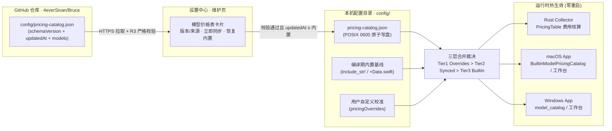

# 模型价格表远端同步设计方案

<!-- @topic: PricingCatalogSync -->
> **created**: 2026-10-31 ｜ **last-change**: 2026-10-31 ｜ **status**: baseline
> **文档ID**: DESIGN-PRICING-SYNC ｜ **状态**: 现行基线（2026-10-31 维护者批准）
> **最后更新**: 2026-10-31 ｜ **所属总体**: [00-系统总体设计.md](00-系统总体设计.md) ｜ **对应 Topic**: `PricingCatalogSync`
> 📌 **变更总账**: 参见 [变更总账 (PricingCatalogSync)](../change/index.json#PricingCatalogSync)

---

## 1. 简介

当前 `Bruce` 的模型基准价卡唯一事实源为 `core/collector/crates/collector-domain/pricing-catalog.json`：编译期通过 `include_str!` 嵌入 Rust Collector（`collector-domain`）与 Windows 视图模型（`apps/win/viewmodel`），并由 `scripts/gen-pricing-catalog.mjs` 生成 macOS 静态数组（`BuiltinModelPricingCatalog+Data.swift`）。当大模型厂商发布新模型或调整官方定价时，用户必须等待客户端发版并重新安装应用才能获得最新基准单价。

本方案将模型价格表抽离为仓库顶层独立配置文件 `config/pricing-catalog.json`，支持客户端在运行期从 GitHub 在线同步更新并原子落盘至本机配置目录，在设置中心**「维护」页面**提供价格表版本状态、手动/自动同步更新与恢复内置基线入口，实现**免发版、免重启的全模型基准价卡热更新**，同时保留编译期内置价卡作为离线兜底。

**批准情况**：2026-10-31 维护者确认（「确认」）第 4.3 节三项决策：① 远端同步源采用方案 A（GitHub Raw 主干直链 `https://raw.githubusercontent.com/4everSivan/Bruce/main/config/pricing-catalog.json`，日常调价直接提交 `main` 分支，无需发版）；② 维护页布局采用布局 1（在「维护」页位于「软件更新」与「数据」之间独立设「模型价格表」卡片）；③ 包含「自动同步价格表」开关（默认开启，启动 30 秒后及每 24 小时静默同步一次，失败不打扰）。据此本文转为现行基线，执行拆解为 T19–T21（第 4.3 节）。

## 2. 索引

- 文档 ID：DESIGN-PRICING-SYNC
- 所属总体：[系统总体设计](00-系统总体设计.md)
- 关联设计：[01-数据采集与多模型计费引擎](01-数据采集与多模型计费引擎.md)、[04-设置中心与价格校准交互](04-设置中心与价格校准交互.md)、[07-软件更新](07-软件更新.md)
- 对应主题：PricingCatalogSync
- 执行记录：[变更总账 (PricingCatalogSync)](../change/index.json#PricingCatalogSync)；任务见 [任务总账](../task/index.json)（M10，T19–T21）

## 3. 规范

### 3.1 目标

1. **价格表抽离与版本化契约**：将深埋于 crate 内部的价卡提升至仓库顶层 `config/pricing-catalog.json`，补充 `schemaVersion` 与 `updatedAt` 元数据字段，100% 兼容既有 `models` 条目结构（含 `peak` 峰谷价、`longContext` 超长上下文分档、`cacheWrite` TTL 倍率与 `listed` 标记）。
2. **GitHub 远端同步与三层优先级兜底**：支持从 GitHub 拉取最新价格表并经严格校验后原子落盘至本机 `config/pricing-catalog.json`，建立「**用户手动校准 (`pricingOverrides`) > 本地已同步远端价格表 (`config/pricing-catalog.json`) > 编译期内置基线**」三层优先级与防版本倒退（Anti-Rollback）机制。
3. **设置中心「维护」页同步卡片**：在 macOS 与 Windows 设置中心「维护」页面提供「模型价格表」卡片（视觉与状态机对齐同页「软件更新」卡），展示当前生效来源/日期/模型数，支持立即同步、自动同步开关与一键恢复内置基线。
4. **全链路零重启热生效**：同步完成或恢复内置后，Rust Collector 计费引擎、macOS（`BuiltinModelPricingCatalog` / `ModelNormalizer` / `ModelPricingSettingsView`）与 Windows（`model_catalog` / `analytics` / `settings-pricing.js`）立即采用新价格表并触发内存态与快照费用重算。

### 3.2 非目标

1. **不爬取第三方厂商网页**：远端同步源仅限本仓库受控的 GitHub 静态文件，不向外部厂商页面发起价格嗅探。
2. **不改写用户个人校准 (`pricingOverrides`)**：远端同步仅更新基准价卡层（Tier 2），用户在「模型计费」页手动配置的覆盖单价（Tier 1）不受影响且保持最高优先级。
3. **不引入自有云端服务**：遵循本地优先（Local-First）原则，信任根仍为项目 GitHub 仓库与 HTTPS/TLS。

### 3.3 现状与约束盘点

| 维度 | 现行实现 | 抽离与动态同步需改造点 |
|---|---|---|
| 仓库事实源路径 | `core/collector/crates/collector-domain/pricing-catalog.json`（无顶层版本/日期字段，共 94 条模型记录、87 条 `listed: true`） | 提升至 `config/pricing-catalog.json`，顶层增加 `schemaVersion` 与 `updatedAt` |
| Rust 采集端 (`collector-domain`) | `pricing::catalog()` 通过 `OnceLock` 解析 `include_str!` 编译期常量；`PricingTable::new(overrides)` 固定取编译期 `catalog()` | 新增 `CatalogFile::parse_and_validate` 与 `PricingTable::with_catalog(models, overrides)`；`BridgeRequest.context` 支持传入生效的动态 `pricingCatalog` |
| Windows 视图模型 (`apps/win/viewmodel`) | `model_catalog::catalog()` 使用 `OnceLock<Vec<CatalogEntry>>` 且字段为 `&'static str`，绑定编译期静态切片 | 改为 `CatalogEntryOwned` + `RwLock<Arc<Vec<CatalogEntryOwned>>>`（默认编译期基线），支持同步后运行时热替换 |
| macOS 模型目录 (`BruceOnboardingCore`) | `BuiltinModelPricingCatalog.allModels` 为 `scripts/gen-pricing-catalog.mjs` 生成的编译期静态常量 | 保留生成的静态数组作为 `builtinModels` 兜底；`allModels` / `resolveAll` 优先读取内存活动目录（来自本地已同步 `config/pricing-catalog.json`） |
| 维护页 UI (`SettingsView` / `settings-maintenance.js`) | 现有「软件更新」「数据」「诊断」三块，无价格表同步入口 | 新增「模型价格表」维护卡片（或数据区入口），复用 `FluentCard` / `FluentRow` 与底部 `stage` 状态区规范 |

## 4. 设计详情

### 4.1 架构与行为



#### 远端同步源可选方案对比

| 方案 | 远端 URL | 优势 | 局限与风险 |
|---|---|---|---|
| **A. GitHub Raw 主干直链（推荐）** | `https://raw.githubusercontent.com/4everSivan/Bruce/main/config/pricing-catalog.json` | **日常调价与发版彻底解耦**：维护者修改 `config/pricing-catalog.json` 推入 `main` 分支即刻生效，无需打 Tag 或跑双端安装包流水线 | GitHub Raw CDN 有约 5 分钟缓存窗口；部分网络环境下 `raw.githubusercontent.com` 连通性与 Releases 相当 |
| **B. GitHub Releases 固定资产直链** | `https://github.com/4everSivan/Bruce/releases/latest/download/pricing-catalog.json`（或专用 `pricing-latest` tag） | 与 `07-软件更新` 的 `latest.json` 域名及 CDN 链路完全一致 | 若挂 `releases/latest` 则必须在每次调价时上传到最新 Release（需配 GitHub Action 在 `config/pricing-catalog.json` 变更时自动同步上传至最新 Release） |
| **C. Release 资产 + Raw 双源回退** | 主用 `releases/latest/download/pricing-catalog.json`（配 Action 自动同步），失败时自动回退方案 A Raw 直链 | 兼顾 `github.com` 域名下载链路与 `main` 分支直推的即时性，单点网络抖动容错更好 | 客户端同步器需按序尝试两个 URL（代码增加约 20 行） |

#### 维护页布局可选方案对比

| 方案 | 做法 | 优势 | 局限 |
|---|---|---|---|
| **布局 1：独立「模型价格表」卡片（推荐）** | 在「维护」页置于「软件更新」卡正下方、「数据」卡上方，独立 `paneCaption("模型价格表")` + `FluentCard` | 与「软件更新」卡同属 GitHub 在线同步能力，职责聚焦；可完整容纳「自动同步开关 / 当前版本与恢复内置 / 立即同步 / 底部状态区（新增与调价明细）」 | 维护页增加一张 2~3 行的卡片 |
| **布局 2：并入「数据」卡片首行** | 不新建卡片，在「数据」卡片首行加入「模型价格表」行（右侧放「同步更新」按钮），状态反馈复用卡片底部提示行 | 卡片数量不变，页面更紧凑 | 难以同时承载自动同步开关、「恢复内置」操作与同步差异明细 |

---

### 4.2 核心业务规则

<!-- @topic: PricingCatalogSync -->

#### R1 价格表文件位置与 Schema 契约（`config/pricing-catalog.json`）

1. **物理路径抽离**：
   - 仓库内唯一事实源由 `core/collector/crates/collector-domain/pricing-catalog.json` 迁至仓库根目录下的 `config/pricing-catalog.json`；
   - `collector-domain/src/pricing.rs` 的 `include_str!` 与 `scripts/gen-pricing-catalog.mjs` 的 `sourcePath` 统一指向 `config/pricing-catalog.json`，保持构建期内置基线零拷贝同源。
2. **Schema 定义**：
   ```json
   {
     "$comment": "Bruce 模型基准价格表唯一事实源: 支持编译期内置与运行期从 GitHub 在线同步更新。单位: 美元 / 百万 token。",
     "schemaVersion": 1,
     "updatedAt": "2026-10-31",
     "models": [
       {
         "model": "claude-opus-5-5",
         "displayName": "Claude Opus 5.5",
         "vendor": "Anthropic",
         "input": 4,
         "output": 20,
         "cacheRead": 0.2,
         "cacheWrite": [1.25, 2],
         "note": "新一代高算力旗舰"
       }
     ]
   }
   ```
   - `schemaVersion`：必填正整数，当前固定为 `1`。未来若发生破坏性结构变更则递增 `schemaVersion`，旧客户端遇到高版本 schema 时安全拒绝并保留本地版本；
   - `updatedAt`：必填日期字符串（`YYYY-MM-DD` 或 `YYYY-MM-DD.N` 同日修订号，字典序可比），标识本次价格表修订批次；
   - `models`：模型定价数组，字段契约与现有 `CatalogModel`（`model`, `displayName`, `vendor`, `input`, `output`, `cacheRead`, `cacheWrite`, `note`, `listed`, `peak`, `longContext`）完全一致。

#### R2 本地持久化、三层优先级与防倒退门禁

1. **本地落盘路径与权限**：
   - **macOS**：`~/Library/Application Support/Bruce/config/pricing-catalog.json`（父目录 `0700`、文件 `0600`，通过临时文件 + `replaceItemAt` 原子替换）；
   - **Windows**：`%APPDATA%\Bruce\config\pricing-catalog.json`（临时文件 + rename 原子替换）；
   - **同步状态元数据**（`lastSyncAt` 上次同步成功时间、`autoSyncEnabled` 自动同步开关）：持久化于现有设置配置（macOS `UserDefaults` 或 `onboarding-v1.json`；Windows `settings.json`）；
   - **缓存清理隔离**：「维护 → 清理用量缓存」只删除 `snapshots/` 与 `collector-cache-v1/`，**不删除** `config/pricing-catalog.json`。用户若需回退到随包内置版本，通过卡片上的「恢复内置」显式移除 `config/pricing-catalog.json`。
2. **三层定价裁决优先级**：
   - **Tier 1（最高）· 用户自定义覆盖 (`pricingOverrides`)**：用户在「模型计费」页手动校准的模型单价始终最先匹配；
   - **Tier 2（中间）· 本地已同步价格表 (`config/pricing-catalog.json`)**：文件存在、通过 R3 完整性校验、且满足下述防倒退门禁时作为基准价卡；
   - **Tier 3（兜底）· 编译期内置基线**：当未曾同步、已恢复内置、本地同步文件损坏、或内置基线更新时作为基准价卡。
3. **防倒退门禁（Anti-Rollback）**：
   - 当用户升级 Bruce 客户端后，新客户端编译期内置基线的 `updatedAt` 可能**新于**本机磁盘上数月前同步的 `config/pricing-catalog.json`；
   - 启动加载与运行期裁决时，比较 `synced.updatedAt` 与 `builtin.updatedAt`：若 `synced.updatedAt < builtin.updatedAt`，自动以编译期内置基线为准并静默清理过期的本地 `config/pricing-catalog.json`，防止旧同步缓存遮蔽新版客户端内置的新模型。

#### R3 远端拉取与严格校验门禁（Fail-Closed）

1. **网络边界**：
   - 仅允许 `https://`（白名单主机名 `raw.githubusercontent.com` / `github.com` / `objects.githubusercontent.com`）；
   - 请求超时 **10 秒**，响应体字节上限 **512 KB**（当前文件约 11 KB，防异常大包撑爆内存）。
2. **结构与语义校验（双端与 Collector 共用同一套判据）**：
   - 合法 UTF-8 JSON，`schemaVersion == 1`，`updatedAt` 匹配 `^\d{4}-\d{2}-\d{2}(\.\d+)?$`；
   - `models` 为非空数组（上限 2,000 条）；
   - 每条记录的 `model`、`displayName`、`vendor` 去首尾空白后非空，且 `model.to_lowercase()` 在表内唯一；
   - `input`、`output`、`cacheRead`（非空时）必须为有限非负浮点数（`isFinite && >= 0`）；
   - `cacheWrite`（非空时）两项倍率均须有限且 `> 0`；
   - `peak`（非空时）单价有限非负，且 `startMinuteUtc < 1440`、`endMinuteUtc <= 1440`、`startMinuteUtc != endMinuteUtc`；
   - `longContext`（非空时）单价有限非负，且 `threshold > 0`。
3. **拒绝策略**：
   - 任一校验失败一律按 `InvalidCatalog` 拒绝落盘，本机已有的 `config/pricing-catalog.json` 与内存态目录保持原样。

#### R4 三端消费者动态加载与零重启热生效

1. **Rust Collector（`collector-domain` / `collector-application` / `collector-bridge`）**：
   - `collector-domain::pricing` 保留 `builtin_catalog() -> &'static [CatalogModel]` 与 `builtin_updated_at() -> &'static str`；
   - 新增 `CatalogFile::parse_and_validate(bytes: &[u8]) -> Result<CatalogFile, CatalogValidationError>` 与 `PricingTable::with_catalog(models: &[CatalogModel], overrides: HashMap<String, ModelPricingOverride>)`；
   - `collector-bridge` 的 `ALLOWED_CONTEXT_FIELDS` 白名单新增可选字段 `"pricingCatalog"`（结构为 `CatalogFile` 或 `Vec<CatalogModel>`）：当本机存在生效的已同步价格表时，macOS / Windows 在构造 `BridgeRequest` 时将其注入 `context.pricingCatalog`；Collector 校验通过后用其构造 `PricingTable`（未传或校验失败时平滑回退 `builtin_catalog()`）。
2. **macOS 端（`BruceOnboardingCore` / `BruceAppCore` / `BruceApp`）**：
   - `BuiltinModelPricingCatalog` 保留 `builtinModels`（由 `scripts/gen-pricing-catalog.mjs` 生成），新增内存态当前生效目录（启动时从 `config/pricing-catalog.json` 加载并执行 R2 防倒退比对）；
   - 同步成功或点击「恢复内置」后：更新内存态生效目录 → 通知 `ModelPricingSettingsView` 与 `ModelNormalizer` 刷新 → 立即调用 `scheduler.refresh(.agentUsage)` 重新折算费用并更新菜单栏与仪表盘快照。
3. **Windows 端（`apps/win/viewmodel` / `apps/win/src-tauri` / `apps/win/src`）**：
   - `apps/win/viewmodel/src/model_catalog.rs` 改为维护可热更新的活动目录（`set_active_catalog` / `reset_to_builtin`），`as_json()` 与 `analytics.rs` 读取当前活动目录；
   - 同步成功或恢复内置后：更新活动目录 → 派发 `pricing-catalog-state` 事件更新维护页与模型计费页 UI → 触发后台采集重算。

#### R5 维护页「模型价格表」卡片规格与状态机（双端同构）

1. **位置与结构（按布局 1 草案）**：
   - 位于设置中心「维护」分类下，紧接「软件更新」卡片下方、「数据」卡片上方；
   - 分组小标题：`模型价格表`（`paneCaption` / `card-caption`）；
   - 卡片行（`FluentRow`）：

| 行 | 标题 | 副标题（逐字） | 右侧控件 |
|---|---|---|---|
| 1 | 自动同步价格表 | `启动 30 秒后静默同步一次, 之后每 24 小时一次; 同步失败不打扰` | 药丸开关（默认开启，遵循 C145 不附状态文字） |
| 2 | 当前价格表 | 内置态：`内置基线 · 87 款模型`；已同步态：`GitHub 已同步 · 89 款模型` | 等宽日期 `2026-10-31`；已同步态下右侧并列 `恢复内置` 次按钮 |
| 3 | 同步价格表 | `上次同步 今天 14:02`（跨天 `M月d日 HH:mm`，从未同步为 `上次同步 —`） | `同步更新` 中性次按钮（遵循 C155 `minimumWidth = 64`） |

2. **底部状态区（`pricing-sync-stage`，复用 `update-stage` 样式与 C111 就地消噪约定）**：

| 状态 | 状态区内容（逐字） | 交互与行为 |
|---|---|---|
| `idle` | 空（状态区隐藏） | 「同步更新」按钮启用 |
| `syncing` | 旋转 spinner + `正在从 GitHub 同步模型价格表…` | 「同步更新」与「恢复内置」按钮禁用 |
| `upToDate` | `✓`（绿 `#5ec273`）+ `已是最新价格表 · 2026-10-31 (87 款模型)` | 校验通过且内容与当前生效价格表一致 |
| `updated` | `✓` + `已更新至 2026-10-31 · 共 89 款模型 (新增 2 款 / 调价 1 款)` | 原子写盘并立即触发热重算 |
| `restored` | `✓` + `已恢复为内置基准价格表 · 2026-10-31 (87 款模型)` | 删除本地同步副本并回退内置基线重算 |
| `failed` | `同步失败`（warn 色）+ 失败说明 + `[重试]` link；状态行 warn 文案 | 仅手动同步失败时呈现；自动同步失败完全静默 |

3. **失败分类文案（与 `07-软件更新` 句式对齐，双端共享 fixture 对拍）**：

| 失败分支 | 状态区说明 | 状态行（warn） |
|---|---|---|
| 网络超时 | `无法访问 GitHub (超时 10 秒);当前继续使用本地价格表` | `同步价格表失败：网络超时` |
| 网络不可用 | `无法访问 GitHub (网络不可用);当前继续使用本地价格表` | `同步价格表失败：网络不可用` |
| HTTP 非 2xx | `无法获取价格表 (HTTP 404);当前继续使用本地价格表` | `同步价格表失败：HTTP 404` |
| 校验失败 | `远端价格表格式无法识别;已拒绝覆盖本地价格表` | `同步价格表失败：价格表格式无效` |
| 版本低于本地 | `远端价格表版本低于本地基线;已保留当前价格表` | `同步价格表失败：远端版本过期` |

---

### 4.3 验证与实现情况

- **实现情况**：未实现，待按 T19–T21 拓扑执行（具体完成态以代码与卡片验收证据为准）。
- **已确认决策（2026-10-31 维护者确认）**：
  1. **远端同步源**：采用**方案 A**（GitHub Raw 主干直链 `https://raw.githubusercontent.com/4everSivan/Bruce/main/config/pricing-catalog.json`），日常更新模型价格只需提交至 `main` 分支，与客户端发版解耦。
  2. **维护页布局**：采用**布局 1**，在设置中心「维护」页位于「软件更新」与「数据」之间独立设「模型价格表」卡片。
  3. **自动同步策略**：包含「自动同步价格表」开关（默认开启，启动 30 秒后静默同步一次，之后每 24 小时一次，失败完全静默不打扰；支持手动点击「同步更新」与已同步态「恢复内置」）。
- **任务拆解（M10：T19–T21，批次 0.16.0，拓扑 `T19 → {T20, T21}`）**：
  - **T19（价格表抽离与 Collector 动态价卡契约）**：将 `pricing-catalog.json` 迁至 `config/pricing-catalog.json` 并补 `schemaVersion` / `updatedAt`；`collector-domain` 实现 `CatalogFile::parse_and_validate`、防倒退比较与 `PricingTable::with_catalog`；`collector-bridge` 支持 `context.pricingCatalog`；同步 `scripts/gen-pricing-catalog.mjs`。
  - **T20（macOS 价格表同步服务与维护页卡片，依赖 T19）**：实现 `PricingCatalogSyncService`（HTTPS 拉取、校验、0600 原子落盘、防倒退清理、注入 `BuiltinModelPricingCatalog` 与采集请求）及维护页「模型价格表」卡片；新增双端共享对拍 fixture `tests/fixtures/pricing-sync-parity/cases.json` 与 `PricingCatalogSyncHarness`。
  - **T21（Windows 价格表同步与维护页卡片，依赖 T19）**：`apps/win/viewmodel` `model_catalog` 改为支持运行时热更新的活动目录；`src-tauri` 实现同步/恢复命令与采集请求注入；`settings-maintenance.js` 渲染「模型价格表」卡片并通过 `pricing-sync-parity` 与 `frontend.test.mjs` 验收。

### 4.4 规则演进

| 编号 | 类型 | 简介 | 规则演进 |
|---|---|---|---|

### 4.5 参考资料

- `core/collector/crates/collector-domain/pricing-catalog.json`：现行内置模型价卡文件
- `core/collector/crates/collector-domain/src/pricing.rs`：Rust 计费引擎与价卡解析实现
- `apps/macos/Sources/BruceOnboardingCore/BuiltinModelPricingCatalog.swift`：macOS 模型定价目录与覆盖合并
- `apps/win/viewmodel/src/model_catalog.rs`：Windows 模型展示目录
- `docs/devel/design/04-设置中心与价格校准交互.md`：设置中心与「模型计费」页基线设计
- `docs/devel/design/07-软件更新.md`：维护页「软件更新」卡片交互与状态机参照基线
