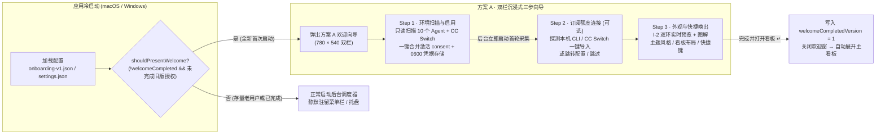

# 首次启动欢迎与引导向导设计方案

<!-- @topic: FirstLaunchWelcome -->
> **created**: 2026-11-02 ｜ **last-change**: 2026-11-02 ｜ **status**: baseline
> **文档ID**: DESIGN-WELCOME ｜ **状态**: 现行基线（2026-11-02 维护者批准）
> **最后更新**: 2026-11-02 ｜ **所属总体**: [00-系统总体设计.md](00-系统总体设计.md) ｜ **对应 Topic**: `FirstLaunchWelcome`
> 📌 **变更总账**: 参见 [变更总账 (FirstLaunchWelcome)](../change/index.json#FirstLaunchWelcome)

---

## 1. 简介

在 `v0.16.0` 及此前版本中，`Bruce` 首次冷启动时的引导链路存在三处体验断点：
1. **macOS 双重门禁割裂导致首次配置后看板仍不可用**：首次启动时 `BruceApp.swift` 检测到 `!consentConfirmed || !keychainAccessConfigured` 后直接打开设置中心「通用」页，并由 `SettingsView` 弹出「配置凭据存储」Sheet。用户点击「现在配置」仅将 `keychainAccessConfigured` 置为 `true`，而激活本地会话扫描所需的 `consentConfirmed`（`consentVersion == 1`）与 `selectedModules = [.agentUsage]` 藏在左侧导航第 5 项「授权与隐私」页，导致 `CollectorActivationGate.canActivate` 判定不通过，首次启动配置后菜单栏看板仍停留在「未配置模块，前往设置」空状态；
2. **Windows 首次启动直接落入未授权空看板**：Windows 端 `AppSettings::default()` 默认 `consent_version = 0`，首次启动直接展开托盘看板，仅显示「未配置模块，前往设置」空状态，缺少产品定位说明与引导流程；
3. **缺少直观的核心价值传达與快速接入路径**：新用户首次启动时无法直观看到本机已就绪的 AI Agent 会话源、不知道可直接一键只读导入本机 CLI / CC Switch 订阅凭据，也不了解菜单栏 `I-2` 双同心子母环（外母环平均剩余额度、内子环最低短板预警）的读数含义与快速个性化选项。

本方案将首次启动升级为**独立双栏沉浸式三步欢迎向导（方案 A，`780 × 540`，以 `local/welcome-onboarding-demo.html` 为高保真视觉规格基准）**，将双门禁合并为 Step 1 单次主确认（点击即刻激活本机 Agent Token 统计与 `0600` 凭据存储），提供可选订阅额度快速连接与菜单栏实时预览定制，并在完成向导后自动收起欢迎窗口、展开主看板呈现实时统计数据（向导专注服务全新安装与首启引导，设置页保持纯净不冗余测试按钮）。

**批准情况**：2026-11-02 维护者确认四项核心决策（A1 独立欢迎向导窗口 + 完成后自动展开看板、A2 精简 3 步式引导、A3 Step 1 合并激活本地采集与 `0600` 凭据存储、A4 macOS + Windows 双端同步落地并附设置中心重开入口）及方案 A（`780 × 540` 双栏沉浸式向导 + 真实项目比格犬图标）高保真原型。据此本文转为现行基线，执行拆解为 `T22`（第 4.3 节）。

## 2. 索引

- 文档 ID：DESIGN-WELCOME
- 所属总体：[系统总体设计](00-系统总体设计.md)
- 关联设计：[01-数据采集与多模型计费引擎](01-数据采集与多模型计费引擎.md)、[02-订阅额度与凭据安全存储](02-订阅额度与凭据安全存储.md)、[03-菜单栏状态与多风格原生渲染](03-菜单栏状态与多风格原生渲染.md)、[04-设置中心与价格校准交互](04-设置中心与价格校准交互.md)、[05-Windows平台适配](05-Windows平台适配.md)
- 对应主题：FirstLaunchWelcome
- 执行记录：[变更总账 (FirstLaunchWelcome)](../change/index.json#FirstLaunchWelcome)；任务见 [任务总账](../task/index.json)（M11，T22）

## 3. 规范

### 3.1 目标

1. **首启即用（One-Click Ready）**：用户在欢迎向导 Step 1 点击一次主确认按钮，即同步完成本地会话采集授权（`consentVersion = 1`、`selectedModules = [.agentUsage]`）与本机 `0600` 凭据存储初始化（`keychainAccessConfigured = true`），后台立即触发首轮本地扫描，彻底消除「配置了凭据存储却仍显示未配置模块」的死锁体验。
2. **存量老用户零打扰平滑升级**：已走过旧版授权与凭据存储配置的老用户升级至新版本后，自动识别其已完成状态，绝不重复弹出欢迎向导窗口。
3. **三步渐进式引导（方案 A · `780 × 540` 双栏沉浸式布局）**：
   - **Step 1（环境扫描与启用）**：只读展示本机 10 个 Agent 会话源与 CC Switch 数据库就绪状态，明确 100% 本地闭环与零系统钥匙串弹窗承诺，一键启用本地统计；
   - **Step 2（订阅额度连接 · 可选）**：自动嗅探本机已存在的 Codex CLI、Claude CLI、Grok CLI 与 CC Switch 凭据并提供一键只读导入，同时支持对 10 家 Provider 快速发起配置或直接跳过；
   - **Step 3（外观与快捷唤出）**：提供菜单栏 / 托盘 `I-2` 双同心子母环实时预览条与环规图解、界面风格切换（经典 / 液态玻璃 / Nothing 点阵）、卡片布局切换（纵向级联 / 顶栏单卡）、纯图标 / 悬停预览开关及一键设置默认全局快捷键（`⌘⇧B` / `Control+Shift+B`）。
4. **收口直达看板**：完成 Step 3 后自动关闭欢迎向导并展开菜单栏 / 托盘看板；设置中心保持紧凑极简，不常驻冗余的重开按钮。

### 3.2 非目标

1. **不移除「设置 → 授权与隐私」页**：欢迎向导 Step 1 仅合并首次启动激活操作，用户在设置中心「授权与隐私」页随时查看授权摘要或「撤销全部授权」的能力 100% 保持不变。
2. **不强制要求配置云端订阅额度**：Step 2 严格保持可选（Optional），用户未添加任何订阅 Provider 时仍可完整使用本地 Agent Token 统计与模型费用分析。
3. **不在首次启动触发任何外部网络请求或系统钥匙串弹窗**：Step 1 仅执行本机文件系统只读扫描（`LocalDependencyScanner`），未经用户点击导入或验证前不发起任何云端 API 请求。

### 3.3 视觉布局方案对比

| 方案 | 窗口尺寸与结构 | 优势 | 取舍结论 |
|---|---|---|---|
| **方案 A：双栏沉浸式向导（已选定）** | `780 × 540`；左侧 `224px` 品牌与三步导航轨 + 底部本地只读隐私承诺卡，右侧 `556px` 主舞台 + 底部固定操作栏 | 品牌感与步骤进度一目了然，左侧常驻展示真实项目图标与 100% 本地只读安全背书，与 `SettingsView` Fluent 侧栏基因一脉相承 | **维护者确认选定为现行基线** |
| **方案 B：单栏居中聚焦卡片** | `620 × 520`；顶部胶囊步骤条 + 居中内容区 | 窗口占地略小 | 缺少常驻安全背书区与步骤副标题导航，信息层次不如双栏舒展 |

## 4. 设计详情

### 4.1 架构与行为

### 4.2 核心业务规则

<!-- @topic: FirstLaunchWelcome -->

#### R1 首次启动判定、配置持久化与存量用户平滑迁移

1. **持久化字段契约**：
   - **macOS (`OnboardingConfiguration`，持久化于 `config/onboarding-v1.json`)**：
     - 新增可选字段 `welcomeCompletedVersion: Int?`，当前版本常量 `OnboardingConfiguration.currentWelcomeVersion = 1`；
     - 自定义 `init(from:)` 按 `decodeIfPresent(Int.self, forKey: .welcomeCompletedVersion)` 解码，旧配置文件缺失该键时为 `nil`，不破坏向后兼容。
   - **Windows (`AppSettings`，持久化于 `config/settings.json`)**：
     - 新增字段 `welcome_completed_version: u32`（`#[serde(default)]` 缺省为 `0`），当前版本常量 `CURRENT_WELCOME_VERSION: u32 = 1`。
2. **存量老用户平滑免打扰判定（`shouldPresentWelcomeOnStartup`）**：
   - **macOS**：
     - 若 `welcomeCompletedVersion ?? 0 >= OnboardingConfiguration.currentWelcomeVersion`，返回 `false`；
     - 若 `welcomeCompletedVersion == nil`，但配置同时满足 `consentConfirmed == true`（`consentVersion == 1`）且 `keychainAccessConfigured == true`，判定为已走过旧版引导的存量老用户，返回 `false`（不打扰老用户）；
     - 其余情况（即未完成欢迎向导且未完成旧版双门禁配置）返回 `true`，在启动完成（`bootstrap.startIfNeeded()`）后自动弹出独立欢迎向导窗口 `WelcomeWindowController`，同时抑制旧版自动弹出 `SettingsWindowController` 与 `keychainAccessGuide` Sheet 的行为。
   - **Windows**：
     - 若 `welcome_completed_version >= 1` 或 `consent_version >= 1`，判定为已完成或存量老用户，不自动弹出欢迎向导；
     - 若 `welcome_completed_version == 0 && consent_version == 0`，判定为全新首次启动，启动时打开设置窗口并自动激活全屏欢迎向导覆盖层。

#### R2 方案 A · 双栏沉浸式向导容器与品牌规范 (`780 × 540`)

1. **容器形态**：
   - **macOS (`WelcomeWindowController` + `WelcomeOnboardingView`)**：独立 `NSWindow`（内容尺寸锁定 `780 × 540`，标题 `"欢迎使用 Bruce"`，`styleMask = [.titled, .closable, .fullSizeContentView]`，`titlebarAppearsTransparent = true`，居中显示）；打开期间激活 Regular Dock 策略方便切换焦点，关闭时若设置窗口未打开则恢复 Accessory 菜单栏常驻模式。
   - **Windows (`settings-welcome.js` + `#welcome-wizard-overlay`)**：在 `settings.html` 内提供同构双栏沉浸式向导覆盖层（居中 `780 × 540` 舞台卡，小窗口下自适应铺满），受严格 CSP 保护（外链脚本 `welcome-presentation.js` + `settings-welcome.js`，零内联脚本与内联事件）。
2. **左侧品牌与步骤导航栏（宽 `224px`）**：
   - **顶部品牌头**：展示本项目真实应用图标（macOS 读取 `NSApp.applicationIconImage` / Bundle `AppIcon.icns`，Windows 读取 `icons/icon.png`，尺寸 `42 × 42`、圆角 `11px`）+ `Bruce` 标题 + `v<当前版本> · LOCAL-FIRST` 等宽副标；
   - **三步垂直导航轨**：
     - `1` `环境扫描与启用` / `自动探测本机 Agent 目录`
     - `2` `订阅额度连接` / `可选 · 一键导入或稍后配置`
     - `3` `外观与快捷唤出` / `菜单栏预览 · 主题与快捷键`
     - 已完成步骤显示翡翠绿 `✓` 徽章，当前步骤高亮主色描边与微光底，支持点击已解锁步骤自由回看；
   - **底部本地只读隐私承诺卡**：常驻展示翡翠绿安全盾牌与承诺文案：`100% 本地只读闭环` — `不代理对话流量、不修改外部会话数据库（SQLite 强制 mode=ro），凭据以 POSIX 0600 权限保存在本机目录。`

#### R3 Step 1：本机 Agent 环境只读扫描与双门禁合并一键激活

1. **本机环境只读扫描网格**：
   - 展示 `LocalDependencyScanner`（macOS）与 `get_runtime_info.localProbes`（Windows）探测到的 10 个 Agent 会话目录（`Claude Code`、`ChatGPT / Codex`、`Kimi Code`、`OpenCode`、`Grok`、`火山引擎 / 豆包`、`Pi`、`ZCode`、`CodeBuddy`、`DSH`）及 `CC Switch` 数据库状态；
   - 复用真彩品牌位图（`agent-codex.png`、`agent-zcode.png`、`agent-codebuddy.png`）与官方品牌矢量徽章，右上角汇总展示 `已发现 N 个就绪源` 胶囊与 `重新扫描` 按钮。
2. **双门禁合并说明与一键激活（`completeWelcomeStep1()`）**：
   - 底部高亮卡片说明启用后将同时完成两项本地初始化：
     - **本地会话只读采集**：开启 `agent-usage` 模块并确认 `consentVersion = 1`；
     - **本机 `0600` 凭据安全存储**：初始化 `Application Support/Bruce/credentials.json`（Windows 为 `%APPDATA%\Bruce\credentials.json`）访问标记（`keychainAccessConfigured = true`），后台刷新绝不弹出系统钥匙串密码框。
   - 用户点击底部主按钮 `启用本地统计并继续 →` 时：
     - 原子化写入 `consentVersion = 1`、`selectedModules = ["agent-usage"]`、`keychainAccessConfigured = true`（Windows 写入 `consentVersion = 1`、`usageEnabled = true`）；
     - 立即触发 `reconcileScheduler()` 与 `scheduler.refresh(.agentUsage)`（Windows 触发后台采集），使应用在用户浏览 Step 2 / Step 3 期间即完成首轮数据聚合，并推进至 Step 2。

#### R4 Step 2：订阅额度可选快速连接与本机凭据嗅探导入

1. **可选定位与零阻断跳过**：
   - Step 2 顶部展示琥珀色胶囊 `可选步骤 · 可随时跳过`，明确告知即使跳过此步，Step 1 启用的本地 Token 统计与费用估算也已正常工作。
2. **本机 CLI / CC Switch 凭据一键只读导入**：
   - 自动检测本机已存在的外部凭据源：
     - `Codex CLI`（`~/.codex/auth.json`）与 `Codex CC Accounts`：调用既有 `importCodexFromLocalCLI()` / `codex_import_discovered`；
     - `Claude Code CLI`：调用既有 `importClaudeFromLocal()` / `import_claude_from_local`；
     - `Grok CLI`：调用既有 `importGrokFromLocal()` / `import_grok_from_local`；
     - `CC Switch 数据库`（火山引擎 / Codex）：调用既有 `importVolcengineFromCCSwitch()` / `import_volcengine_from_ccswitch`；
   - 若本机探测到任一可导入源，在顶部高亮卡片展示并提供 `一键只读导入` 按钮，导入后状态即时更新为 `✓ 已导入`。
3. **10 家订阅服务快速列表与配置跳转**：
   - 展示 `Codex`、`Claude`、`Kimi`、`DeepSeek`、`Z.ai (智谱)`、`火山引擎`、`StepFun`、`OpenCode`、`Grok`、`Cline` 的品牌徽章、认证方式简介与当前连接状态（`已连接` / `可导入` / `前往配置`）；
   - 点击任一未连接 Provider 的「配置」按钮，可直接唤起设置中心「订阅额度」分类并定位到该 Provider 的配置弹层；
   - 底部操作栏提供 `← 上一步`、`稍后在设置中配置`（跳过）与 `继续 →` 按钮。

#### R5 Step 3：菜单栏 / 托盘实时预览、外观风格、卡片布局与快捷键

1. **菜单栏 / 托盘实时预览条与双同心环图解**：
   - 顶部深色仿真菜单栏实时渲染 `I-2` 双同心子母环（外环 `r=6.8pt` 平均剩余额度、内环 `r=4.0pt` 最低短板额度）与指标读数（经典 / 液态玻璃主题显示 `68%  124K  $1.28`，切换至 Nothing 主题即时联动为 `68% / 124K / $1.28` 等宽斜杠格式）；
   - 预览条下方并列展示两条图解胶囊：
     - `外母环 · 全局平均剩余额度`（`≥30% 翡翠绿 · 15~30% 琥珀黄 · <15% 警示红`）
     - `内子环 · 最紧缺窗口短板预警`（`防止长周期充裕掩盖 5h 窗口即将耗尽的断流风险`）。
2. **界面风格与看板卡片布局即时定制**：
   - **界面风格**：提供 `经典材质` (`classic` / `fluent`)、`液态玻璃` (`liquidGlass`，macOS 专属；Windows 展示经典与 Nothing 两项)、`Nothing 点阵` (`nothing`) 卡片选择，点击立即调用 `coordinator.setInterfaceStyle(_:)` / `persist({ theme })` 实时生效；
   - **看板卡片布局**：提供 `纵向级联 (Stack)` 与 `顶栏单卡切换 (Tabbed)` 二选一，点击立即调用 `model.setLayoutMode(_:)` / `persist({ layoutMode })`。
3. **快捷偏好开关**：
   - **菜单栏仅显示双环图标**（macOS `coordinator.setMenuBarIconOnly(_:)`；Windows 对应 `托盘悬停微缩预览` `trayHoverPreview` 开关）；
   - **全局唤出快捷键**：提供一键启用默认快捷键按钮（macOS 为 `⌘⇧B`，即 `GlobalHotkey(keyCode: 11, modifiers: [.command, .shift])`；Windows 为 `Control+Shift+B`），已设置时支持一键恢复默认或清除。

#### R6 向导收口、自动展开看板与设置中心重开入口

1. **完成向导并自动展开主看板（`completeWelcomeWizard()`）**：
   - 用户在 Step 3 点击 `完成并打开看板 ↵` 时：
     - 若用户通过步骤条跳过了 Step 1 的点击，自动补齐 `completeWelcomeStep1()` 确保本地采集与凭据存储已激活；
     - 将 `welcomeCompletedVersion` 设为 `1`（Windows `welcome_completed_version = 1`）并落盘保存；
     - 关闭欢迎向导窗口（Windows 关闭向导覆盖层并隐藏设置窗口）；
     - 立即调用 `statusItemController.openDashboardIfNeeded()`（Windows 调用 `expand_dashboard`），在菜单栏 / 托盘位置自动弹出主看板，让用户即刻看到刚刚采集到的本机 Agent 用量与额度数据。
2. **设置中心保持极简**：
   - 欢迎向导严格服务于新安装与未完成向导用户的初次启动体验，日常设置中心通用页保持干净极简，不常驻测试性质的重开入口。

---

### 4.3 验证与实现情况

- **实现情况**：按 `T22` 交付双端实现、共享对拍 fixture 与自动化测试。
- **已确认决策（2026-11-02 维护者确认）**：
  1. **容器形态（A1）**：采用独立欢迎向导窗口 / 全屏向导覆盖层，替代原首次启动直接弹设置通用页 + 钥匙串弹窗的割裂流程，并在向导完成后自动展开主看板。
  2. **引导流程（A2）**：采用 3 步精简向导（Step 1 环境扫描与一键启用 → Step 2 可选订阅额度快速导入与配置 → Step 3 菜单栏双同心环实时预览、主题、布局与快捷键）。
  3. **门禁合并（A3）**：在 Step 1 将本地会话只读采集授权（`consentVersion = 1` + `selectedModules = [.agentUsage]`）与本机 `0600` 凭据存储（`keychainAccessConfigured = true`）合并为一次确认，一步跑通本地统计。
  4. **视觉方案与双端范围（A4 + 方案 A）**：锁定方案 A（`780 × 540` 双栏沉浸式向导，左侧品牌区使用项目真实比格犬图标 `AppIcon.icns` / `icon.png`），macOS 与 Windows 双端同步落地。
- **任务拆解（M11：T22，批次 0.16.1）**：
  - **T22（首次启动欢迎与三步引导向导：macOS / Windows 双端同构）**：
    - `T22-1`：`BruceOnboardingCore` 欢迎向导状态、存量平滑迁移与一步合并激活契约，以及双端共享对拍 fixture `tests/fixtures/welcome-onboarding-parity/cases.json`；
    - `T22-2`：macOS `WelcomeWindowController` 与 `WelcomeOnboardingView`（方案 A `780 × 540` 双栏三步向导）；
    - `T22-3`：macOS 首次启动触发流改造、完成后自动展开菜单栏看板；
    - `T22-4`：Windows `AppSettings` 欢迎状态、`get_runtime_info.localProbes`、`welcome-presentation.js` + `settings-welcome.js` 三步向导覆盖层；
    - `T22-5`：双端 Harness / 前端对拍测试与 `verify-local.sh` 全量验证。

### 4.4 规则演进

| 编号 | 类型 | 简介 | 规则演进 |
|---|---|---|---|
| `T22` | `Task` | 首次启动欢迎与三步引导向导（方案 A · macOS / Windows 双端同构） | 建立 R1–R6 首次启动判定、存量用户免打扰迁移、Step 1 双门禁合并激活、Step 2 本机凭据快速导入、Step 3 双环预览定制与完成后自动展开看板基线 |

### 4.5 参考资料

- `local/welcome-onboarding-demo.html`：方案 A（`780 × 540` 双栏沉浸式向导）高保真交互原型与视觉规格基准
- `apps/macos/Sources/BruceOnboardingCore/OnboardingConfiguration.swift`：macOS 非敏感配置持久化与门禁契约
- `apps/macos/Sources/BruceApp/OnboardingCoordinator.swift`：macOS 扫描、授权与凭据存储协调器
- `apps/macos/Sources/BruceApp/BruceApp.swift`：macOS 应用入口与首次启动窗口调度
- `apps/win/src-tauri/src/settings.rs`：Windows 应用设置持久化
- `apps/win/src/settings-maintenance.js`：Windows 设置中心通用与维护面板实现
