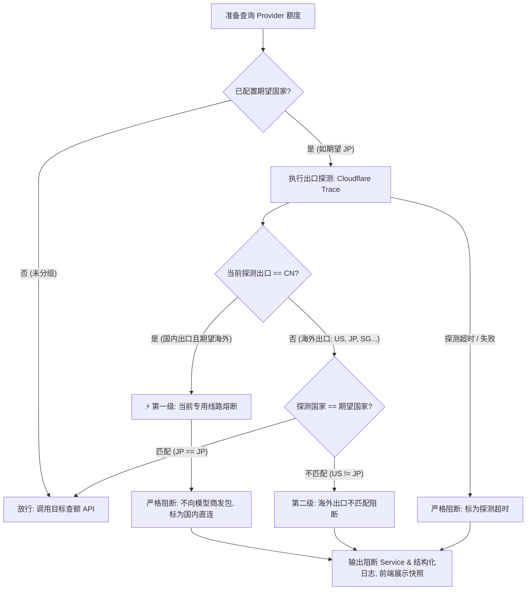

# 网络出口国家校验设计方案

<!-- @topic: NetworkEgressCountry -->
> **文档ID**: DESIGN-EGRESS-COUNTRY ｜ **状态**: 现行基线
> **创建日期**: 2026-11-03 ｜ **最后更新**: 2026-11-04 ｜ **所属总体**: [00-系统总体设计.md](00-系统总体设计.md) ｜ **对应 Topic**: `NetworkEgressCountry`
> 📌 **变更总账**: 参见 [变更总账 (NetworkEgressCountry)](../change/index.json#NetworkEgressCountry) ｜ **任务总账**: 参见 [任务总账 (NetworkEgressCountry)](../task/index.json#NetworkEgressCountry)

---

## 1. 简介 (Introduction)

本方案定义 Bruce 在发起云端大模型订阅额度查询时的**网络出口国家校验（Network Egress Country Validation）**机制。

### 1.1 业务动因与核心心智
随着大模型服务商（如 OpenAI/Codex、Anthropic/Claude 等）对访问来源国家/地区的风控策略日趋严格，开发者在本机使用代理工具（如 Mihomo/Clash、Surge、Sing-box 等）时，常因代理未开启、TUN 掉线、节点异常漂移或回退直连，导致应用误用国内 IP 或非目标国家 IP 发送请求，进而面临账号被服务商封禁或列入风控名单的风险。

本设计在受保护的订阅查额前检测专用代理线路；检测结果不匹配、探测失败或配置不完整时阻断查额。此保护依赖用户配置的专用端口在探测和查额期间始终连接同一固定节点及稳定公网出口，不能保证代理或上游在两次连接之间发生变化时仍然有效。

### 1.2 核心原则
1. **精准收敛，专防查额（Scope-Focused）**：保护动作严格收敛于**“查询订阅额度发送请求前”**，不侵入本地会话扫描、不拦截登录或设备流等其他外围网络。
2. **渐进增强，未分组零干扰（Zero Intrusion for Unmanaged）**：仅显式加入国家分组的订阅服务商才开启出口校验；未分组订阅（如国内模型或自由联网模型）保持原有行为，**界面不增加任何出口标识或提示**。
3. **阻断与失效强区分（Fail-Closed without Panic）**：出口校验阻断属于网络环境拦截，**绝不标记为“凭据失效 / 需重新登录”**，不删除凭据，保留合格历史额度快照并明确告知用户，杜绝误导重登。
4. **服务商级统一对齐（Provider-Level Scope）**：以服务商为单位关联预设国家，同一服务商下的所有账号共用该出口约束；StepFun 亦作为标准服务商统一管理，不做特殊分流。
5. **国内出口短路（CN Fast-Fail）**：专用线路探测到 `CN` 时，使用该线路且期望海外出口的订阅不发送查额请求；不同专用线路分别判断。
6. **隐私最小暴露原则（Privacy-First）**：日志与界面默认不展示完整公网 IP，诊断与 Tooltip 中仅展示掩码脱敏 IP（如 `104.28.***.***`）。
7. **配置丢失防护**：保存非空分组时配置 schema 升至 3；读取失败或损坏时拒绝自动加载和保存，不自动恢复可能尚未启用保护的旧备份。旧版应用可能不认识该配置，禁止依赖旧版处理受保护订阅；手工恢复或降级后须重新确认分组与代理线路。

配置需要人工恢复时，先退出 Bruce 并断开网络，保留损坏文件与备份；人工核对备份是否包含当前所有受管订阅、国家及端口，不能盲目使用早于保护设置的备份。恢复后保持离线启动并检查所有分组和专用端口，确认无误后再恢复网络；无法确认时先不要启用相关订阅查额。

---

## 2. 索引 (Index)

- **文档 ID**: `DESIGN-EGRESS-COUNTRY`
- **所属总体**: [00-系统总体设计.md](00-系统总体设计.md)
- **对应 Topic**: `NetworkEgressCountry`
- **关联设计**:
  - [02-订阅额度与凭据安全存储.md](02-订阅额度与凭据安全存储.md)（订阅查询执行与快照缓存管理）
  - [03-菜单栏状态与多风格原生渲染.md](03-菜单栏状态与多风格原生渲染.md)（看板用量卡与预警微气泡呈现）
  - [04-设置中心与价格校准交互.md](04-设置中心与价格校准交互.md)（设置面板卡片化布局与交互）
- **高保真原型**: [egress_country_validation_demo.html](file:///Users/sivan/.gemini/antigravity/brain/7e040fb2-e32b-4228-92ea-6dae2ebeeff6/egress_country_validation_demo.html)

---

## 3. 前端交互与视觉设计规范 (Frontend Design Specifications)

### 3.1 设置中心：双卡分立布局（Settings Center）

在「设置 → 订阅额度」面板中，采用**上下双卡分立**的布局架构，实现凭据管理与出口校验的职责完全解耦：

```text
┌─────────────────────────────────────────────────────────────────┐
│ 设置 → 订阅额度                                                  │
│                                                                 │
│ [云端额度凭证] (既有卡片 1: 凭据录入、拖拽排序、状态与启用开关)       │
│ ≡  [Codex]    OAuth 设备码 · 2 个账号       [已配置] [配置] [开关]  │
│ ≡  [Claude]   CLI 登录态                   [已配置] [配置] [开关]  │
│ ≡  [DeepSeek] API Key · 1 个账号            [已配置] [配置] [开关]  │
│ --------------------------------------------------------------- │
│ + 添加服务...                                                   │
├─────────────────────────────────────────────────────────────────┤
│ [网络出口国家校验] (新增卡片 2: 独立国家组与出口保护配置)              │
│ 保护受管订阅在查询额度时的出口国家。未加入分组的订阅不受影响。        │
│                                           [诊断报告] [＋ 添加国家] │
│                                                                 │
│ ▼ 🇯🇵 日本 (JP)                        [测试线路]  [✕ 解散]       │
│   ┌───────────────────────────────────────────────────────────┐ │
│   │ [Codex]    2 个账号  • 预期 JP · 探测匹配        [移出] [调至] │ │
│   │ [Claude]   1 个账号  • 预期 JP · 探测匹配        [移出] [调至] │ │
│   └───────────────────────────────────────────────────────────┘ │
│   ＋ 将已有订阅加入日本组                                         │
│                                                                 │
│ ▼ 🇺🇸 美国 (US)                        [测试线路]  [✕ 解散]       │
│   ┌───────────────────────────────────────────────────────────┐ │
│   │ [Grok]     1 个账号  • 尚未检查                 [移出] [调至] │ │
│   └───────────────────────────────────────────────────────────┘ │
│   ＋ 将已有订阅加入美国组                                         │
└─────────────────────────────────────────────────────────────────┘
```

#### 关键交互契约：
1. **添加国家（Add Country）**：支持常用国家快捷按钮（🇯🇵、🇺🇸、🇸🇬、🇬🇧 等）与 2 位 ISO 代码手动输入，自动去重（同一国家代码不可重复建组）。
2. **订阅分配与移动（Assign & Move）**：
   - 可以在国家组底部的「＋ 将已有订阅加入该组」下拉中，将未分组的订阅纳入保护；
   - 支持跨国家组平滑迁移（如将 Codex 从 JP 调至 US），原子更新归属。
3. **移出分组（Remove from Group）**：
   - 点击 `[移出]` 仅解除国家约束、恢复自由联网，**绝对严禁触碰或删除底层凭据**。
4. **专用端口与测试线路（Test Route）**：
   - 每个国家组配置本机回环地址上的专用 HTTP 代理端口，当前仅支持无需代理身份认证的端口。用户须在 Mihomo 中为该端口指定固定节点，不能使用动态选择、自动切换、负载均衡或按域名分流的普通端口；Bruce 不修改代理配置。
   - 组头提供 `[测试线路]` 按钮，经该端口调用探测信标，行内即时反馈脱敏 IP 与国家或相应告警。端口缺失或无效时受管订阅必须阻断。

   Mihomo 示意（端口与节点名由用户按本机配置修改，节点须是固定出站而非策略组）：

   ```yaml
   listeners:
     - name: bruce-jp
       type: mixed
       listen: 127.0.0.1
       port: 18081
       proxy: fixed-japan-node
   ```

   Bruce 中的 JP 组填写 `18081`。配置与线路由用户维护；测试结果不是持续保证。
5. **测试结果状态与持久化（Test Status & Persistence）**：
   - **三色状态契约**：线路测试返回「线路探测匹配」时状态点与文案为绿色（`ok`）；返回「出口国家不匹配」时为红色警示（`danger`）；探测失败、无法识别国家等异常为黄色（`warn`）。状态点与反馈文字颜色必须强一致，不得用包含关系误判「匹配」。
   - **上次结果持久化**：每个国家组持久化保留最近一次测试结论与脱敏地址（`lastTestResult`）；重新进入设置中心时恢复展示，端口变更时清空重置，避免用旧结果误导当前线路。
   - **隐私边界**：持久化与展示的地址只能是脱敏掩码 IP。

---

### 3.2 菜单栏仪表盘（Dashboard SubscriptionCard）

在菜单栏 Popover 的 `SubscriptionCard` 中，落实低干扰视觉呈现与历史额度保护机制：

```text
┌──────────────────────────────────────────────────────────────────┐
│ 订阅用量                                                 [折叠]  │
│                                                                  │
│ [⚡] Codex  [PRO]  [🇯🇵]                          [暂停刷新] [↻]  │
│ ┌──────────────────────────────────────────────────────────────┐ │
│ │ ⚠ 出口 IP 泄漏 │ 已拦截查额以保护账号 · 保持历史快照  [去设置] [重测] │ │
│ └──────────────────────────────────────────────────────────────┘ │
│ 5小时周期 (快照)                                 32% 已用 (已保护) │
│ [=========>                                                    ] │
│ ---------------------------------------------------------------- │
│ [C] Claude  [TEAM]  [🇯🇵]                         [10分钟前] [↻]  │
│ 5小时周期                                         88% 已用 · 紧张 │
│ [============================================>                 ] │
│ ---------------------------------------------------------------- │
│ [D] DeepSeek                                     [余额 ¥42.50]   │
│ API 余额账户 · 随官方账单实时变动                                 │
└──────────────────────────────────────────────────────────────────┘
```

#### 视觉呈现规则：
1. **正常放行态**：
   - 受保护且校验匹配的服务，在标题行尾展示纯国旗 Emoji 低对比度半透明微胶囊，如 `[🇯🇵]`（只显示国旗，不显示字母代码，悬停提示完整探测出口与国家）；
   - 未加入分组的服务（如 DeepSeek），**完全不展示任何国家微标或出口状态**，保持纯粹的原版样式。
2. **出口阻断态（单行紧凑问题卡片）**：
   - **标题文案**：国家不匹配时固定显示 **`出口 IP 泄漏`**；国内直连 / 探测失败 / 出口未知 / 配置无效保留各自原因文案。原 `US ≠ JP` 对比信息不再作为标题，改由卡片悬停提示（`预期 JP · 探测为 US`）与设置页承载；
   - **单行布局**：采用 `30pt` 高度、8px 圆角、微琥珀半透明底色（`bg-amber-500/10`）的轻量卡片（`Issue Sub-Card`），警示图标、标题、1px 分隔线、保护承诺（`已拦截查额以保护账号 · 保持历史快照`）同排，右侧为操作区；
   - **间距**：卡片上、下各留 `10pt`（阻断态标题行下间距由 3pt 放大到 10pt），与标题行及进度条保持呼吸；不再使用 40pt 双行卡片；
   - **快捷操作**：卡片内提供 `[去设置]`（平滑滚动高亮设置页对应项）与 `[重测]`，两者以 8pt 间距 + 1px 竖线分隔；
   - **额度展示**：进度条正常保留并标记为 **`(快照)`**，数值微灰显示 `32% 已用 (已保护)`；
   - **阻断态倒计时列**：窗口行重置时间列统一显示 `已拦截`（阻断优先于窗口过期 `刷新中`），解除阻断后恢复真实倒计时；不再输出可能被误读为刷新在途的 `刷新中`。
3. **折叠态（Collapsed Mini）**：
   - 处于阻断状态的 Provider，其品牌徽章右上角浮现微型黄色警告圆点（`Warning Dot`），防止用户在折叠态下遗漏异常。

---

### 3.3 预警微气泡与差异化跳转（QuotaAlertBubble）

发生出口阻断时，复用既有的 280pt 浮层微气泡组件（`QuotaAlertBubblePanel` 与 `QuotaAlertBubbleView`），在 macOS 菜单栏图标下方弹出提示：

```text
       ┌───────────[ 菜单栏 Bruce 图标 ]───────────┐
       │                                           │
  ┌────┴───────────────────────────────────────────┴────┐
  │ [⚡] Codex           [⚠️ 国内直连]             [✕]  │
  │      已拦截海外查额以保护账号 · 保持快照             │
  └─────────────────────────────────────────────────────┘
```

#### 核心行为与差异化路由契约：
1. **状态跳变触发（Edge-Triggered Anti-Spam）**：
   - 仅在状态由 `放行` ➡️ `阻断` 时弹出一次气泡；
   - 后续定时刷新静默更新快照，不再重复弹窗打扰；网络恢复后再阻断或手动刷新失败时才重新触发；
   - **定向刷新作用域**：定向刷新仅对目标 Provider 的阻断状态重新激活告警，非目标订阅的旧阻断状态不得因合并快照而重复弹出；失败退避重试继承原刷新作用域。
2. **差异化点击跳转（单独卡片处理）**：
   - **额度超限告警 (`.quota`)**：点击跳转 ➡️ **主看板仪表盘**；
   - **网络出口异常 (`.egress`)**：点击跳转 ➡️ **设置中心「订阅额度」面板**（直达下方的出口校验卡片，便于排查）；
   - **跳转前关闭仪表盘**：点击出口异常条目时先关闭菜单栏仪表盘面板（`.statusBar` 层级），再打开设置中心并定位出口校验卡片；主面板可见时按 [03-菜单栏状态与多风格原生渲染.md](03-菜单栏状态与多风格原生渲染.md) §14 静默跳过气泡。
   > *注：该点击分发扩展将在后续作为独立卡片承接实施。*

---

## 4. 核心业务规则与检测机制 (Core Rules & Detection Architecture)

<!-- @topic: NetworkEgressCountry -->

### 4.1 触发时机与拦截点

出口检测**仅在查询订阅额度发送 HTTP 请求前**触发。

在 Collector 执行流 [`core/collector/crates/collector-application/src/execution.rs`](file:///Users/sivan/code_project/my_project/app_project/Bruce/core/collector/crates/collector-application/src/execution.rs) 的 `execute_one` 中，在解析完凭证、获取网络许可之后、调用 `provider.execute_quota(&http, &request, ...)` 之前执行拦截：



### 4.2 探测端点选型与协议规范

探测端点采用全球高可用 Anycast CDN 诊断接口：
`https://cloudflare.com/cdn-cgi/trace`（或 `https://1.1.1.1/cdn-cgi/trace`）。

1. **协议与超时**：采用 HTTPS GET 请求，严格校验证书，禁用重定向，超时时间设定为 **2.5 ~ 3.0 秒**。
2. **响应解析**：按行匹配键值对：
   - `ip=<公网IP>`
   - `loc=<ISO-3166两位国家代码>`（大写，如 `JP`、`US`、`CN`）。
3. **专用代理绑定**：探测和查额必须显式使用同一组的回环 HTTP 代理端口，禁止出错后回退直连或系统默认代理。不同目标域名即使使用同一 HTTP Client 也可能走不同的代理规则，因此不能使用普通分流端口作为出口相同的证据。
4. **信任边界**：用户负责将该端口绑定到固定节点并确保代理节点和上游出口稳定。Trace 只能证明探测连接当时的出口；Bruce 无法证明稍后独立连接的公网出口，也无法自动验证用户的代理配置或排除线路在两次请求之间变化。界面须说明上述前提，不得宣称绝对安全或已验证服务商实际出口。

### 4.3 两级决策与同轮次合并探测

1. **第一级：国内 IP 快速熔断（CN Fast-Fail）**：
   - 若某专用端口探测到的 `loc` 为 `CN`，使用该端口且期望国家为海外的订阅短路阻断；其他端口独立判断；
   - 本轮被阻断的订阅不调用服务商查额 API，探测本身存在网络耗时。
2. **第二级：海外出口精准比对**：
   - 若 `loc != "CN"`，比对 `loc.eq_ignore_ascii_case(expected_country)`；
   - 匹配放行，不匹配则短路阻断。
3. **同轮次合并探测（Run-Level Deduplication）**：
   - 单次额度刷新批次（Run）中，以专用代理端口为键共享探测结果；同端口并发请求只探测一次，不同端口各自探测；
   - 结果只在当前轮次有效，实际延迟受网络影响，不能承诺固定耗时。

---

### 4.4 统一报错文案与结构化日志体系

前端严格杜绝机器错误码，统一使用友好人话；后端日志与诊断严格记录标准错误码。

| 场景 | 后端错误码 (仅日志/诊断) | 前端徽标 (Badge) | 卡片标题 & 对比信息 | 卡片说明文案 (Note) |
|---|---|---|---|---|
| **国内出口熔断** | `EGRESS_CN_DIRECT` | `[⚠️ 国内出口]` | **当前出口为国内 (CN)** | 当前专用线路探测到国内出口，已拦截查额 · 保留合格历史额度 |
| **国家不匹配** | `EGRESS_COUNTRY_MISMATCH` | `[⚠️ US ≠ JP]` | **出口 IP 泄漏**<br>对比信息移入 tooltip（`预期 JP · 探测为 US`） | 当前出口与预设国家不符，已拦截请求以保护账号 · 保持历史额度 (凭据依然有效) |
| **探测超时 / 断网** | `EGRESS_PROBE_TIMEOUT` | `[⚠️ 探测超时]` | **网络出口探测失败** | 无法确认当前网络出口环境，已拦截请求以保护账号 · 保持历史额度 (凭据依然有效) |
| **无法识别国家** | `EGRESS_COUNTRY_UNKNOWN` | `[⚠️ 出口未知]` | **无法识别出口国家** | 未能获取到有效的出口国家信息，已拦截请求以保护账号 · 保持历史额度 (凭据依然有效) |
| **配置缺失或无效** | `EGRESS_CONFIG_INVALID` | `[⚠️ 配置无效]` | **出口保护配置无效** | 请检查国家与专用代理端口 · 已拦截查额并保留合格历史额度 |

---

## 5. 验证场景与验收标准 (Verification & Acceptance)

| 场景 | 验收条件与预期证据 |
|---|---|
| **国内出口拦截 (CN)** | 模拟某端口探测返回 `loc=CN`：使用该端口且期望海外出口的受保护服务阻断，0 目标查额请求；其他端口独立判断；日志输出 `[EGRESS_CN_DIRECT]`。 |
| **国家不匹配阻断** | 预期为 `JP`，探测为 `US`：立即阻断查额；前端问题卡标题展示 `出口 IP 泄漏`，悬停提示展示 `预期 JP · 探测为 US`；历史额度快照完整保留。 |
| **国家完全匹配** | 预期为 `JP`，探测为 `JP`：正常发送查额请求并更新额度；标题行呈现低调 `[🇯🇵]` 纯国旗微胶囊（悬停提示探测 IP）。 |
| **未分组订阅零干扰** | 未加入任何国家组的服务（如 DeepSeek）：无论当前是国内直连还是海外，均正常放行，且界面不显示任何出口微标。 |
| **设置页管理独立性** | 在国家组中进行添加、移动、移出操作：底层凭据文件（`credentials.json`）完全不受损，移出不等于删除。 |
| **线路测试即时反馈** | 点击「测试线路」：3 秒内反馈带有脱敏掩码 IP 的测试结果，超时给出友好提示。 |
| **同轮次合并去重** | 同端口配置 Codex、Claude：单次刷新仅向 Cloudflare 发出 1 次探测；不同端口分别探测。 |

---

## 6. 任务拆解与分期计划 (Task Breakdown)

本功能分为两个独立的任务卡执行推进：

### 任务 1：网络出口国家校验核心能力（主任务）
- **范围**：
  1. `config/onboarding-v1.json` 扩展国家组存储结构；
  2. 设置中心「订阅额度」面板实现双卡分立（凭据卡 + 出口校验卡）；
  3. Collector 接入查额前 Cloudflare Trace 探测、国内快速熔断与同轮次合并；
  4. 仪表盘 `SubscriptionCard` 适配国家胶囊与 30pt 单行问题小卡片；
  5. 自动化测试用例覆盖两级决策与阻断快照保护。

### 任务 2：状态预警微气泡通用化与分流路由（独立卡片）
- **范围**：
  1. 扩展 `QuotaAlertBubblePanel` 与 `QuotaAlertBubbleView` 支持出口异常告警项；
  2. 实现点击分发：额度超限跳转主仪表盘，出口异常跳转设置中心；
  3. 落实边沿跳变（Edge-triggered）防频繁打扰逻辑与单元测试。
