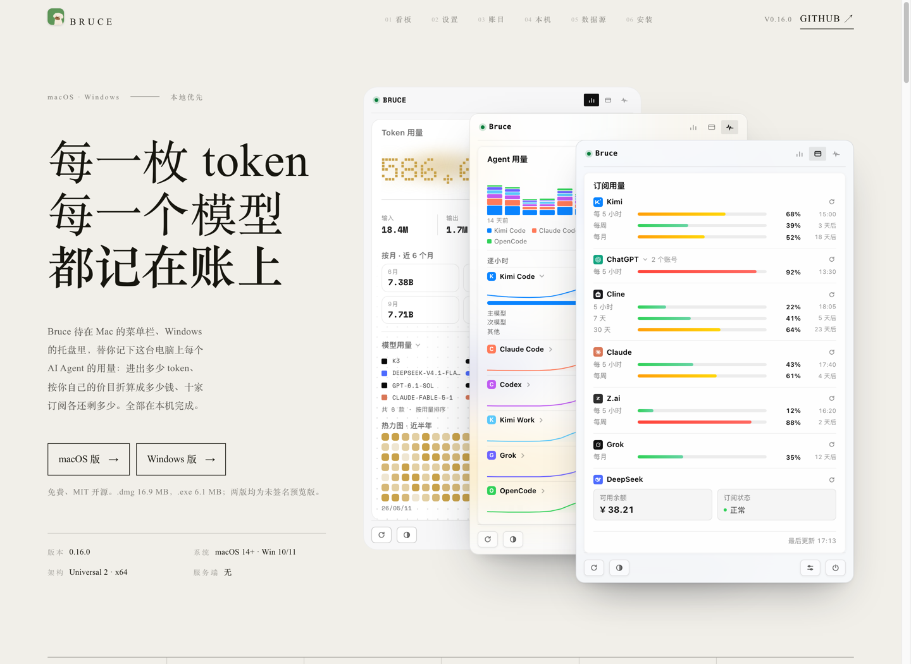
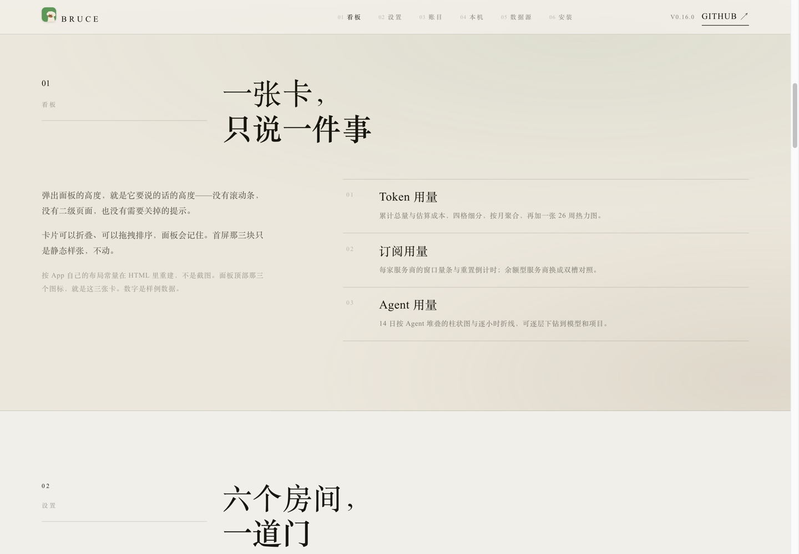
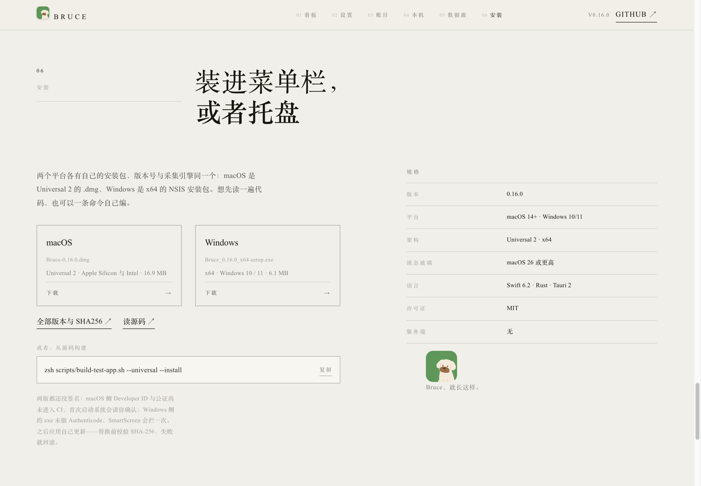
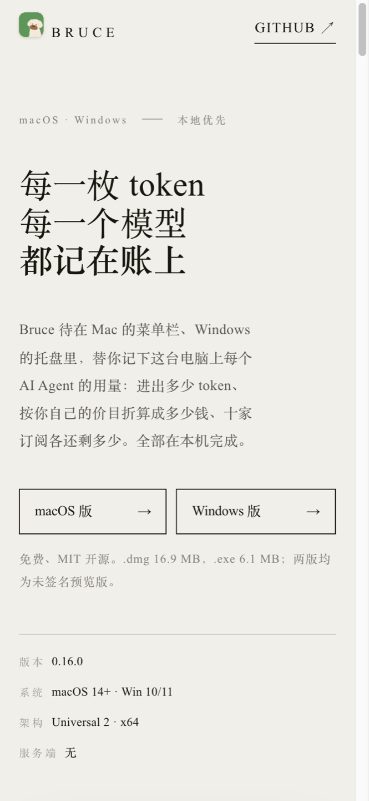

# 官方网站设计方案

<!-- @topic: OfficialWebsite -->
> **created**: 2026-11-05 ｜ **last-change**: 2026-11-06 ｜ **status**: baseline
> **文档ID**: DESIGN-WEBSITE ｜ **状态**: 现行基线（2026-11-06 批准首屏移动端适配基线变更）
> **最后更新**: 2026-11-06 ｜ **所属总体**: [00-系统总体设计.md](00-系统总体设计.md) ｜ **对应 Topic**: `OfficialWebsite`
> 📌 **变更总账**: 任务总账 [index.json](../task/index.json)（M15，T27；M17，T33）

---

## 1. 简介

官网是 Bruce 的对外门面：一页中文长卷，讲清「它是什么、界面长什么样、数据从哪来、怎么装」。它不承载业务逻辑，但承载三类容易被忽视的事实一致性——**版本号、下载资产名、品牌资产**，这三样都来自仓库本身。

迁移前，官网以 `local/designs/bruce-official-site/` 的形式存在。`local/` 按 `AGENTS.md` 第三节属于本地构建产物与草稿区，已被 `.gitignore` 整体忽略：整套站点 60 个文件、4.8 MB 没有任何版本历史，一次误删或换机即丢失；同时页面里的版本号、下载链接与厂商图标只能靠人工与 `VERSION`、`docs/assets/` 对齐。

**批准情况**：2026-11-05 维护者确认「确认搬到website」——官网源码迁入主仓 `website/`，与 App、Docs 同仓治理；发布走独立的 Pages 工作流，不与 App 的 CI/Release 混在一起。对应任务卡 `T27`。

## 2. 索引

- 文档 ID：DESIGN-WEBSITE
- 所属总体：[00-系统总体设计.md](00-系统总体设计.md)
- 关联设计：
  - [03-菜单栏状态与多风格原生渲染.md](03-菜单栏状态与多风格原生渲染.md)（面板三主题与 Nothing 点阵的源码依据）
  - [04-设置中心与价格校准交互.md](04-设置中心与价格校准交互.md)（设置窗口样张的布局依据）
  - [05-Windows平台适配.md](05-Windows平台适配.md)（Windows 版的存在事实与托盘形态）
  - [07-软件更新.md](07-软件更新.md)（版本号与 Release 产物命名的权威口径）
- 对应主题：`OfficialWebsite`
- 站点源码：`website/`
- 构建与门禁：`scripts/build-site.mjs` / `scripts/check-site-sync.mjs` / `scripts/serve-site.mjs`
- 发布流水线：`.github/workflows/site.yml`
- 执行记录：任务见 [任务总账](../task/index.json)（M15，T27）

## 3. 规范

### 3.1 定位与边界

1. **单页交付**：一张长卷，六章（看板 / 设置 / 账目 / 本机 / 数据源 / 安装），不做多页路由、不做登录、不做埋点。
2. **零依赖静态**：只用 `index.html` + CSS + 原生 JS，无构建框架、无 npm 依赖树；构建步骤只做占位符注入与产物收拢。
3. **高保真是硬要求**：面板与设置窗口不是截图，是按 App 布局常量（`website/spec/panel-spec.md`、`system-spec.md` 逐条标注源码行号）在 HTML/CSS 里重建的可交互 DOM。
4. **不碰产品逻辑**：官网不读取真实用量、不携带凭据，所有数字为样例数据并在页面注明。

### 3.2 为什么放在主仓而不是独立仓库

官网与仓库存在三处硬耦合，分仓即需跨仓同步机制：

| 耦合点 | 事实来源 | 分仓代价 |
|---|---|---|
| 版本号 | 仓库根 `VERSION` | 每次发版两处改，或引入 CI 注入 + 拉取 |
| 下载地址 | GitHub Release 资产名 `Bruce-<version>.dmg` / `Bruce_<version>_x64-setup.exe` | 需读 Release API 或手工同步 |
| 品牌图形 | `docs/assets/provider-icons/` | 需 submodule 或构建时跨仓拉取 |

同时 `AGENTS.md` 要求「设计基线 → T 卡 → 实现 → 收口」在同一个仓库闭环，分仓会把设计、实现与验收拆成两半。**代码同仓不等于发布同仓**：部署由 `site.yml` 单独触发，站点故障不影响 App 的 CI 与 Release。

只有以下情况出现才考虑拆仓：官网交给独立维护者且不愿给主仓写权限；站点引入重依赖（Astro/Next）并需要独立 CI 配额；主仓转私有而站点需公开。当前均不成立。

### 3.3 目录结构

```
website/                     # 站点源码（构建输入，不直接部署）
├── index.html
├── css/                     # base / site / panel / settings 四层
├── js/                      # data.js 样例数据、panel.js 看板、settings.js 设置窗口、site.js 页面行为
├── assets/                  # 字体子集、App 图标、厂商图形副本（构建时随站点一起复制）
├── spec/                    # 面板与系统规格摘录（源码行号证据，不参与构建）
└── tools/                   # shot.mjs 截图、responsive-check.mjs 多宽度断言（均不参与构建）
local/dist/site/             # 构建产物（gitignored，部署来源）
```

`website/spec/` 与 `website/tools/` 不进入构建白名单（构建只复制 `index.html`、`css/`、`js/`、`assets/`）。

### 3.4 构建管线与版本单一事实源

源文件不写死版本号，使用三个占位符：

| 占位符 | 取值来源 | 出现位置 |
|---|---|---|
| `{{VERSION}}` | 仓库根 `VERSION`（唯一权威值） | 页头版本、首屏规格、数据源脚注、安装规格、页脚、设置窗口样张、下载 URL 与文件名 |
| `{{DMG_SIZE}}` | GitHub Release `v<VERSION>` 的 `Bruce-<VERSION>.dmg` 字节数 | 首屏 CTA 副文案、下载卡 |
| `{{EXE_SIZE}}` | 同上，`Bruce_<VERSION>_x64-setup.exe` | 同上 |

`scripts/build-site.mjs` 负责三件事：

1. 读 `VERSION` 并校验 `x.y.z`；从 Release API 取两个资产大小，网络失败时回退 `local/build/site-release-cache.json` 的上次结果；
2. 复制构建白名单到 `local/dist/site/`（产物收拢到 `local/`，见 `AGENTS.md` 第三节）；
3. 替换占位符，替换后仍残留 `{{...}}` 直接失败；`--strict` 下资产大小未解析也失败（CI / 发布使用）。

### 3.5 品牌资产同步

订阅卡的厂商图形是 `docs/assets/provider-icons/` 的副本，`scripts/check-site-sync.mjs` 逐字节比对；不一致时 `--fix` 从源目录覆盖网站副本，绝不反向写。唯一例外是 `zai-mark.svg`：官方 SVG 是「深色圆角方块 + 白色 Z + 白描边」的组合图，官网上只取 Z 字形，方块交给徽章底色，因此该文件为手绘来源，登记在门禁的白名单里。

### 3.6 信息架构与版式

1. **首屏**：左侧巨字标题（每一枚 token / 每一个模型 / 都记在账上）＋双平台下载，右侧三种主题的面板牌堆；不带主题标尺与演示注脚。
2. **一章一屏**：每章有编号、名称、细线与标题，正文按 12 列网格排布。
3. **字体系统**：中文宋体（`Songti SC` / `STSong` / `Noto Serif CJK SC`），西文 Times New Roman；强调用字重而非斜体；中文一律不做大写转换。
4. **色彩**：纸色 `#F1EFE9`、墨色 `#17160F`、墨绿 `#4D7A52`，正文灰阶取不透明度派生；Nothing 主题内部使用琥珀 `#c9a24a` 与自己的灰阶。
5. **长卷节奏**：章节之间用留白与细线分隔，不用色块切分，保持「时装画册」气质；明确避开赛博朋克式的霓虹、扫描线与高饱和发光。

### 3.7 三个主题与牌堆

首屏牌堆由三块静态面板叠成：Nothing、液态玻璃、经典，自左向右层叠，横向步进 168、纵向步进 42，自然尺寸 776×818。牌堆按容器宽度用定宽占位容器 + `transform: scale()` 缩放，不使用非标准 `zoom`：`>1100px` 放在首屏标题右侧；`721–1100px` 整堆等比缩放、排在文案下方且三张全部保留；`≤720px` 改为三张纵向缩略叠放（当前卡展开，其余两张各留 48–56px 顶条，点顶条切换），并移到标题之后、导语之前。

- **Nothing**：Doto 点阵数字（圆度 `ROND 0` 的方形点）、Space Mono、琥珀色氛围灯、24 段刻度条、点阵 Agent 图与琥珀热力图。
- **液态玻璃**：半透明材质、模糊层与极光绿趋势线。
- **经典**：纸面卡片、细线、绿色进度条。

卡片映射固定为 Nothing → Token 用量、液态玻璃 → Agent 用量、经典 → 订阅用量；三张卡高度按内容自适应（实测约 734 / 699 / 701），牌堆高度取最高卡 + 两道纵向步进，保证横向叠放时后两张露出的是标题与大数字。

### 3.8 静态样张与交互边界

首屏面板是**静态样张**：面板内部的 tab、折叠、刷新、窗口切换全部为惰性 `span`，不绑定事件；设置窗口样张（第 02 章）保留交互（分类切换、开关、复制按钮），因为那一章要演示的是设置项本身。

移动端缩略叠放的顶条是唯一例外：它是原生 `button`，只负责把对应主题的卡切换到展开位，不触达卡内任何控件。

这条边界写进页面文案而不是靠注释，避免访客把样张当产品功能试用。

### 3.9 响应式与可访问性

1. 断点：1240 / 1100 / 980 / 720 / 620。
   - `>1100px`：首屏双栏，牌堆在标题右侧，三卡横向叠放；
   - `721–1100px`：首屏单列，牌堆在文案下方，三卡全部保留，整堆按容器宽等比缩放；
   - `≤720px`：牌堆移到标题之后、导语之前，三张纵向缩略叠放；当前卡按容器宽缩放展开（390px 约 0.85×），其余两张各留 48–56px 顶条，点顶条切换；01 章卡片同步使用同一缩放工具（320px 下约 0.69×）；
   - `≤620px`：单列、下载卡纵排、首屏双 CTA 均分整行；`≤360px` 双 CTA 改为纵向整行，避免 320px 右缘裁切。
2. 缩放与高度：牌堆与看板卡统一用定宽占位容器 + `transform: scale()`；高度由布局函数按面板实测高度计算，不写死；断点值只在 JS 常量与 CSS 媒体查询各出现一次并互相注释。
3. 语义：`header/nav/main/section` 结构、章节 `aria-labelledby`、下载链接带 `aria-label`（含文件名与大小）、面板容器 `role="group"`；移动端顶条为原生 `button` 并带 `aria-pressed`。
4. 触控：粗指针下放大卡内可点控件热区；热力图日期提示补点击显示、点空白关闭；首屏样张仍为静态，不因触控新增交互。
5. 动效：进场位移淡入 + `IntersectionObserver` 单次揭示；牌堆切换 320ms 过渡；`prefers-reduced-motion: reduce` 全部关闭。
6. 焦点：下载卡片、CTA、导航、牌堆顶条均为原生可聚焦元素，焦点态用墨色描边。

### 3.10 部署

`.github/workflows/site.yml`：仅当 `website/**`、`docs/assets/provider-icons/**`、`scripts/build-site.mjs`、`scripts/check-site-sync.mjs`、`VERSION` 或该工作流自身变化时触发；构建前跑 `check-site-sync.mjs`，构建用 `--strict`，产物 `local/dist/site` 经 `upload-pages-artifact` 交给 GitHub Pages。

站点使用全相对路径（`css/base.css`、`assets/...`），可直接部署在 `https://<owner>.github.io/<repo>/` 子路径下；自定义域名与 CDN 待定。

## 4. 契约

### 4.1 构建契约

| 项 | 约定 |
|---|---|
| 输入 | `website/` 白名单目录 + 根 `VERSION` + GitHub Release 元数据（或本地缓存） |
| 输出 | `local/dist/site/`（每次构建先清空重建） |
| 占位符 | 仅 `{{VERSION}}` / `{{DMG_SIZE}}` / `{{EXE_SIZE}}`，其余 `{{...}}` 视为缺陷 |
| 退出码 | 0 成功；1 版本非法、白名单缺失、残留占位符或 `--strict` 下大小未解析 |
| 网络 | 只读 GitHub Releases；不写远端、不携带凭据（`GITHUB_TOKEN` 可选，仅提权限） |

### 4.2 门禁契约

`node scripts/check-site-sync.mjs`（`verify-local.sh` 与 `site.yml` 同跑）四条断言：

1. `website/` 源文件不得出现三段式写死版本号（先剥掉内联 SVG 的 `d` 属性再扫描）；
2. 必备占位符存在（页面与设置样张各有 `{{VERSION}}`，页面含两个大小占位符）；
3. 被 `js/data.js` 引用的厂商图标必须存在，且与 `docs/assets/provider-icons/` 逐字节一致（`zai-mark.svg` 白名单例外）；
4. `README.md` 版本徽章与「当前版本」行必须等于根 `VERSION`。

### 4.3 本地预览契约

```bash
node scripts/build-site.mjs      # 注入版本与资产大小 → local/dist/site
node scripts/serve-site.mjs 4311 # 只服务构建产物，端口默认 4311
```

禁止直接以 `file://` 或源码目录作为验收对象：源码含占位符，且厂商图标需随构建复制。

## 5. 验收依据

| 验收项 | 通过条件 | 证据 |
|---|---|---|
| 站点可构建 | `build-site.mjs --strict` 退出码 0，产物位于 `local/dist/site/` 且无占位符残留 | `local-20261105-01` |
| 同步门禁 | `check-site-sync.mjs` 退出码 0 | 同上 |
| 版本一致 | 构建产物中版本号、下载 URL、README 徽章均等于 `VERSION` | 同上 |
| 视觉回归 | 首屏 / 看板 / 安装 / 移动端截图与 `docs/assets/screenshots/site-*.png` 一致 | 截图文件 |
| 响应式 | 320 / 390 / 768 / 1100 / 1101 / 1440 下首屏可见牌堆，`721–1100` 保留三卡，`≤720` 三张顶条可切换，且无横向溢出 | Playwright 双内核截图与断言 |
| 部署 | `site.yml` 在 `website/**` 变更时触发，Pages 可访问 | 待推送后核实 |

## 6. 设计纪要与踩坑

### 6.1 为什么不是「赛博朋克」

最初的直觉是深色 + 霓虹 + 网格，但那是仪表盘的语法，不是消费级产品的语法。最终选择纸色底 + 宋体 + 极细线条的「时装画册」方向：它把注意力留给版式与留白，也让「记账」这件事显得克制、可信。

### 6.2 字体：中文宋体，西文 Times

`--serif` 栈为 `"Times New Roman", "Songti SC", "STSong", "Noto Serif CJK SC", "Noto Serif SC", serif`。中文强调用 `font-weight: 700` 而不是 `italic`（宋体伪斜体观感差）；中文不做 `text-transform: uppercase`。

**踩坑（Doto 静默回退）**：Nothing 主题的点阵数字第一次渲染成衬线体——`document.fonts.check("40px Doto")` 仍返回 `true`。根因是下载的 woff2 是 latin-ext 子集，不含 `U+0030-0039` 数字区，浏览器对缺字符静默回退。换成 latin 子集（`unicode-range: U+0000-00FF`）后恢复。教训：字体「加载成功」不等于「字形存在」。

**踩坑（CSS 覆盖）**：同一个 `.bp-hero__num` 规则被脚本追加了六次，先出现的旧规则反而生效，数字字号一直是错的。收口为唯一权威块并加注释。

### 6.3 高保真的做法：从源码常数重建

面板与设置窗口的尺寸、圆角、行高、色值全部取自 Swift 源码，摘录在 `website/spec/` 并标注 `文件:行号`。这让「像不像」变成可核对的问题，而不是审美争论。

### 6.4 厂商图形

**踩坑（色块）**：徽章最初用 CSS `mask` 加 `url(../assets/...)`，但图标地址写在**行内 style** 里——行内样式中的相对 URL 相对 HTML 文档解析，而非相对 CSS 文件，于是全部 404，只剩底色色块。改为文档相对路径 + `` + `filter: brightness(0) invert(1)`，并保留单字回退。

**踩坑（Z.ai）**：官方 SVG 是组合图（深色圆角方块 + 白 Z + 白描边）。整图染色后方块与 Z 都变白，糊成一个白框。最终只提取 Z 字形的三段路径生成 `zai-mark.svg`，方块交给徽章底色。

### 6.5 首屏收口

牌堆下方原本挂着主题标尺与「三块都是静态样张，不能点」的说明，后来整块移除：首屏三块面板本身就是产品画面，注脚会把注意力拉回「这是张图」；主题名与卡片名已在下方案例章节出现过一次。

### 6.6 双平台下载

Bruce 有 macOS 与 Windows 两版（Windows 为 Tauri 托盘应用，见 design/05）。首屏给两颗 CTA，安装章节给两张下载卡（文件名、架构、大小、下载），链接直指 Release 资产而非发布列表页；版本与大小由构建注入，页面不写死。

### 6.7 首屏牌堆的移动端适配（2026-11-06）

原基线在 `≤1100px` 只保留经典一块，并把牌堆整块排到文案下方。实测 1100px 与 1101px 只差 1px，牌堆却从首屏右侧（y≈117）跳到文案下方（y≈910）：手机首屏与窄桌面窗口都看不到卡片，三卡展示形态也不存在。

现改为三档：`>1100` 横向三卡、`721–1100` 保留三卡并整堆缩放、`≤720` 纵向缩略叠放且移到标题之后。缩放从 `zoom` 换成定宽占位容器 + `transform: scale()`：`zoom` 非标准，旧 Firefox/WebView 会失效并把 440px 卡塞进窄容器；且 `sizeDeck()` 与 `fit()` 同时写 inline 高度，窄→宽 resize 后牌堆会沿用 CSS 的固定 1004px，比实际内容多出约 186px 空白。高度此后一律由单一布局函数计算。

## 7. 待定事项

1. **部署域名**：先用 `github.io/<repo>` 子路径验证，自定义域名与 CDN 方案待定；
2. **Windows 文案深度**：目前只在安装章节出现双平台下载，是否单开一段讲托盘形态与 WebView2 待定；
3. **英文版**：字体系统已把西文交给 Times，若做 `/?lang=en` 只需补一份文案；
4. **数据真实性**：全站为样例数据，是否替换为一次真实采集的 Artifact 待定；
5. **落地形态**：当前为手写静态站；若后续要复用 `docs/` 的 Markdown，再评估 Astro 等方案。

## 附录 A：面板与系统规格

- [panel-spec.md](../../../website/spec/panel-spec.md)：菜单栏面板的尺寸、圆角、字号、色值与阈值（逐条标注 Swift 源码行号）
- [system-spec.md](../../../website/spec/system-spec.md)：设置窗口、菜单栏指示器、品牌与文案口径

## 附录 B：站点截图

| 位置 | 截图 |
|---|---|
| 首屏（三主题牌堆 + 双平台下载） |  |
| 看板章节（卡片解剖） |  |
| 安装章节（双平台下载卡） |  |
| 移动端首屏 |  |
