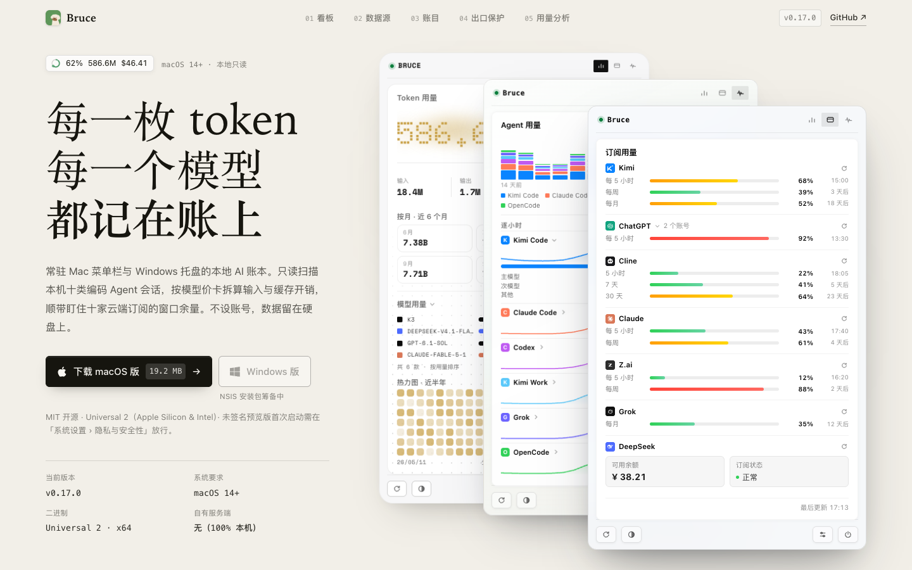
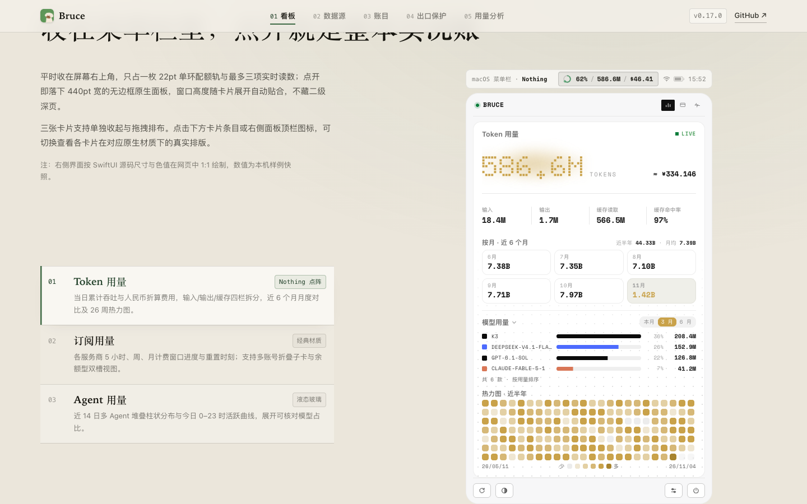
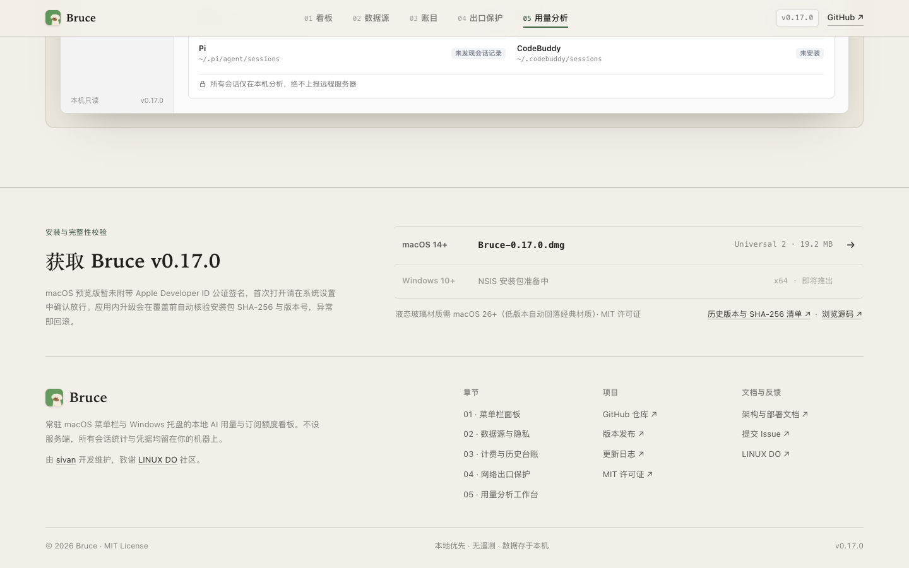
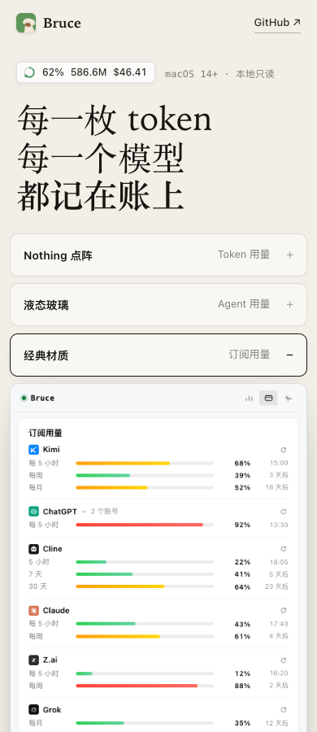

# 官方网站设计方案

<!-- @topic: OfficialWebsite -->
> **last-change**: 2026-11-18 ｜ **status**: baseline
> **文档ID**: DESIGN-WEBSITE ｜ **状态**: 现行基线（2026-11-18 校准五章信息架构、首屏叠牌前置预览、去 AI 腔版式规范与全站强制开启动效）
> **最后更新**: 2026-11-18 ｜ **所属总体**: [00-系统总体设计.md](00-系统总体设计.md) ｜ **对应 Topic**: `OfficialWebsite`
> 📌 **变更总账**: 任务总账 [index.json](../task/index.json)（M15，T27；M17，T33）｜ 变更总账 [index.json](../change/index.json)（C244、C245、C247）

---

## 1. 简介

官网是 Bruce 的对外门面：一页中文长卷，讲清「它是什么、界面长什么样、数据从哪来、怎么装」。它不承载业务逻辑，但承载三类容易被忽视的事实一致性——**版本号、下载资产名、品牌资产**，这三样都来自仓库本身。

迁移前，官网以 `local/designs/bruce-official-site/` 的形式存在。`local/` 按 `AGENTS.md` 第三节属于本地构建产物与草稿区，已被 `.gitignore` 整体忽略：整套站点 60 个文件、4.8 MB 没有任何版本历史，一次误删或换机即丢失；同时页面里的版本号、下载链接与厂商图标只能靠人工与 `VERSION`、`docs/assets/` 对齐。

**批准情况**：2026-11-05 维护者确认「确认搬到website」——官网源码迁入主仓 `website/`，与 App、Docs 同仓治理；发布走独立的 Pages 工作流，不与 App 的 CI/Release 混在一起。对应任务卡 `T27`。

## 2. 索引

- 文档 ID：DESIGN-WEBSITE
- 所属总体：[00-系统总体设计.md](00-系统总体设计.md)
- 关联设计：
  - [03-菜单栏状态与多风格原生渲染.md](03-菜单栏状态与多风格原生渲染.md)（面板三主题与 Nothing 点阵的源码依据）
  - [04-设置中心与价格校准交互.md](04-设置中心与价格校准交互.md)（设置窗口样张的布局依据）
  - [05-Windows平台适配.md](05-Windows平台适配.md)（Windows 版的存在事实与托盘形态）
  - [07-软件更新.md](07-软件更新.md)（版本号与 Release 产物命名的权威口径）
- 对应主题：`OfficialWebsite`
- 站点源码：`website/`
- 构建与门禁：`scripts/build-site.mjs` / `scripts/check-site-sync.mjs` / `scripts/serve-site.mjs`
- 发布流水线：`.github/workflows/site.yml`
- 执行记录：任务见 [任务总账](../task/index.json)（M15，T27）

## 3. 规范

### 3.1 定位与边界

1. **单页交付**：一张长卷，五章（01 看板 / 02 数据源 / 03 账目 / 04 出口保护 / 05 用量分析）加页脚下载与验证台账，不做多页路由、不做登录、不做埋点。
2. **零依赖静态**：只用 `index.html` + CSS + 原生 JS，无构建框架、无 npm 依赖树；构建步骤只做占位符注入与产物收拢。
3. **高保真是硬要求**：菜单栏 22pt 状态项、弹出面板、出口保护设置与用量分析工作台均不是截图，而是按 App 布局常量（`website/spec/panel-spec.md`、`system-spec.md` 逐条标注源码行号）在 HTML/CSS 里重建的 DOM。
4. **不碰产品逻辑**：官网不读取真实用量、不携带凭据，所有数字为样例数据并在页面注明。
5. **平实克制的工程表达**：拒绝对称排比金句、机翻隐喻、页面自指说明（如在页脚报出字体栈与色值）及营销浮夸辞藻；用具体的数据源路径、权限数字、计费规则与窗口口径说话。

### 3.2 为什么放在主仓而不是独立仓库

官网与仓库存在三处硬耦合，分仓即需跨仓同步机制：

| 耦合点 | 事实来源 | 分仓代价 |
|---|---|---|
| 版本号 | 仓库根 `VERSION` | 每次发版两处改，或引入 CI 注入 + 拉取 |
| 下载地址 | GitHub Release 资产名 `Bruce-<version>.dmg` / `Bruce_<version>_x64-setup.exe` | 需读 Release API 或手工同步 |
| 品牌图形 | `docs/assets/provider-icons/` | 需 submodule 或构建时跨仓拉取 |

同时 `AGENTS.md` 要求「设计基线 → T 卡 → 实现 → 收口」在同一个仓库闭环，分仓会把设计、实现与验收拆成两半。**代码同仓不等于发布同仓**：部署由 `site.yml` 单独触发，站点故障不影响 App 的 CI 与 Release。

只有以下情况出现才考虑拆仓：官网交给独立维护者且不愿给主仓写权限；站点引入重依赖（Astro/Next）并需要独立 CI 配额；主仓转私有而站点需公开。当前均不成立。

### 3.3 目录结构

```
website/                     # 站点源码（构建输入，不直接部署）
├── index.html
├── css/                     # base / site / panel / settings 四层样式
├── js/                      # data.js 样例数据、panel.js 看板与菜单栏状态项、egress.js 出口保护、analysis.js 分析工作台、settings.js 设置基线、site.js 页面行为、preview-fallback.js 预览兜底
├── assets/                  # 字体子集、App 图标、Agent 与厂商图形副本（构建时随站点一起复制）
├── spec/                    # 面板与系统规格摘录（源码行号证据，不参与构建）
└── tools/                   # shot.mjs 截图、responsive-check.mjs 多宽度断言（均不参与构建）
local/dist/site/             # 构建产物（gitignored，部署来源）
```

`website/spec/` 与 `website/tools/` 不进入构建白名单（构建只复制 `index.html`、`css/`、`js/`、`assets/`）。

### 3.4 构建管线与版本单一事实源

源文件不写死版本号，使用三个占位符：

| 占位符 | 取值来源 | 出现位置 |
|---|---|---|
| `{{VERSION}}` | 仓库根 `VERSION`（唯一权威值） | 页头版本、首屏规格、数据源脚注、安装规格、页脚、设置窗口样张、下载 URL 与文件名 |
| `{{DMG_SIZE}}` | GitHub Release `v<VERSION>` 的 `Bruce-<VERSION>.dmg` 字节数 | 首屏 CTA 副文案、下载卡 |
| `{{EXE_SIZE}}` | 同上，`Bruce_<VERSION>_x64-setup.exe` | 同上 |

`scripts/build-site.mjs` 负责三件事：

1. 读 `VERSION` 并校验 `x.y.z`；从 Release API 取两个资产大小，网络失败时回退 `local/build/site-release-cache.json` 的上次结果；
2. 复制构建白名单到 `local/dist/site/`（产物收拢到 `local/`，见 `AGENTS.md` 第三节）；
3. 替换占位符，替换后仍残留 `{{...}}` 直接失败；`--strict` 下资产大小未解析也失败（CI / 发布使用）。

### 3.5 品牌资产同步

订阅卡的厂商图形是 `docs/assets/provider-icons/` 的副本，`scripts/check-site-sync.mjs` 逐字节比对；不一致时 `--fix` 从源目录覆盖网站副本，绝不反向写。唯一例外是 `zai-mark.svg`：官方 SVG 是「深色圆角方块 + 白色 Z + 白描边」的组合图，官网上只取 Z 字形，方块交给徽章底色，因此该文件为手绘来源，登记在门禁的白名单里。

### 3.6 信息架构与版式

1. **首屏**：左侧眉标含 22pt 原生菜单栏状态项微缩样张（单环配额轨 + 最多三项等宽实时指标）、巨字主标题、平实导语与双平台下载，右侧三种主题的面板牌堆与底线样例提示栏。
2. **章节标头与网格**：采用纸面台账顶线分栏（左侧章节号与名称、右侧工程规格短注），取代装饰性圆点眉标；正文按 12 列网格排布。
3. **字体分工**：大标题、章节题与导语采用衬线栈（`Iowan Old Style` / `Palatino` / `Times New Roman` + `Songti SC` / `STSong` / `Noto Serif CJK SC`），保留纸质印品的呼吸感；密集技术条目、暗底说明、规格表与产品界面内部统一使用系统无衬线与等宽数字，保证小字号与深色背景下的清晰度。大小写混排专有名词（`macOS`、`Windows`、`Nothing`、`GitHub`）严禁施加宽字距，宽字距仅用于全大写缩写与章节编号。
4. **色彩**：纸色 `#F1EFE9`、抬升纸面 `#F8F6F1`、墨色 `#17160F`、墨绿 `#3F6A45`，正文灰阶取不透明度派生；04 章出口保护采用深墨底盘形成长卷节奏对照；Nothing 主题内部使用琥珀 `#C9A24A` 与专属点阵色阶。
5. **长卷节奏**：章节之间用留白、纸面冷暖层级与 1px 细线分隔，明确避开赛博朋克霓虹、渐变发光卡片墙与仪表盘装饰徽章堆砌。

### 3.7 三个主题与牌堆

首屏牌堆由三块面板叠成：Nothing、液态玻璃、经典，自左向右层叠，横向步进 168、纵向步进 42，自然尺寸 776×818。牌堆按容器宽度用定宽占位容器 + `transform: scale()` 缩放，不使用非标准 `zoom`：`>1100px` 放在首屏标题右侧；`721–1100px` 整堆等比缩放、排在文案下方且三张全部保留；`≤720px` 改为三张纵向缩略叠放（当前卡展开，其余两张各留 48–56px 顶条，点顶条切换），并移到标题之后、导语之前。

- **Nothing**：Doto 点阵数字（圆度 `ROND 0` 的方形点）、Space Mono、琥珀色氛围灯、24 段刻度条、点阵 Agent 图与琥珀热力图（含匹配色阶图例）。
- **液态玻璃**：高不透明度磨砂玻璃底板与镜面高光边（避免叠放时下层面板文字透印串行）及趋势线。
- **经典**：纸面卡片、细线、绿色进度条。

卡片映射固定为 Nothing → Token 用量、液态玻璃 → Agent 用量、经典 → 订阅用量；三张卡高度按内容自适应，牌堆高度取最高卡 + 两道纵向步进。桌面叠放态默认经典置前，访客直接点击叠堆中的任意后排面板即可将该主题按物理槽位顺滑发牌至前景完整检视，其余两张维持相对层级顺滑退居中后排；牌堆底部仅保留极简细线与“点击任意面板提至前景 · 样例数据”提示（不堆叠额外切换按钮），01 章左侧切换栏与 05 章分段控制条配备滑动指示器。

### 3.8 样张与交互边界

首屏面板内部控件（tab、折叠、刷新、窗口切换）全部为惰性 `span`，不触发应用级操作；仅允许直接点击叠放面板（桌面端）或移动端顶条 `button` 切换前置展示的主题卡，避免后两张卡长期被遮挡裁切。

01 章看板配备联动的 22pt 菜单栏状态条与三卡双向过渡（含手风琴展开高度跟随与配额条舒展动效），04 章出口保护与 05 章用量分析采用持久化 DOM 骨架与原地更新机制，保留完整的页内交互演示（通道重测连续收起、卡片斜向换位、新建通道弹窗渐变显隐、五档时间范围 KPI 滚动插值、零重建时序十字准星、归并/原始渠道抽屉与导出预览），所有样例边界在文案中平实点明。

### 3.9 响应式与可访问性

1. 断点：1240 / 1100 / 980 / 720 / 620。
   - `>1100px`：首屏双栏，牌堆在标题右侧，三卡横向叠放；
   - `721–1100px`：首屏单列，牌堆在文案下方，三卡全部保留，整堆按容器宽等比缩放；
   - `≤720px`：牌堆移到标题之后、导语之前，三张纵向缩略叠放；当前卡按容器宽缩放展开（390px 约 0.85×），其余两张各留 48–56px 顶条，点顶条切换；01 章卡片同步使用同一缩放工具（320px 下约 0.69×）；
   - `≤620px`：单列、下载卡纵排、首屏双 CTA 均分整行；`≤360px` 双 CTA 改为纵向整行，避免 320px 右缘裁切。
2. 缩放与高度：牌堆与看板卡统一用定宽占位容器 + `transform: scale()`；高度由布局函数按面板实测高度计算，不写死；断点值只在 JS 常量与 CSS 媒体查询各出现一次并互相注释。
3. 语义：`header/nav/main/section` 结构、章节 `aria-labelledby`、下载链接带 `aria-label`（含文件名与大小）、面板容器 `role="group"`；移动端顶条为原生 `button` 并带 `aria-pressed`；顶栏右上角提供指向维护者个人 GitHub Pages（`https://4eversivan.github.io/`）的图标链接，新窗口打开并带明确 `aria-label`，浅色与 04 章深色顶栏均保持可辨识。
4. 触控：粗指针下放大卡内可点控件热区；热力图日期提示补点击显示、滑动浮标连续跟随、点空白关闭；首屏样张仍为静态，不因触控新增交互。
5. 动效：建立 `--ease-silk` / `--ease-morph` 连续缓动语义；首屏牌堆支持初始扇面入场与物理槽位发牌切换；01 章双向层叠切换与量条/曲线渐进绘制；03 章热力图对角线波纹与四项台账滚入；04/05 章采用 `grid-template-rows: 0fr↔1fr` 抽屉、滑块指示器与原地十字准星，避免整块 `innerHTML` 重建闪跳；按维护者要求，官网全站展示动效强制开启，不因宿主操作系统启用「减弱动态效果」（`prefers-reduced-motion: reduce`）而静音。
6. 焦点：下载卡片、CTA、导航、牌堆顶条均为原生可聚焦元素，焦点态用墨色描边。

### 3.10 部署

`.github/workflows/site.yml`：仅当 `website/**`、`docs/assets/provider-icons/**`、`scripts/build-site.mjs`、`scripts/check-site-sync.mjs`、`VERSION` 或该工作流自身变化时触发；构建前跑 `check-site-sync.mjs`，构建用 `--strict`，产物 `local/dist/site` 经 `upload-pages-artifact` 交给 GitHub Pages。

站点使用全相对路径（`css/base.css`、`assets/...`），可直接部署在 `https://<owner>.github.io/<repo>/` 子路径下；自定义域名与 CDN 待定。

## 4. 契约

### 4.1 构建契约

| 项 | 约定 |
|---|---|
| 输入 | `website/` 白名单目录 + 根 `VERSION` + GitHub Release 元数据（或本地缓存） |
| 输出 | `local/dist/site/`（每次构建先清空重建） |
| 占位符 | 仅 `{{VERSION}}` / `{{DMG_SIZE}}` / `{{EXE_SIZE}}`，其余 `{{...}}` 视为缺陷 |
| 退出码 | 0 成功；1 版本非法、白名单缺失、残留占位符或 `--strict` 下大小未解析 |
| 网络 | 只读 GitHub Releases；不写远端、不携带凭据（`GITHUB_TOKEN` 可选，仅提权限） |

### 4.2 门禁契约

`node scripts/check-site-sync.mjs`（`verify-local.sh` 与 `site.yml` 同跑）四条断言：

1. `website/` 源文件不得出现三段式写死版本号（先剥掉内联 SVG 的 `d` 属性再扫描）；
2. 必备占位符存在（页面与设置样张各有 `{{VERSION}}`，页面含两个大小占位符）；
3. 被 `js/data.js` 引用的厂商图标必须存在，且与 `docs/assets/provider-icons/` 逐字节一致（`zai-mark.svg` 白名单例外）；
4. `README.md` 版本徽章与「当前版本」行必须等于根 `VERSION`。

### 4.3 本地预览契约

```bash
node scripts/build-site.mjs      # 注入版本与资产大小 → local/dist/site
node scripts/serve-site.mjs 4311 # 只服务构建产物，端口默认 4311
```

禁止直接以 `file://` 或源码目录作为验收对象：源码含占位符，且厂商图标需随构建复制。

## 5. 验收依据

| 验收项 | 通过条件 | 证据 |
|---|---|---|
| 站点可构建 | `build-site.mjs --strict` 退出码 0，产物位于 `local/dist/site/` 且无占位符残留 | `local-20261105-01` |
| 同步门禁 | `check-site-sync.mjs` 退出码 0 | 同上 |
| 版本一致 | 构建产物中版本号、下载 URL、README 徽章均等于 `VERSION` | 同上 |
| 视觉回归 | 首屏 / 看板 / 安装 / 移动端截图与 `docs/assets/screenshots/site-*.png` 一致 | 截图文件 |
| 响应式 | 320 / 390 / 768 / 1100 / 1101 / 1440 下首屏可见牌堆，`721–1100` 保留三卡，`≤720` 三张顶条可切换，且无横向溢出 | Playwright 双内核截图与断言 |
| 部署 | `site.yml` 在 `website/**` 变更时触发，Pages 可访问 | 待推送后核实 |

## 6. 设计纪要与踩坑

### 6.1 为什么不是「赛博朋克」

最初的直觉是深色 + 霓虹 + 网格，但那是仪表盘的语法，不是消费级产品的语法。最终选择纸色底 + 宋体 + 极细线条的「时装画册」方向：它把注意力留给版式与留白，也让「记账」这件事显得克制、可信。

### 6.2 字体：中文宋体，西文 Times

`--serif` 栈为 `"Times New Roman", "Songti SC", "STSong", "Noto Serif CJK SC", "Noto Serif SC", serif`。中文强调用 `font-weight: 700` 而不是 `italic`（宋体伪斜体观感差）；中文不做 `text-transform: uppercase`。

**踩坑（Doto 静默回退）**：Nothing 主题的点阵数字第一次渲染成衬线体——`document.fonts.check("40px Doto")` 仍返回 `true`。根因是下载的 woff2 是 latin-ext 子集，不含 `U+0030-0039` 数字区，浏览器对缺字符静默回退。换成 latin 子集（`unicode-range: U+0000-00FF`）后恢复。教训：字体「加载成功」不等于「字形存在」。

**踩坑（CSS 覆盖）**：同一个 `.bp-hero__num` 规则被脚本追加了六次，先出现的旧规则反而生效，数字字号一直是错的。收口为唯一权威块并加注释。

### 6.3 高保真的做法：从源码常数重建

面板与设置窗口的尺寸、圆角、行高、色值全部取自 Swift 源码，摘录在 `website/spec/` 并标注 `文件:行号`。这让「像不像」变成可核对的问题，而不是审美争论。

### 6.4 厂商图形

**踩坑（色块）**：徽章最初用 CSS `mask` 加 `url(../assets/...)`，但图标地址写在**行内 style** 里——行内样式中的相对 URL 相对 HTML 文档解析，而非相对 CSS 文件，于是全部 404，只剩底色色块。改为文档相对路径 + `` + `filter: brightness(0) invert(1)`，并保留单字回退。

**踩坑（Z.ai）**：官方 SVG 是组合图（深色圆角方块 + 白 Z + 白描边）。整图染色后方块与 Z 都变白，糊成一个白框。最终只提取 Z 字形的三段路径生成 `zai-mark.svg`，方块交给徽章底色。

### 6.5 首屏收口

牌堆下方原本挂着主题标尺与「三块都是静态样张，不能点」的说明，后来整块移除：首屏三块面板本身就是产品画面，注脚会把注意力拉回「这是张图」；主题名与卡片名已在下方案例章节出现过一次。

### 6.6 双平台下载

Bruce 有 macOS 与 Windows 两版（Windows 为 Tauri 托盘应用，见 design/05）。首屏给两颗 CTA，安装章节给两张下载卡（文件名、架构、大小、下载），链接直指 Release 资产而非发布列表页；版本与大小由构建注入，页面不写死。Windows NSIS 安装包（`Bruce_<version>_x64-setup.exe`）已就绪，双端下载入口均指向 Release 资产。

产品数据口径（C267）：官网展示 **11 类本机会话 Agent**（含 Antigravity）与 **11 家云端订阅**（含 Grok Bot），Kimi Code CLI 路径为 `~/.kimi-code/sessions`，StepFun 为 5 小时/每周窗口；官网数据与仓库真实探针/Provider 注册表由 `tests/unit/u_website_contract.test.mjs` 做一致性守卫。

### 6.7 首屏牌堆的移动端适配（2026-11-06）

原基线在 `≤1100px` 只保留经典一块，并把牌堆整块排到文案下方。实测 1100px 与 1101px 只差 1px，牌堆却从首屏右侧（y≈117）跳到文案下方（y≈910）：手机首屏与窄桌面窗口都看不到卡片，三卡展示形态也不存在。

现改为三档：`>1100` 横向三卡、`721–1100` 保留三卡并整堆缩放、`≤720` 纵向缩略叠放且移到标题之后。缩放从 `zoom` 换成定宽占位容器 + `transform: scale()`：`zoom` 非标准，旧 Firefox/WebView 会失效并把 440px 卡塞进窄容器；且 `sizeDeck()` 与 `fit()` 同时写 inline 高度，窄→宽 resize 后牌堆会沿用 CSS 的固定 1004px，比实际内容多出约 186px 空白。高度此后一律由单一布局函数计算。

### 6.8 视觉精修、去 AI 腔与连续动效编排（C244，2026-11-18）

1. **叠牌透印与遮挡**：液态玻璃面板最初直接套用 `rgba(255,255,255,0.46)` 低不透明度底色，叠在 Nothing 卡片上方时，下层的 `586.6M` 点阵与热力图直接透印到 `Agent 用量` 文字背后导致重影；同时后排两卡不可前置，标题被长期半截遮挡。提高叠放态磨砂底板不透明度并允许点击后排卡或底部主题引线前置检视，彻底消除文字透印。
2. **补齐菜单栏锚点与双源目录**：页面反复提及「22pt 单环配额弧」与「十个 Agent、十家订阅」，但原先既无菜单栏状态项实物，也只用 132px 超大无字图标跑马灯展示品牌。现按 `system-spec.md §1.3` 几何常数补齐首屏与 01 章联动的 22pt 菜单栏状态条，并在 02 章收敛图标尺寸、新增本机会话（10）与云端订阅（10）双栏名录。
3. **版式与文案去 AI 味**：清理全站对称两段式金句标题、机翻隐喻（「还没有发生的日子」等）、页脚自报字体色值及 `.skip-link` 越界显露、Nothing 热力图图例色阶错配、宽字距拉散 `macOS` / `Nothing` 等混排拉丁词的问题；同时清理 `site.css` 多轮追加遗留的冗余覆盖规则，统一分析工作台与出口保护样张的原生克制质感。
4. **连续过渡与持久化 DOM（消除切卡/手风琴/图表生硬闪跳）**：梳理原站点五处高频交互发现生硬感主要来自每次点击整块 `innerHTML` 重建与硬切 `z-index` / `[hidden]`——现统一引入 `--ease-silk` 与 `--ease-morph` 曲线：首屏叠牌改用物理 `slotOrder` 发牌位移与提升弧线；底部切换栏、01 章选项卡及 05 章分段器改用测量位移的浮动滑块指示器；01 章看板改为双向层叠进退场、菜单栏皮肤胶囊轻弹、量条/曲线渐进绘制及手风琴高度 RAF 跟踪；03 章增加热力图对角波纹、四项台账数字滚入及平滑跟随 Tooltip；04/05 章重构为持久化 DOM 骨架 + `grid-template-rows: 0fr↔1fr` 抽屉与弹窗缩放显隐，并实现 05 章时序十字准星原地高频跟随与 KPI 数值插值滚动。
5. **全站强制开启动效（C245，2026-11-18）**：原先 CSS 中全局 `@media (prefers-reduced-motion: reduce)` 会把 `animation-duration` / `transition-duration` 压至 `0.001ms !important` 且 JS 侧监听 `reduceMq.matches` 跳过动画，导致在开启系统「减弱动态效果」的机器上无法预览上述动效。经维护者明确要求，移除 CSS 与 JS 对 `prefers-reduced-motion` 的静默降级判断，使官网作为交互样张展示页强制保留全部动画效果。

## 7. 待定事项

1. **部署域名**：先用 `github.io/<repo>` 子路径验证，自定义域名与 CDN 方案待定；
2. **Windows 文案深度**：目前只在安装章节出现双平台下载，是否单开一段讲托盘形态与 WebView2 待定；
3. **英文版**：字体系统已把西文交给 Times，若做 `/?lang=en` 只需补一份文案；
4. **数据真实性**：全站为样例数据，是否替换为一次真实采集的 Artifact 待定；
5. **落地形态**：当前为手写静态站；若后续要复用 `docs/` 的 Markdown，再评估 Astro 等方案。

## 附录 A：面板与系统规格

- [panel-spec.md](../../../website/spec/panel-spec.md)：菜单栏面板的尺寸、圆角、字号、色值与阈值（逐条标注 Swift 源码行号）
- [system-spec.md](../../../website/spec/system-spec.md)：设置窗口、菜单栏指示器、品牌与文案口径

## 附录 B：站点截图

| 位置 | 截图 |
|---|---|
| 首屏（三主题牌堆 + 双平台下载） |  |
| 看板章节（卡片解剖） |  |
| 安装章节（双平台下载卡） |  |
| 移动端首屏 |  |
