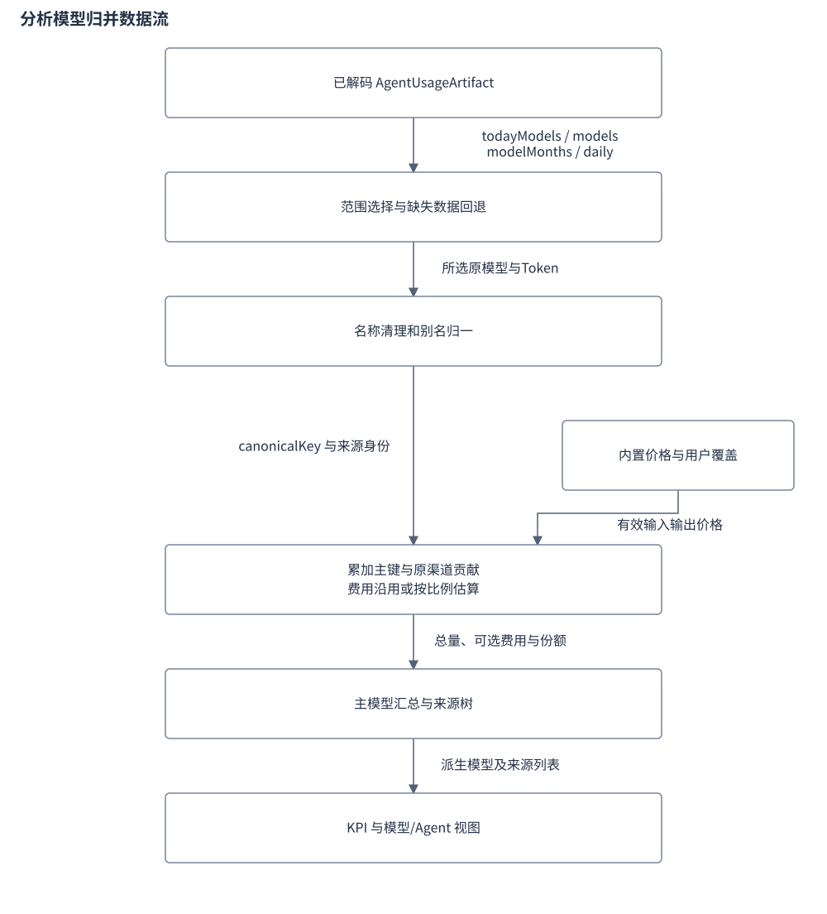
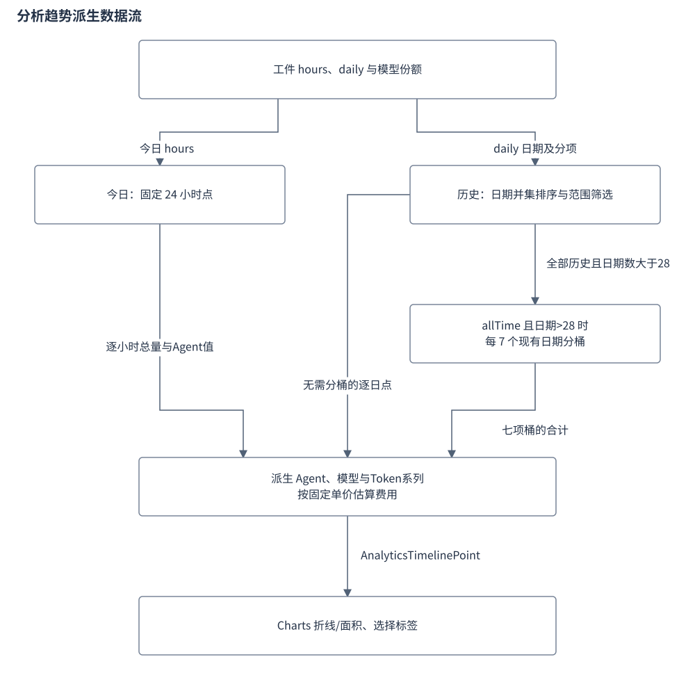
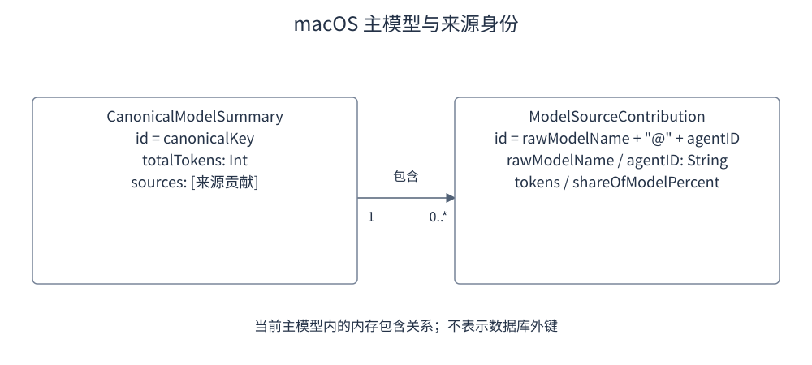

# Agent 用量分析设计

设置中心的 Agent 用量工作台以已缓存的 `AgentUsageArtifact` 为输入，在内存中生成 KPI、模型归并结果、趋势和 Agent 对比。切换视图只更新分析结果；探针重检则交由协调器触发会话扫描。模型归并、历史比例分配和费用估算的精度不同，界面数字应按各自的数据来源解释，不能统一视为原始逐笔计量。

本文的分析算法属于 macOS。Windows 新工作台使用 PanelViewModel 和独立 JavaScript 派生，范围、别名与费用规则见 [Windows 用量工作台设计](Windows用量工作台设计.md)。

## 目录

- [1. 目标](#chapter-1)
- [2. 设计](#chapter-2)
  - [2.1 时间范围与 KPI](#time-kpi)
  - [2.2 模型归一化与渠道贡献](#model-normalization)
  - [2.3 趋势、Agent 与项目下钻](#analytics-display)
  - [2.4 探针与导出](#export)
- [3. 流程](#chapter-3)
  - [3.1 模型数据归并](#model-flow)
  - [3.2 时间桶与趋势系列](#timeline-flow)
- [4. 数据与接口](#chapter-4)
- [5. 异常与边界](#chapter-5)
- [6. 验证要点](#chapter-6)
- [7. 参考文献](#chapter-7)

## 1. 目标

**功能需求**：用户要在设置页查看所选时间范围的 KPI、趋势、模型汇总和 Agent 下钻，并可重新检查来源、导出 CSV 或完整工件 JSON；分析只消费已解码工件，不替代 Collector 的原始统计。

**方案机制**：原分析设计面向宽窗口工作台，要求提供五档时间范围、四格 KPI、四类趋势、跨源模型归并、Agent 与项目下钻，以及 CSV/JSON 导出。当前入口是 `SettingsView` 的 Agent 用量分区，实际视图为 `AgentUsageWorkbenchView`；分析运算分别落在 `AppModel`、`ModelNormalizer` 与 `AnalyticsModels`，没有原设计示意中的独立 `AnalyticsViewModel`。

**边界与非目标**：工作台只分析当前工件包含的历史。界面“全部历史”表示现有 `daily`、`modelMonths` 的范围，没有另行读取无限历史库。原设计中的 MA7 均线和 ≤16 ms 切换目标不能从 Charts 组件或任务卡完成标记推出：当前图表没有 MA7 计算与绘制路径，原设计未提供相应的交互耗时测量记录。

依据：[原分析工作台设计](../devel/design/06-Agent用量分析与Token统计工作台.md) 的目标、算法与验收标准；[`SettingsView.swift`](../../apps/macos/Sources/BruceApp/SettingsView.swift) 的 `agentUsagePane`；[`TimelineChartCard.swift`](../../apps/macos/Sources/BruceApp/Settings/TimelineChartCard.swift)；[`AppModel.swift`](../../apps/macos/Sources/BruceAppCore/AppModel.swift) 的分析接口。

## 2. 设计

| 功能点 | 结果 | 主说明 |
|---|---|---|
| 时间范围与 KPI | 同一范围下的汇总与估算 | [时间范围与 KPI](#time-kpi) |
| 模型归一化 | 合并主模型并保留原渠道与 Agent | [归一化规则](#model-normalization) |
| 趋势与下钻 | 时间系列、模型来源、Agent 和项目视图 | [派生流程](#timeline-flow) |
| 探针与导出 | 重新检查来源，保存分析 CSV 或完整工件 JSON | [导出边界](#export) |

### 2.1 时间范围与 KPI

**功能需求**：同一所选范围下给出总量、费用、缓存收益与活跃 Agent 四格 KPI；非今日窗口为空时回退今日桶，空窗口未必显示 0。

**方案机制**：`AnalyticsTimeRange` 为 today、sevenDays、thirtyDays、thisMonth、allTime，视图默认 sevenDays。KPI 的今日值直接累加四类 `today` 桶；近 7/30 天取每个 Agent 的 `daily.suffix(7/30)`；本月用 `generatedAt` 前七字符筛选日期，格式太短时用当前系统月份；全部历史累加现有 daily。非今日窗口总量为 0 时回退今日桶，因而空窗口未必显示 0。

非今日 daily 的缓存值以 `max(0,total-input-output)` 推导。Collector 的 daily.input 已包含缓存，因此该差值不保证等于真实 cacheRead，不能当作四类桶重建。KPI 费用优先使用归并模型的可用费用之和；总和不大于 0 时，今日回退 artifact.totalCostUsd，其它范围以 `totalTokens×0.0000028` 估算。

**边界与非目标（估算口径）**：活跃 Agent 按“今日大于 0 或任一 daily 大于 0”计数，没有按所选范围重新判断。交互轮次是 `activeAgentsCount×12`，不是会话记录的真实轮数。缓存命中率为 `cacheRead/(input+cacheRead+cacheCreation)`；收益用 `cacheRead×平均每 Token 费用×0.9`，无可用均价时取 0.000003。这些数值由界面规则推导。

依据：[`AnalyticsModels.swift`](../../apps/macos/Sources/BruceAppCore/AnalyticsModels.swift) 的 `AnalyticsTimeRange`、`AnalyticsKPISummary.init`；[`AppModel.swift`](../../apps/macos/Sources/BruceAppCore/AppModel.swift) 的 `analyticsKPISummary`。

### 2.2 模型归一化与渠道贡献

**功能需求**：把多 Agent、多渠道的原始模型名归并为规范模型键并累加，同时保留原渠道与 Agent 身份；缺窗口映射时按份额比例分配。

**方案机制**：`canonicalKey(for:)` 先转小写并修剪首尾空白，从第一个 `[` 截断，去掉最后一个 `/` 及之前所有内容，再依次去尾部八位或四位日期、`-preview` 或 `-latest`。`step-5-preview` 与 `hy4-preview` 保留 preview。实现剥离任意斜杠前缀，不限原设计列举的渠道，也没有把全部空格替换为连字符。

清理后按包含关系匹配别名：GLM 5 系列聚为 glm-5.3，GLM 4 为 glm-4；DeepSeek 依次判 r1、reasoner、pro、chat，剩余归为 deepseek-v4.1-flash；任意包含 opus 的名称归为 claude-opus-5-5。Sonnet、Haiku、GPT 和 Kimi 各有顺序分支，未匹配时保留清理后的键。

`aggregateCanonicalModels` 先选择各 Agent 的原模型数据，再按 canonicalKey 累加。来源以 `rawModelName+"@"+agentID` 区分，同一来源重复项合并；来源内份额以主模型总量为分母，主模型份额以全部归并模型总量为分母，二者分别降序排列。来源不因主键合并而丢弃。

今日优先 todayModels、再 models；本月优先 modelMonths 当月映射；全部历史优先累加全部 modelMonths。缺少这些映射时，用 daily 的窗口总量，按 todayModels 或 models 的份额分配。近 7/30 天优先按当月 modelMonths 份额分配窗口总量，再回退 todayModels、models。每项独立 round 且只保留正值，没有分配余数修正。

费用优先沿用原条目 costUsd；缺失时匹配 `BuiltinModelPricingCatalog.resolveAll` 的有效价格。有 input/output 时按两者计价，没有分项时按 70% 输入、30% 输出估算，不单独计算缓存价。未知且没有完整价格规则的模型仍保留 Token，费用可为空。

**边界与非目标**：这是本项目的聚合策略，不是对厂商模型等价性的通用断言。今日前五模型截断与历史比例分配均使“归并模型总量等于全部原始日志”不能成为通用保证。该路径与 Rust 的四类 Token 计费须分开理解。

依据：[`ModelNormalizer.swift`](../../apps/macos/Sources/BruceAppCore/ModelNormalizer.swift) 的 `canonicalKey`、`matches`、`aggregateCanonicalModels`；[`BuiltinModelPricingCatalog.swift`](../../apps/macos/Sources/BruceOnboardingCore/BuiltinModelPricingCatalog.swift) 的 `resolveAll`；[本地会话解析与计费](本地会话解析与计费.md#pricing)。

### 2.3 趋势、Agent 与项目下钻

**功能需求**：趋势卡提供四类系列与两种形态；模型卡可在合并视图与原始渠道间切换；Agent 卡按总 Token 排序，有明细才可展开。

**方案机制**：趋势卡支持 Agent、前五个主模型、Token 构成、费用四类系列，以及折线和面积两种形态。Charts 使用 Catmull-Rom 插值；数据点不超过 14 个时加点标记。`chartXSelection` 选择现有标签后显示对应数据，图表状态保存在视图内，不改变采集结果。

模型卡可在合并视图与原始渠道之间切换，用展开键集合保留来源明细。Agent 卡按总 Token 排序，有项目或模型明细才可展开；项目直接使用 `agent.projects`，它是 Collector 的今日前三项目，不随七天、本月等选择重算。

**边界与非目标**：Agent 非今日费用采用固定每 Token 0.0000028 的估算，未沿用归并模型的同一价格路径；Agent 的 cacheCreation 固定为 0。

Token 四象限当前显示：Prompt Input=`max(0,total-cacheRead)`，Model Output=`total/5`，Cache Read 为 KPI 值，Cache Creation=`cacheRead/4`。后两项之外的这些比例不能作为真实四类桶分解，四项也没有总量守恒保证。24 小时热力条始终累加 artifact.hours，与所选历史范围独立。

依据：[`TimelineChartCard.swift`](../../apps/macos/Sources/BruceApp/Settings/TimelineChartCard.swift) 的 `chartView`、`activeSeriesMeta`、`chartPoints`；[`CanonicalModelAnalyticsCard.swift`](../../apps/macos/Sources/BruceApp/Settings/CanonicalModelAnalyticsCard.swift)；[`AgentComparisonMatrixCard.swift`](../../apps/macos/Sources/BruceApp/Settings/AgentComparisonMatrixCard.swift)；[`TokenCompositionCard.swift`](../../apps/macos/Sources/BruceApp/Settings/TokenCompositionCard.swift)；[`AppModel.swift`](../../apps/macos/Sources/BruceAppCore/AppModel.swift) 的 `analyticsAgents`。

### 2.4 探针与导出

**功能需求**：探针只展示本地依赖并交由协调器重检，不在视图里直接运行 Collector；CSV 导出所选范围的归并模型，JSON 编码完整已解码工件。

**方案机制**：探针区消费 agentUsage 的 localDependencies，仅显示 sessionDirectory 类别；缺少来源与重复警告经过视图过滤。重新检查调用 `coordinator.rescan()`，采集忙时禁用按钮，不在视图里直接运行 Collector。

CSV 按当前时间范围导出归并模型，列为 CanonicalModel、Vendor、TotalTokens、EstimatedCostUSD、SharePercent、SourceCount，缺费用写为 0.0；JSON 则编码完整已解码 artifact，不随所选范围裁剪，也不包含 Bridge 封套的 credentialUpdates。

两条路径使用 NSSavePanel 选定位置，再原子写 UTF-8 文本。

**边界与非目标**：它没有原始逐笔账单与每个渠道的明细行。取消保存不写文件；JSON 没有工件、编码失败及文件保存失败分别显示提示。导出的完整 artifact 包含用量和项目等信息，不能把它等同于限定字段的诊断 JSON。

依据：[`AgentUsageWorkbenchView.swift`](../../apps/macos/Sources/BruceApp/Settings/AgentUsageWorkbenchView.swift) 的 `sessionProbeFooterCard`、`exportCSV`、`exportJSON`、`saveTextToFile`。

## 3. 流程

### 3.1 模型数据归并

**功能需求**：视图每次使用范围与价格覆盖请求派生数据，Collector 工件保持原样，比例回退只生成分析数据，不回写源日志或工件。

**方案机制**：视图每次使用范围与价格覆盖请求派生数据，Collector 工件保持原样。模型份额、来源份额和 KPI 是不同消费者，数据关系如下。

图：模型归并数据流。范围数据缺失时的比例回退只生成分析数据，不回写源日志或工件。

先选择数据，再归一键，才能在相同模型下累加来自多个 Agent 的渠道。正常输入有完整当月映射时直接求和；缺映射而只有 daily 总量时，才使用来源份额估算，精度限制见[归一化规则](#model-normalization)。

依据：[`ModelNormalizer.swift`](../../apps/macos/Sources/BruceAppCore/ModelNormalizer.swift) 的 `aggregateCanonicalModels`；[`AgentUsageWorkbenchView.swift`](../../apps/macos/Sources/BruceApp/Settings/AgentUsageWorkbenchView.swift) 的 `body`。

### 3.2 时间桶与趋势系列

**功能需求**：今日用固定 24 个小时点，历史用日期并集或七项分桶，再派生趋势系列与费用；模型系列按全范围份额分配到每个点。

**方案机制**：今日生成固定 24 个小时点，Agent 系列来自各自 hours；Token 构成按每小时总量的 42%/18%/40% 推导，费用按每 Token 0.0000028 推导。模型系列把今日前五主模型的全日份额套到每个小时，不是逐小时真实模型数据。

其它范围先收集 daily 日期并集并排序，近 7/30 天取最后相应数量的日期，本月按月份前缀过滤。普通逐日点累加 input/output，缓存为 `max(0,total-input-output)`，费用按总量乘 0.0000027。模型系列仍按整个范围的主模型份额分配到每个日期。

allTime 且日期数超过 28 时，每七个现有日期组成一桶，末尾余项独立成桶，累加后输出首日的月日标签。它不是按自然周边界分桶，也没有固定最多 28 点的总上限；例如 182 个日期得到 26 桶，更多日期会产生更多桶。各桶总量相加保留输入日期总量。

时间与系列的派生关系如下。

图：趋势派生数据流。Agent 总量来自工件，模型份额、部分 Token 构成和费用为派生估算。

峰值比较使用严格大于，首个同高点优先；均值是总量整除点数。

**边界与非目标**：没有数据时返回空点集及占位文案。标签只保留月日，跨年数据可能产生相同 `id=label`，当前实现没有附加年份区分。

依据：[`ModelNormalizer.swift`](../../apps/macos/Sources/BruceAppCore/ModelNormalizer.swift) 的 `buildTimelinePoints`；[`AnalyticsModels.swift`](../../apps/macos/Sources/BruceAppCore/AnalyticsModels.swift) 的 `AnalyticsTimelinePoint`。

## 4. 数据与接口

**功能需求**：分析接口每次从缓存工件派生，不落盘；范围、图表维度、图形类型及展开集合只存在于视图内。

| 契约 | 主要内容 | 状态归属 |
|---|---|---|
| `canonicalModels(range:overrides:)` | `[CanonicalModelSummary]`，主键、总量、可选费用、份额、sources | 每次从缓存工件派生 |
| `analyticsKPISummary(range:overrides:)` | 总量、费用、缓存收益与活跃数 | AppModel 计算，不落盘 |
| `analyticsTimeline(range:overrides:)` | points、peakSummary、avgSummary | 输入范围决定桶形态 |
| `analyticsAgents(range:overrides:)` | Agent 总量、模型来源与 projects | 项目沿用原工件范围 |
| `CanonicalModelSummary.sources` | 原模型名、agentID、Token、费用与模型内份额 | 保留渠道身份 |
| `AnalyticsTimelinePoint` | label、totalTokens、costUsd、seriesValues | id 为 label |

图：内存逻辑实体关系，非数据库表或外键。一个规范模型包含零至多个来源对象；构造器允许空数组，实际归并只为有贡献的模型创建结果。来源 id 在当前主模型内用于合并，不能推导为跨窗口持久主键。`shareOfModelPercent` 与主模型自身份额的分母不同，见[归一化规则](#model-normalization)。

**边界与非目标**：AppModel 没有可解码工件时，KPI 返回零量和空费用，模型、趋势、Agent 返回空集合。范围、图表维度、图形类型及展开集合为 SwiftUI `@State`；价格覆盖由协调器提供，保存流程见[价格配置](设置中心与价格校准设计.md#pricing-activation)。

依据：[`AppModel.swift`](../../apps/macos/Sources/BruceAppCore/AppModel.swift) 的分析接口；[`AnalyticsModels.swift`](../../apps/macos/Sources/BruceAppCore/AnalyticsModels.swift)；[`AgentUsageWorkbenchView.swift`](../../apps/macos/Sources/BruceApp/Settings/AgentUsageWorkbenchView.swift)。

## 5. 异常与边界

**边界与非目标**：工件缺失与无用量分别显示空态；没有价格时模型 Token 仍保留，费用可为空。CSV 把空费用写成 0.0 会失去这一区别。范围总量回退今日值、模型 Top 5 截断、独立取整与比例推导也会使不同卡片总量或费用不一致，不能将这些分歧解释为新的服务端计费事实。

当前分析不按 Agent.status=ok 统一过滤输入。Collector 允许部分来源与诊断并存，维护者需要结合探针状态解释数据覆盖。原设计承诺的逐项守恒、精确缓存与真实轮次，不应由特定 fixture 的守恒断言扩大为任意输入保证。

依据：[`ModelNormalizer.swift`](../../apps/macos/Sources/BruceAppCore/ModelNormalizer.swift) 的输入遍历、round 与费用选择；[`AppModel.swift`](../../apps/macos/Sources/BruceAppCore/AppModel.swift) 的 KPI 回退；[`AgentUsageWorkbenchView.swift`](../../apps/macos/Sources/BruceApp/Settings/AgentUsageWorkbenchView.swift) 的 CSV 编码；[原分析设计](../devel/design/06-Agent用量分析与Token统计工作台.md)。

## 6. 验证要点

源码中的 `modelNormalizerMultiSourceAggregationAndConservationContracts` 构造 GLM 两渠道 50000+30000、DeepSeek 两渠道 120000+80000，期望两条主模型分别为 80000、200000，合计 280000，四个渠道身份保留。该例说明对实际送入归并器的数据求和，不涵盖缺窗口映射时的比例分配误差。

按源码推演，`anthropic/claude-3-7-sonnet-20250219[thinking]` 先去标签、前缀与日期，再得到 claude-3-7-sonnet。若七天总量为 1、两个模型份额均为 1/2，每项独立 round 会各得到 1，归并总量为 2；当前算法没有余数修正。未知模型且没有完整价格时，仍输出来源 Token、费用 nil。

`timelineWeeklyBucketingPerformanceContracts` 用 182 个日期检验约 26 桶和 Token 求和不变；这段测试没有测量 UI 帧耗时。图表字体、滚动、悬停与系统窗口表现需要在目标应用中验证，编译和数据契约测试无法单独建立这些结论。

依据：[`PanelViewModelHarness.swift`](../../apps/macos/Tests/Harnesses/PanelViewModelHarness/PanelViewModelHarness.swift) 的模型归并、价格继承与周分桶用例；[`ModelNormalizer.swift`](../../apps/macos/Sources/BruceAppCore/ModelNormalizer.swift) 的 round 分配。

## 7. 参考文献

- [原分析工作台设计](../devel/design/06-Agent用量分析与Token统计工作台.md)：需求、目标与算法声明。
- [`ModelNormalizer.swift`](../../apps/macos/Sources/BruceAppCore/ModelNormalizer.swift)：归一化、窗口回退、模型计费与趋势派生。
- [`AnalyticsModels.swift`](../../apps/macos/Sources/BruceAppCore/AnalyticsModels.swift)：分析数据契约及展示估算。
- [Bruce 设计文档](Bruce设计文档.md#agent-analytics)：本主题的系统职责与关联。
- [本地会话解析与计费](本地会话解析与计费.md)：上游四类桶、窗口与精确计价的边界。

最后更新：2026-10-20
