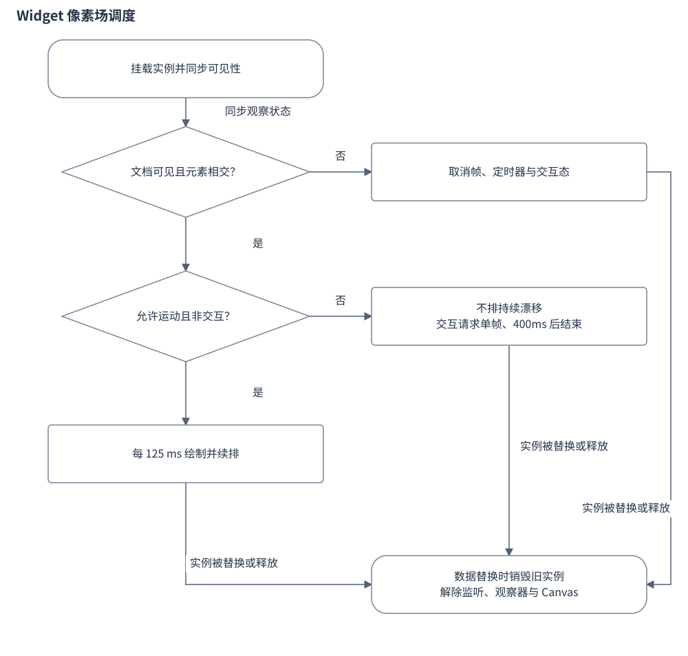

# Widget 设计

Widget 是用于 Daimon / Kimi Work Blueprint 的单文件展示组件。宿主通过 `window.DaimonWidget` 提供数据、状态和主题事件，Widget 据此在浏览器中呈现用量与额度。该组件不属于原生 App 的打包资源。

## 目录

- [1. 目标与职责](#chapter-1)
- [2. 对外契约](#chapter-2)
  - [2.1 宿主接口与数据边界](#host-contract)
- [3. 内部结构](#chapter-3)
- [4. 详细设计](#chapter-4)
  - [4.1 用量与额度的展示口径](#display)
- [5. 流程与状态](#chapter-5)
  - [5.1 动画的可见性与释放](#animation)
- [6. 异常与恢复](#chapter-6)
- [7. 参考文献](#chapter-7)
  - [7.1 原始资料与实现入口](#original-references)
  - [7.2 相关文档](#related)

## 1. 目标与职责

**功能需求**：Widget 管理宿主数据的展示和动画生命周期，会话扫描与 Provider 查询均不在其职责内。

**边界与非目标**：宿主缺失时，组件也不会启动替代采集流程。

## 2. 对外契约

### 2.1 宿主接口与数据边界

**功能需求**：组件通过宿主注册的数据、状态和主题回调更新，不自行调度采集或发起 Provider 网络请求。

**方案机制**：页面注册 `onDataChange(render)`，从回调参数的 `data.main` 读取 `agents`、`services`、`generatedAt` 和 `totalCostUsd`。`onStatusChange` 回调读取宿主当前 `status`，只有 `running` 显示“刷新中”；其他状态显示“LIVE”。主题回调让已有像素场重绘。

**边界与非目标**：组件内没有采集调度器或 Provider 网络请求。宿主接口缺失时不注册数据回调；`main` 或 `agents` 缺失时只把总量占位符设为“—”并返回，其他旧卡片仍然保留。原生打包清单收拢图标与字体，并复制 Collector 二进制，没有复制 Widget 或将原生快照推送到 Daimon 的步骤。宿主如何生产这份数据由外部集成负责。

依据：[`apps/widget/index.html`](../../apps/widget/index.html) 的 `render()`、`renderStatus()` 与末尾宿主回调注册；[`scripts/runtime-manifest.zsh`](../../scripts/runtime-manifest.zsh) 的 `BRUCE_BUNDLE_FILES`、`Bruce_copy_rust_collector()`。

## 3. 内部结构

**方案机制**：宿主回调驱动 `render` 与状态文案，`updateField` 负责替换像素场实例。展示卡片和像素场各自持有浏览器内存状态；原生 App 的模型与 Widget 不共享对象。

## 4. 详细设计

### 4.1 用量与额度的展示口径

**功能需求**：用量与额度按宿主传入数据的口径展示；日期对齐、成员归并与余额口径由输入决定，页面不补齐缺失日期。

**方案机制**：用量按 `status === "ok"` 的 Agent 汇总今日 Token，输入栏包含普通输入、缓存读取和缓存创建，输出栏单列输出。Agent 行按状态、今日总量排序。组合柱图按传入 `daily` 的各日下标对齐，前四个 Agent 单独分色，其余合并；逐小时折线只在数组恰有 24 项且存在正数时显示。

额度同时接收 `services` 与 Agent 自带的 `quota.windows`。窗口 `usedPercent` 用于显示剩余比例，60% 和 85% 为警示分界；Codex 多账号组显示有效成员中“最大窗口已用比例”的平均值。余额型项目显示余额与币种，不转换为窗口百分比。

**边界与非目标**：它依赖宿主提供一致的日期数组，不在页面内补齐缺失日期。该均值是页面汇总指标，不是服务端共同余额。

底部关于 CC Switch 与“每 30 分钟”的文字是固定文案，不能据此推断宿主的真实定价来源或调度周期。原生调度行为见[刷新生命周期](刷新生命周期设计.md)。

依据：[`apps/widget/index.html`](../../apps/widget/index.html) 的 `render()`、`renderCombo()`、`detailView()`、`renderQuota()`、`groupBlock()`。

## 5. 流程与状态

### 5.1 动画的可见性与释放

**功能需求**：像素场根据宿主更新、文档可见性与交互切换绘制节拍；隐藏时取消帧与定时器，`destroy()` 彻底释放。

**方案机制**：像素场根据宿主更新、可见性与交互切换调度方式。

图：Widget 像素场生命周期。减少动态效果或零漂移不进入持续定时绘制。

`KimiPixelField.mount(container, options)` 创建 Canvas，并返回 `render`、`setVisible`、`setInteractive`、`destroy`。像素场同时考虑文档可见性和 `IntersectionObserver` 的相交状态。可见、非交互且允许运动时，每 125 ms 安排一次绘制；指针交互请求单帧，400 ms 无新交互后回到常规节拍。隐藏时取消帧与定时器，`destroy()` 还会解除观察器、事件监听并移除 Canvas。

`compact` 档位或系统“减少动态效果”会禁止持续漂移；总量数字的滚动动画也检查“减少动态效果”。每次数据更新先销毁旧像素场再挂载新实例，避免重复保留旧调度器。

**边界与非目标**：性能 Harness 使用伪 Canvas 和伪调度器表达隐藏、8 fps 上限、交互与销毁的预期，不覆盖 Daimon 宿主集成。

依据：[`apps/widget/index.html`](../../apps/widget/index.html) 的 `mount()`、`motionAllowed()`、`setVisible()`、`updateField()`；[`scripts/widget-performance-harness.mjs`](../../scripts/widget-performance-harness.mjs)。

## 6. 异常与恢复

**边界与非目标**：`data.main` 或 `agents` 缺失时仅重设总量占位并提前返回，已有其它卡片不会被统一清空。按实现推演，隐藏会取消动画调度，重新可见仅在允许运动时恢复；数据更新先销毁旧实例再挂载新实例。宿主数据日期不齐不会在页面内自动修补。

## 7. 参考文献

### 7.1 原始资料与实现入口

- [index.html](../../apps/widget/index.html)：本主题的原始声明或实现入口。
- [runtime-manifest.zsh](../../scripts/runtime-manifest.zsh)：本主题的原始声明或实现入口。
- [widget-performance-harness.mjs](../../scripts/widget-performance-harness.mjs)：本主题的原始声明或实现入口。

### 7.2 相关文档

- [Bruce 设计文档](Bruce设计文档.md#widget)：本主题在完整系统中的职责、关系和约束。
- [系统设计](Bruce设计文档.md)：原生应用、Collector 与独立 Widget 的关系。
- [Collector 设计](采集引擎与本地用量设计.md)：上游用量与 Artifact 的含义。

最后更新：2026-10-20
