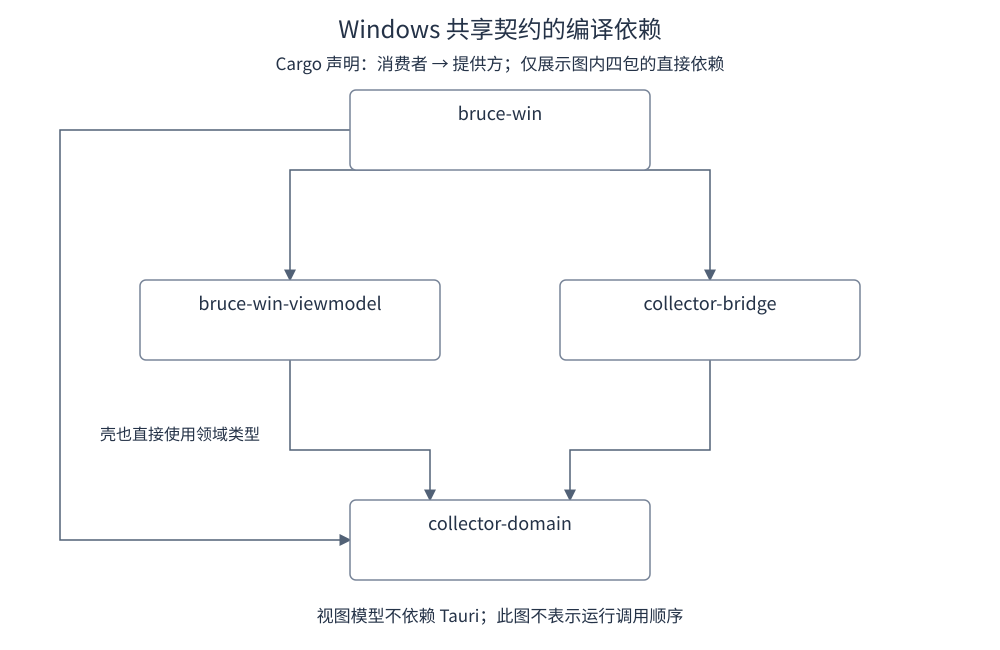
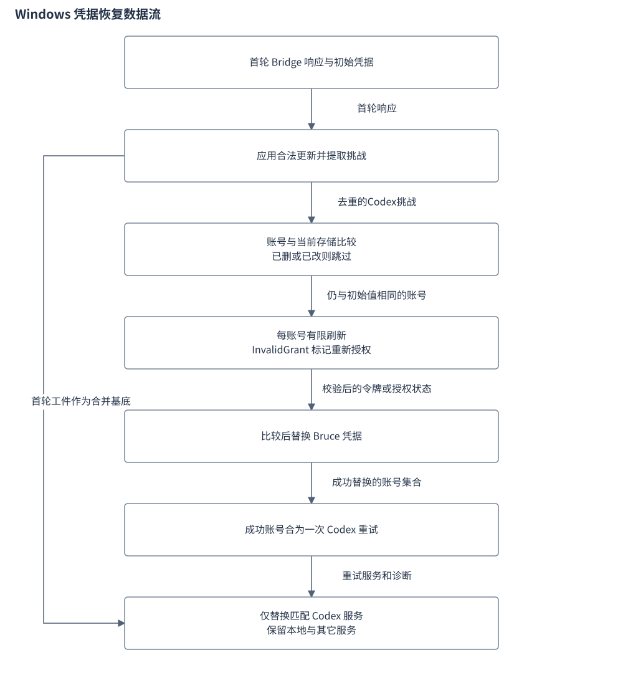
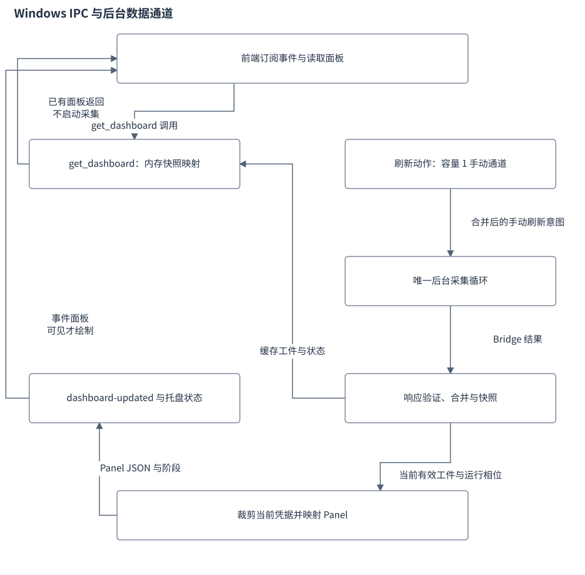

# Windows 应用设计

Windows 应用以 Tauri 托盘壳承载看板与独立设置窗口，进程内调用共享 Rust Collector，再把采集结果映射成前端展示模型。Windows 自行实现调度、快照、凭证存储与系统交互；macOS 的 Swift 视图模型是其行为对齐基准。

Windows 原生 WebView2、Toast、系统热键、SID ACL 与真实 Agent 路径的验收范围，见文末的证据边界。

## 目录

- [1. 目标与职责](#chapter-1)
- [2. 对外契约](#chapter-2)
  - [2.1 职责与接口](#windows-contract)
- [3. 内部结构](#chapter-3)
  - [3.1 配置与采集授权](#windows-config)
  - [3.2 共享包的依赖方向](#windows-dependencies)
- [4. 详细设计](#chapter-4)
  - [4.1 凭证存储与恢复](#windows-credentials)
  - [4.2 视图模型、告警与维护](#windows-mapping)
  - [4.3 Fluent 与 Nothing 呈现](#windows-theme)
  - [4.4 Agent 用量工作台](#windows-workbench)
- [5. 流程与状态](#chapter-5)
  - [5.1 启动、刷新与展示](#windows-startup)
- [6. 异常与恢复](#chapter-6)
  - [6.1 对齐范围与证据边界](#windows-limits)
- [7. 参考文献](#chapter-7)
  - [7.1 原始资料与实现入口](#original-references)
  - [7.2 相关文档](#related)

## 1. 目标与职责

Windows 壳负责自己的系统窗口、IPC、凭证与调度，把共享 Collector 的静态协议接入 Tauri。跨平台共享逻辑不等于已完成 Windows 系统交互验收。

## 2. 对外契约

### 2.1 职责与接口

`main()` 仅调用 `bruce_win_lib::run()`。启用 `desktop` feature 后，`desktop::run()` 注册 Tauri 插件、加载持久快照、创建共享调度状态、注册热键与托盘菜单，最后启动采集线程。采集由启动后的调度循环显式发起，模块初始化本身不扫描会话。

| 组件 | 负责的行为 | 依赖与输出 |
|---|---|---|
| Tauri 壳 | 托盘、窗口、IPC、热键、系统通知 | 维护 `SchedulerControl`，向前端发布事件 |
| `collector.rs` | 根据设置筛选能力与凭证，构造采集请求 | 进程内调用 `collector_bridge::run_bytes_panic_safe`，返回 `BridgeResponse` |
| `runtime_core.rs` | 快照验证、合并、持久化、面板组装与窗口策略 | 接收 artifact，调用纯 Rust 视图模型 |
| `credentials.rs` 与 `credentials/lifecycle.rs` | 应用自有凭证存储、轮换回写、Codex 恢复 | 以元数据向前端展示账号；凭证供采集与恢复使用 |
| `viewmodel` | 用量、逐小时、订阅与诊断的纯数据映射 | `PanelViewModelMapper::make` 产生 `PanelViewModel` |
| `app.js` 与 `settings.js` | 看板绘制、局部展开状态、表单与命令调用 | 消费 IPC 返回值及 `dashboard-updated`、`settings-updated` 事件 |

下列 IPC 是前端与后端的主要边界。表中的字段名保留前端调用形式；Rust 参数经过 Tauri 序列化。

| 命令 | 输入 | 返回或效果 |
|---|---|---|
| `get_dashboard` | 无 | `Result<Value, String>`；读取内存快照并组装面板，发布前按当前凭证裁剪服务，不执行采集 |
| `refresh_now` | 无 | 向容量为 `1` 的调度通道提交手动刷新请求 |
| `get_runtime_info` | 无 | 版本、数据与缓存目录、快照位置、运行状态、诊断、用量及模型汇总 |
| `get_settings` / `save_settings_command` | 保存时传入 `settings: AppSettings` | 加载设置；或校验、替换热键、持久化并发布设置变更 |
| `get_credential_accounts` | 无 | `field`、`accountId`、`displayName`、`authorizationState` 元数据 |
| `save_credential_account` / `remove_credential_account` | `field`、`accountId`，保存另传 `payload` | 修改单个账号，成功后请求刷新 |
| `save_credentials_command` | `payloads` 字段补丁 | 有值覆盖，`null` 删除，未提及的字段保留 |
| `import_codex_auth` | `auth` JSON | 从 `tokens.account_id` 及令牌字段导入应用自有存储 |
| `clear_snapshot_cache` | 无 | 删除磁盘快照并请求刷新；内存中的有效 artifact 不在此命令内清空 |
| `export_billing` / `export_diagnostics` | 可选 `path` | 返回导出文件的完整路径，失败返回错误 |
| `open_settings` / `hide_dashboard` / `quit_app` | 无 | 呈现设置、隐藏看板并记录位置、或 `app.exit(0)` |

依据：[`main.rs`](../../apps/win/src-tauri/src/main.rs) 的 `main`；[`lib.rs`](../../apps/win/src-tauri/src/lib.rs) 的 `desktop::run` 与 IPC 命令；[`scheduler.rs`](../../apps/win/src-tauri/src/scheduler.rs) 的 `SchedulerControl`、`cached_panel`；[`viewmodel/src/lib.rs`](../../apps/win/viewmodel/src/lib.rs)。

## 3. 内部结构

### 3.1 配置与采集授权

Windows 数据根优先取去除首尾空白后的 `%APPDATA%\Bruce`，缺失或空白时使用用户目录下的 `AppData\Roaming\Bruce`。非 Windows 开发运行使用 `Library/Application Support/Bruce-Windows-Dev`，与 macOS 原生应用的数据目录隔离。设置位于数据根的 `config/settings.json`，凭证位于 `credentials.json`，快照位于 `snapshot.json`。Collector 缓存根由共享 `collector_local::default_cache_root` 解析。

| 设置 JSON 字段 | 默认值 | 校验或生效方式 |
|---|---|---|
| `consentVersion` | `0` | 允许 `0`、`1`；仅 `1` 可向共享采集请求注入订阅凭证 |
| `usageEnabled` | `true` | 为假时移除 `localSessions` 能力，并隐藏面板的 `usage`、`hourly` |
| `enabledProviders` | `PROVIDERS` 的全部 `10` 项 | 保存时拒绝未知或重复项；控制凭证筛选与订阅展示 |
| `providerOrder` | 空数组 | 调整订阅段顺序；映射后再次排序 |
| `pricingOverrides` | 空对象 | 最多 `512` 个模型；支持价格、币种、备注字段，价格须为非负有限数值 |
| `refreshIntervalSecs` | `1800` | 保存范围为 `60` 至 `86400` 秒；加载时先钳制到此范围 |
| `notificationsEnabled` | `true` | 控制自动刷新时的配额通知投递 |
| `theme` | `fluent` | 仅允许 `fluent`、`nothing` |
| `cardOrder` | `usage`、`subscription`、`hourly` | 拒绝未知或重复卡片；前端补齐未列出的卡片 |
| `hotkey` | 空字符串 | 空值关闭热键；非空值由插件解析与注册 |

设置缺失或 JSON 损坏时回落默认值；缺少字段由 `serde(default)` 补齐，未知字段忽略。界面提供 `5`、`15`、`30`、`60` 分钟选项，历史非预设值会追加显示。确认授权立即写入 `consentVersion = 1` 和 `usageEnabled = true`，撤销立即写入 `0` 与 `false`，两种动作均调用保存命令并触发刷新。

采集侧分开判断这两个开关：`consentVersion == 1` 决定是否注入订阅凭证，`usageEnabled` 决定是否扫描本机会话。因此，默认 `consentVersion = 0` 并不关闭默认启用的本机会话扫描，不能把界面上的一次授权说明理解为采集侧对两类能力使用同一条件。请求默认回看 `182` 天；本地扫描、外部请求与模块预算分别为 `120`、`30`、`150` 秒。价格覆盖通过请求上下文传入共享 Collector。

设置页与 `PROVIDERS` 含 Cline，但当前凭证校验器没有 `clineQuotaAccounts` 的账号字段分支，`build_configured_request` 也没有 `cline` 的凭证映射。视图模型可以展示已有 Cline service，不代表 Windows 设置页的新增、保存与出站查询链路已完整接通。Jev 由订阅展示策略隐藏。

依据：[`paths.rs`](../../apps/win/src-tauri/src/paths.rs) 的 `data_root`、`collector_cache_root`；[`credentials.rs`](../../apps/win/src-tauri/src/credentials.rs) 的 `app_data_root_with`、`validate_credential_payload`；[`settings.rs`](../../apps/win/src-tauri/src/settings.rs) 的 `AppSettings`、`load_settings`、`validate_settings`；[`collector.rs`](../../apps/win/src-tauri/src/collector.rs) 的 `build_local_request`、`build_configured_request`；[`settings.js`](../../apps/win/src/settings.js) 的 `loadSettings`、`applyConsent`；[`subscription.rs`](../../apps/win/viewmodel/src/subscription.rs) 的 `is_provider_temporarily_disabled`。

### 3.2 共享包的依赖方向

图：四个第一方包之间的 Cargo 编译依赖，箭头从消费者指向提供方。图只展示这四个包的直接关系，不包含 Bridge 的应用层或第三方依赖，也不表示运行调用顺序。

`bruce-win-viewmodel` 不依赖 Tauri，接收领域工件后生成纯展示值；Tauri 壳消费视图模型和 Bridge，并直接使用领域类型。共享输入类型不意味着两端前端会使用同一套分析算法。

依据：[`Windows Cargo.toml`](../../apps/win/src-tauri/Cargo.toml)、[`viewmodel Cargo.toml`](../../apps/win/viewmodel/Cargo.toml)、[`Bridge Cargo.toml`](../../core/collector/crates/collector-bridge/Cargo.toml) 的 dependencies。

## 4. 详细设计

### 4.1 凭证存储与恢复

账号清单 IPC 只返回显式列出的元数据，已保存的密钥不会回传前端。单账号更新与完整字段补丁共用存储互斥锁，先在锁内读取最新文件，再修改与写回。账号映射须为对象；读取时拒绝链接或重解析点、超过 `4 MiB` 的文件及无效字段。

Windows 写入器取得进程令牌的当前 SID，为父目录和仍为空的临时文件设置受保护 DACL，再写入内容、同步文件并以 `MoveFileExW` 替换目标。收权失败会中止写入，并保留既有凭证文件。非 Windows 开发分支采用目录 `0700`、文件 `0600`。

Windows 的恢复在自身凭据边界内完成，关系如下。

图：Windows 凭据恢复。账号删除或手动替换会阻止旧请求回写；失败诊断留在响应中。

调度器用 `collect_with_recovery` 消费共享响应中的凭证更新与挑战。当前回写支持 StepFun 令牌轮换；写回以请求前的账号值作比较，账号已删除或被人工替换时不覆盖新值。Codex 挑战按账号去重，每个账号至多尝试一次令牌刷新，成功账号合并为一次仅查询 Codex 的重试；该重试不重复本地会话和其他 Provider。`InvalidGrant` 把账号标为 `reauthRequired`。重试结果只替换首次 artifact 中匹配的 Codex 服务，保留本地用量与其他服务。

Codex 的 `refresh_token`、`id_token`、`expiry` 等恢复字段留在应用存储侧，注入共享 Bridge 时仅保留 `access_token`、`display_name`，并排除 `reauthRequired` 账号。设置页通过文件选择器读取用户指定的 JSON，再调用导入命令；后端导入函数不自行打开外部 CLI 文件。

依据：[`credentials.rs`](../../apps/win/src-tauri/src/credentials.rs) 的 `credential_accounts`、`load_credentials`、`save_credentials_patch`、`write_path_with_permissions`、`import_codex_auth`；[`windows_security.rs`](../../apps/win/src-tauri/src/credentials/windows_security.rs) 的 `current_sid`、`restrict`、`replace`；[`lifecycle.rs`](../../apps/win/src-tauri/src/credentials/lifecycle.rs) 的 `collect_with_recovery_using`、`apply_updates`、`compare_and_replace`；[`collector.rs`](../../apps/win/src-tauri/src/collector.rs) 的 `build_configured_request`、`run_codex_retry`；[`settings.js`](../../apps/win/src/settings.js) 的 `buildSubscription`。

### 4.2 视图模型、告警与维护

`PanelViewModelMapper::make` 接受可选 `AgentUsageArtifact` 和调用方注入的时间，输出用量、订阅、逐小时与诊断四部分。输出字段使用 camelCase；输入缺失时三张业务卡为 `None`，并产生 `MissingArtifact`。用量映射聚合今日 Token，取日期并集最后 `14` 天制作日柱，并形成月度、热力图与模型统计。订阅映射按 Provider 分组，保留窗口、余额、账号状态和过期数据的上次成功时间。

看板前端区分单账号、多账号和纯余额三种形态。多账号默认折叠，展开时显示账号子卡；纯余额型显示余额与状态双槽。DeepSeek 月度消费账本已按 C020 移除，当前展示使用余额字段；凭证存储中仍有写入 `deepseek-tracking-id` 的残留逻辑，不应据此推断月度账本仍在运行。

配额预警仅识别 `5` 小时窗口，要求已用比例严格大于 `80%`，并跳过 `freshness = stale` 的服务。去重键为 `serviceID|windowLabel`，只在进入超阈值集合时投递；持续超标不重复。手动刷新及其退避重试更新跨越状态但不投递通知，关闭通知也仍更新去重状态。

维护页可导出 UTF-8 BOM 的账单 CSV 和限定字段的诊断 JSON。前端优先打开系统保存对话框，取消时不导出；对话框不可用时回落数据根下的 `exports/`。诊断文件仅取版本、平台、模块阶段、最近成功、错误码与诊断码，不加入凭证、账号、完整本机路径或用量明细。设置页诊断预览另保留目录末段名。

依据：[`models.rs`](../../apps/win/viewmodel/src/models.rs) 的 `PanelViewModel`；[`usage.rs`](../../apps/win/viewmodel/src/usage.rs) 的 `PanelViewModelMapper::make`、`make_usage`；[`subscription.rs`](../../apps/win/viewmodel/src/subscription.rs) 的 `make_subscription`、`last_success_text`；[`app.js`](../../apps/win/src/app.js) 的 `subscriptionCard`、`isMultiAccount`、`isBalanceBased`；[`alerts.rs`](../../apps/win/src-tauri/src/alerts.rs) 的 `over_threshold_entries`、`AlertDeliveryState`；[`runtime_core.rs`](../../apps/win/src-tauri/src/runtime_core.rs) 的 `billing_csv`、`diagnostics_report`；[`settings.js`](../../apps/win/src/settings.js) 的 `runExport`、`showDiagnosticsPreview`；[C020](../archive/0.12.0/change/C020.json) 的 DeepSeek 月度统计移除声明。

### 4.3 Fluent 与 Nothing 呈现

`theme` 保存为 fluent 或 nothing。看板的 `applySettings` 应用 body 类后重绘已有面板，设置页则通过 `applyTheme` 切换同名类。Tauri 的 dashboard 配置新增 `transparent: true`；Fluent 面板使用 16px 圆角、阴影与半透明背景。这是配置及 CSS 声明，不是 WebView2 合成效果的实机结论。

Nothing 使用 `#000000` 面板、10px 圆角、关闭背景模糊和阴影，卡片以 `#111111`、3px 圆角和细描边区分。字体通过本地 @font-face 注册 Doto、Space Grotesk、Space Mono 常规与粗体；文件位于 src/fonts。Hero 最终规则为 Doto 48px，并仍保留 radial-gradient 背景声明。含小数点的总量文本按第一个点拆分，以 `.dot-square` 替代该字符；当前 CSS 方块为 5×5px，不能把 C066 文字中的 4×4px 目标当成实际尺寸。LIVE 灯为 5×5px 实心方格。

订阅卡的 Nothing 分支追加固定三档图例：<50、50–79、≥80，颜色为 `#4A9E5C`、`#D4A843`、`#E44B47`。图例本身不新增阈值判定。Agent 项目明细改为 PRJ.CONSOLE，保留名称、Token 与份额，每行六个刻度，亮格数为 `max(share>0 ? 1 : 0, min(6, round(share×6)))`。Fluent 继续使用原项目分布组件，展开状态仍由前端集合持有。

这些选择器和格式分支没有更改采集、凭据、告警或计费口径。工作台也有 Nothing 字体、颜色和几何覆写，但不能由样式推断其数据算法已与 macOS 等价。

依据：[`app.js`](../../apps/win/src/app.js) 的 `applySettings`、`usageCard`、`subscriptionCard`、`nothingProjectConsole`；[`styles.css`](../../apps/win/src/styles.css) 的 @font-face 与 theme-nothing；[`tauri.conf.json`](../../apps/win/src-tauri/tauri.conf.json)；[C066](../archive/0.12.2/change/C066.json) 的目标与变更记录。

### 4.4 Agent 用量工作台

设置页从缓存 PanelViewModel 生成 KPI、曲线、模型及 Agent 矩阵，默认今日。时间按钮不重新读取完整工件；面板 days 只有最后 14 个日期，30d 和 all 也受此限制。模型、矩阵及构成沿用已有行，不统一跟随历史范围重算。

当前维度按钮只更新选中样式，费用和命中率含固定规则或默认值；MA7、十字悬停和项目下钻没有执行路径。完整的正常、空数据和跨端差异见 [Windows 用量工作台设计](Windows用量工作台设计.md)。

依据：[`settings.js`](../../apps/win/src/settings.js) 的 `renderAgentUsageWorkbench`；[`usage.rs`](../../apps/win/viewmodel/src/usage.rs) 的 `make_usage`、`make_hourly`；[T08](../archive/0.12.2/task/T08.json)。

## 5. 流程与状态

### 5.1 启动、刷新与展示

Tauri 在启动时预建 `dashboard` 与 `settings` 两个隐藏窗口。看板无装饰、启用透明通道、跳过任务栏并置顶；设置窗口为 `1040 × 680`，最小 `980 × 620`。`open_settings` 优先呈现已有窗口，窗口缺失时通过 `run_on_main_thread` 兜底创建。

托盘左键和全局热键切换看板。打开时根据显示器工作区、DPI 与托盘矩形重新计算位置和尺寸，然后请求一次手动刷新；保存的 `panelX`、`panelY` 不作为下次唤出的定位依据。看板失焦或关闭时隐藏并保存坐标，设置窗口失焦保持可见，关闭时隐藏。托盘点击对刚发生的看板失焦隐藏设置 `300 ms` 防抖，前端 `Escape` 调用 `hide_dashboard`。

后台线程不受看板可见性控制。它依次执行采集、凭证恢复、快照更新、通知判定与事件发布，再选择一次可被手动请求中断的等待。`get_dashboard` 和前端刷新按钮均不直接调用 Collector。[Windows 快照与刷新状态](Windows快照与刷新状态.md) 说明这条链路的失败、重试和旧数据保留规则。

前端缓存读取与后台采集通过不同通道协作，关系如下。

图：Windows IPC 与后台通道。读取面板不采集；手动意图经唯一后台循环执行，前端隐藏时保留待绘结果。

看板前端启动时先订阅事件，再取设置与缓存面板；设置页有独立的加载顺序，见[工作台更新流程](Windows用量工作台设计.md#windows-refresh)。`dashboard-updated` 到达后重建卡片栈；页面隐藏时只保存待展示面板，恢复可见时补绘一次。账号与 Agent 的展开状态存于前端集合，跨数据刷新保留，不落盘。退出菜单与 `quit_app` 调用 `app.exit(0)`；采集线程的循环没有独立的退出消息分支。

依据：[`tauri.conf.json`](../../apps/win/src-tauri/tauri.conf.json) 的 `app.windows`；[`lib.rs`](../../apps/win/src-tauri/src/lib.rs) 的 `toggle_dashboard`、`open_settings`、`on_window_event`；[`runtime_core.rs`](../../apps/win/src-tauri/src/runtime_core.rs) 的 `window_action`、`compute_dashboard_geometry`；[`scheduler.rs`](../../apps/win/src-tauri/src/scheduler.rs) 的 `spawn`；[`app.js`](../../apps/win/src/app.js) 的 `init`、`renderWhenVisible` 与事件处理。

## 6. 异常与恢复

### 6.1 对齐范围与证据边界

设计基线选择共享采集引擎、独立 Windows UI 与 Rust 视图模型。液态玻璃、浅色外观和 Daimon Widget 不迁移；Windows 提供深色 Fluent 与 Nothing 风格。C012 记录的是当时九家 Provider 色板对齐的历史验证，当前代码已扩展 Cline 并调整 Z.ai 色值，应以当前品牌色表判断实际数值。

`mac_parity_golden_matches` 使用 `valid`、`partial`、`empty` 三个 artifact，按 f64 归一数值后比较 Rust 输出与 macOS golden。`runtime_coverage.rs`、`collector_configuration.rs` 及生产 HTML/JS 的控制 DOM/IPC 用例分别约束状态策略、请求门控与前端事件行为。这些测试代码规定固定输入下的预期，不等于当前执行结果，也不涵盖 Windows 系统集成验收。

C009 仍为 `in_progress`，其原验收记录将 WebView2、原生焦点与窗口重开、系统热键冲突、Toast、实际 SID ACL、真实 Agent 与凭证路径列为未完成项。设计 05 也保留真机路径与任务栏实测清单。维护者判断是否可发布时，应分别检查自动化结果与这些目标环境证据。

依据：[Windows 平台适配设计](../devel/design/05-Windows平台适配.md) 的目标、非目标、真机清单与对拍规则；[C009](../devel/change/C009.json) 的 `status`、`verification`；[C012](../devel/change/C012.json) 的历史色板验证；[`fixture_parity.rs`](../../apps/win/viewmodel/tests/fixture_parity.rs) 的 `mac_parity_golden_matches`；[`runtime_coverage.rs`](../../apps/win/src-tauri/tests/runtime_coverage.rs)；[`collector_configuration.rs`](../../apps/win/src-tauri/tests/collector_configuration.rs)；[`frontend.test.mjs`](../../apps/win/tests/frontend.test.mjs)。

## 7. 参考文献

### 7.1 原始资料与实现入口

- [05-Windows平台适配.md](../devel/design/05-Windows平台适配.md)：本主题的原始声明或实现入口。
- [C009.json](../devel/change/C009.json)：本主题的原始声明或实现入口。
- [main.rs](../../apps/win/src-tauri/src/main.rs)：本主题的原始声明或实现入口。
- [lib.rs](../../apps/win/src-tauri/src/lib.rs)：本主题的原始声明或实现入口。
- [scheduler.rs](../../apps/win/src-tauri/src/scheduler.rs)：本主题的原始声明或实现入口。

### 7.2 相关文档

- [Bruce 设计文档](Bruce设计文档.md#windows)：本主题在完整系统中的职责、关系和约束。
- [Windows 快照与刷新状态](Windows快照与刷新状态.md)：调度触发、等待策略、快照合并与前端状态的完整关系。

最后更新：2026-10-20
