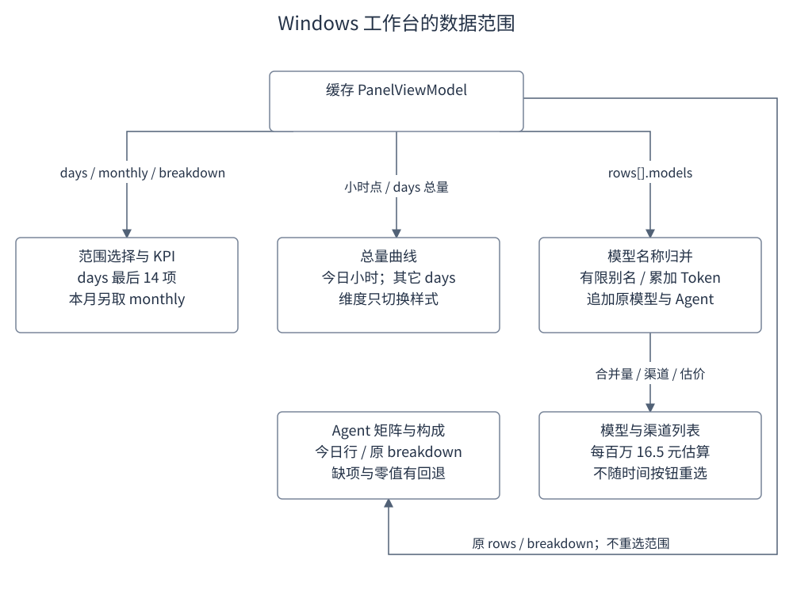
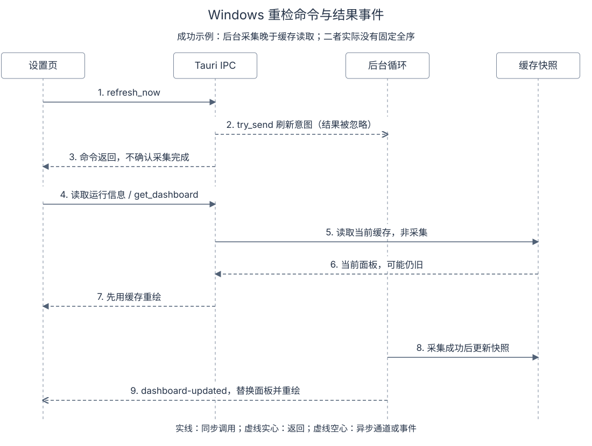

# Windows 用量工作台设计

Windows 设置页的 Agent 用量工作台以已映射的 `PanelViewModel` 为输入，生成时间按钮、四格 KPI、总量曲线、模型汇总和 Agent 矩阵。该工作台不直接消费 macOS 分析模型，切换时间范围也不重新查询完整历史。各张卡片的输入范围与派生规则不同，因此同页数字需要按各自口径解释。

## 目录

- [1. 目标](#chapter-1)
- [2. 设计](#chapter-2)
  - [2.1 时间范围与 KPI](#windows-ranges)
  - [2.2 曲线与维度按钮](#windows-timeline)
  - [2.3 模型合并与渠道](#windows-models)
  - [2.4 Agent 矩阵与 Token 构成](#windows-matrix)
- [3. 流程](#chapter-3)
  - [3.1 面板字段的派生范围](#windows-lineage)
  - [3.2 缓存更新与重新检查](#windows-refresh)
- [4. 数据与接口](#chapter-4)
- [5. 异常与边界](#chapter-5)
- [6. 验证要点](#chapter-6)
- [7. 参考文献](#chapter-7)

## 1. 目标

**功能需求**：T08 声明对齐 macOS 分析工作台，并提出多维系列、MA7、悬停探针及渠道下钻。当前 `buildAgentUsage` 创建工作台、会话来源和采集授权区；`renderAgentUsageWorkbench` 完成数据派生与 DOM 绘制。

**边界与非目标**：部分分析能力的当前展示仍与任务目标存在差异，判断算法是否等价，需要检查具体数据路径，不能只依据任务卡的完成状态。macOS 的归一化键、历史模型份额、趋势系列和导出由独立实现负责，见 [Agent 用量分析设计](Agent用量分析设计.md)。Windows 的缓存、采集与窗口边界见 [Windows 应用设计](Windows应用设计.md)。

依据：[T08](../archive/0.12.2/task/T08.json) 的目标与任务；[`settings.js`](../../apps/win/src/settings.js) 的 `buildAgentUsage`、`renderAgentUsageWorkbench`。

## 2. 设计

**功能需求**：工作台从缓存面板派生时间按钮、KPI、曲线、模型与 Agent 矩阵，点击按钮只重绘汇总，不加载更多历史，也不重新查询完整工件。

| 功能点 | 触发与结果 | 数据限制 |
|---|---|---|
| 时间范围与 KPI | 点击五档按钮，重绘汇总 | 不加载更多历史；各 KPI 不共享完整窗口算法 |
| 曲线与维度按钮 | 重建平滑路径及选中样式 | 四个维度仍使用同一总量点集 |
| 模型合并 | 遍历各 Agent 的模型行，合并名称 | 使用原面板模型行，不随时间按钮改变 |
| Agent 与 Token 构成 | 展示已有 Agent、项目和 breakdown | Agent 总量为今日；堆叠条包含默认值回退 |

### 2.1 时间范围与 KPI

**功能需求**：用户点击五档时间按钮后，工作台重绘 Token、费用、命中率与活跃 Agent 四格 KPI；今日数值沿用面板既有文本，历史档位在已有 `days` 条目内截取或求和。

**方案机制**：`selectedTimeRange` 默认 `today`，另有 `7d`、`30d`、`month`、`all`。今日 Token 和费用沿用 `usage.totalTokensText`、`usage.costText`，缺失分别显示 `0`、`¥0.00`。近 7/30 天截取 `usage.days` 末尾对应数量的条目；全部历史求现有 days 的和。总和大于零才替换 Token 文本，否则保留今日值；这三档费用始终用 `Token/1000000×15.2` 生成人民币估算文本。

按月 KPI 读取 `usage.monthly` 中 `isCurrent` 条目，找不到时取首项。缓存命中率优先读取 breakdown 中标签含“命中率”的 `valueText`；活跃 Agent 先统计 `hourly.rows` 中 `todayTotal>0` 的数量，结果为零时回退全部 rows 数量。

**边界与非目标**：上游 `make_usage` 只把各 Agent 日期并集最后 14 项写入 `usage.days`。因此“近 30 天”和“全部历史”最多使用这 14 项已有数据，不能据按钮名称推断完整历史。月份项缺失时保留今日 Token，费用也保持今日文本。月汇总来自另一条全量 daily 聚合路径，覆盖范围可以超过曲线。没有命中率项时固定显示 `21.0%`；活跃 Agent 与命中率均不按所选历史范围重算。“43 款基准模型价格引擎折算”是固定界面文案，当前工作台的费用分支没有据此查询模型价格表。

依据：[`settings.js`](../../apps/win/src/settings.js) 的 `TIME_RANGES` 与 KPI 分支；[`usage.rs`](../../apps/win/viewmodel/src/usage.rs) 的 `make_usage`、`make_usage_monthly`。

### 2.2 曲线与维度按钮

**功能需求**：曲线在已有离散总量上画平滑路径，今日取小时点，其它范围取 `days` 总量；四个维度按钮切换选中样式。

**方案机制**：今日使用 `hourly.collapsedPoints`，缺失时填 24 个零。其它范围从 days 取总量：7d/30d 截取尾部，本月与全部历史直接使用全部已有 days，没有按月份再过滤。历史点少于两个时在两端补零；标签仅取所选 days 前七项的月日部分，无数据时显示“无数据”。

点集映射到 `600×150` 的 SVG，峰值至少为 1，再乘 `1.15` 留出空间。相邻点用 Catmull-Rom 控制点转换为三次贝塞尔，纵向控制点钳制在图高内，面积路径沿底边闭合。

**边界与非目标**：平滑显示已有离散总量，不产生新的计量样本。四个按钮修改 `selectedDimension` 并重绘，但后续点集计算没有读取该变量，只有按钮 active 样式发生变化。目前没有费用、模型或 Agent 独立系列，也没有 MA7、十字线或悬停取值事件。T08 的这些目标须与当前代码区分。

依据：[`settings.js`](../../apps/win/src/settings.js) 的 `catmullRomToBezier`、`selectedDimension` 和 chartPoints 分支。

### 2.3 模型合并与渠道

**功能需求**：工作台把各 Agent 的模型行按名称归并成模型汇总，并在每个模型行内附带来源渠道明细。

**方案机制**：归并器遍历 `hourly.rows[].models`。`normalizeModelName` 依次修剪空白、去掉清单内的一层渠道前缀、删除末尾八位日期、移除首个 `[thinking]`，再用小写副本匹配别名。别名涵盖部分 Claude、DeepSeek、Kimi、GPT、GLM；没有匹配时保留清理后的原大小写名称。

同名条目累加 `m.total`，同时向 channels 数组追加 Agent 展示名、原模型名和 Token。模型按总量降序；份额用模型总量除以所有输入模型总量，条形宽度至少 3%。每个模型的费用固定按每百万 Token `16.5` 元估算。

渠道树直接随每个模型行显示。上游只保留今日有量的 Agent，并把各 Agent 的 models、projects 归为前三项加“其他”。

**边界与非目标**：别名匹配不等同于 macOS 的 canonicalKey 规则。这里没有按“原模型名＋Agent ID”再次去重；固定每百万 Token `16.5` 元估算，没有使用其输入/输出拆分或价格覆盖。渠道树没有单独的渠道展开按钮。矩阵模型行本身已由上游筛选和聚合，工作台也不随时间按钮重新选模型历史，不能把这里的渠道总量解释为所选月份的逐笔账单。

依据：[`settings.js`](../../apps/win/src/settings.js) 的 `normalizeModelName`、canonicalMap 和 channels；[`usage.rs`](../../apps/win/viewmodel/src/usage.rs) 的 `make_hourly` 及模型行映射。

### 2.4 Agent 矩阵与 Token 构成

**功能需求**：矩阵按原 rows 顺序展示 Agent、今日总量、前两个模型与项目；四格构成从 breakdown 取输入、输出、缓存读取、缓存写入文本。

**方案机制**：矩阵按原 rows 顺序展示 Agent 名、`todayTotalText`、前两个模型名和前两个项目名。rows 为空时显示“暂无活跃 Agent 记录”。

四格构成按中文标签从 breakdown 取输入、输出、缓存读取、缓存写入文本，缺项显示 `—`。下面的堆叠条只包含前三类，其数值分别使用 `value || 40`、`value || 20`、`value || 30`。

**边界与非目标**：标题虽为“周期 Token”，实现仍取今日总量；项目标签没有下钻或展开事件。当前 Rust `make_usage` 提供输入、输出、缓存读取和命中率，没有缓存写入项。真实零值也会被默认数替代；该条只能解释为当前展示规则，不能据此还原完整的四类原始 Token 桶。

依据：[`settings.js`](../../apps/win/src/settings.js) 的 agent-matrix、compItems 和 totalComp；[`usage.rs`](../../apps/win/viewmodel/src/usage.rs) 的 breakdown 构造。

## 3. 流程

### 3.1 面板字段的派生范围

**功能需求**：渲染从当前缓存面板派生全部卡片，时间按钮不统一改变所有输入分支的范围。

图：Windows 工作台数据血缘。日期总量、月份汇总和今日模型属于不同输入分支；时间按钮没有统一改变所有分支的范围。图中没有表示额外历史查询或价格表查询。

**方案机制**：渲染先清空工作台容器，再读取当前面板并依次建立时间按钮、KPI、曲线、模型、矩阵和构成卡。每次按钮点击都重新派生 DOM。

**边界与非目标**：面板本身与后台快照不被改写。

### 3.2 缓存更新与重新检查

**功能需求**：页面初始化并发加载设置、凭据、价格、运行信息和面板，再经 `dashboard-updated` 事件接收后台新结果；“重新检查”提交后台意图后重读缓存并显示提示。

**方案机制**：初始化并发加载设置、凭据、价格、运行信息和面板；`loadPlans` 经 `get_dashboard` 保存 currentDashboard 并重绘工作台。这些加载结束后才注册 `dashboard-updated` 监听。事件到达后用 payload 替换面板并重绘，所选时间和维度变量在当前页面会话内保留。

“重新检查”先等待 `refresh_now` 命令返回，再依次读取运行信息与缓存面板，最后显示“会话扫描已刷新”。`refresh_now` 仅向后台循环提交意图。

命令内部以 `try_send` 提交意图并忽略发送结果。下面选择后台成功晚于缓存读取的场景；后台也可能更早完成。

图：重检的成功示例。实线为同步调用，虚线实心箭头为返回，虚线空心箭头为异步通道或事件。省略运行中事件与失败分支，其状态处理见 [Windows 快照与刷新状态](Windows快照与刷新状态.md)。

**边界与非目标**：不能描述为先订阅事件再读取缓存。这段 await 链没有等待该轮采集完成，因此第一次重绘可能仍是旧缓存，后续结果依赖后台事件；按钮提示本身不是采集成功证据。通道已满或不可用时也不向前端确认接收状态；后台完成与缓存读取二者没有固定全序。`loadPlans` 的 catch 只清空 providerPlans，不重新赋空 currentDashboard；已有工作台可能保留旧数据。后台错误与陈旧状态的完整规则见 [Windows 快照与刷新状态](Windows快照与刷新状态.md#windows-snapshot)。

依据：[`settings.js`](../../apps/win/src/settings.js) 的 ready、`loadPlans` 与 session-rescan 回调；[`scheduler.rs`](../../apps/win/src-tauri/src/scheduler.rs) 的 `SchedulerControl`。

## 4. 数据与接口

**功能需求**：工作台只消费缓存 `PanelViewModel` 的既有字段与 `get_dashboard`/`dashboard-updated` 通道，各字段由上游限定范围。

| 输入 | 消费位置 | 范围与所有者 |
|---|---|---|
| `PanelViewModel.usage.days` | 历史 Token 与曲线 | 映射器保留最后 14 个日期 |
| `usage.monthly` | 本月 Token | 上游从 daily 汇总月数据 |
| `usage.breakdown` | 命中率与构成 | 今日字段；不是历史窗口重算 |
| `hourly.collapsedPoints` | 今日总量曲线 | 上游聚合的小时点 |
| `hourly.rows` | Agent、模型与项目 | 已映射的展示行 |
| `get_dashboard` / `dashboard-updated` | 初始读取与后台更新 | Tauri 缓存读接口及事件 |

**边界与非目标**：本工作台没有 macOS 的 CSV/完整 artifact JSON 导出按钮；Windows 维护页的账单与诊断导出是另一条流程。主题只改变样式，不能改变这些数据范围；字体和 Nothing 渲染规则见 [Windows 应用设计](Windows应用设计.md#windows-theme)。

## 5. 异常与边界

**边界与非目标**：无面板时仍构造按钮与四格 KPI，显示零量、默认命中率或占位符；模型和矩阵各有空态。零历史窗口保留今日 Token、费用却可以为零，因而同一 KPI 组内也不保证同范围。按月 Token 与历史曲线可覆盖不同天数，模型沿用面板范围，Agent 总量仍为今日。这些是当前派生路径的限制。

任务目标中的多维分析、MA7、悬停与下钻没有因为组件外形齐全而接通。源码定义的 DOM 测试验证结构、按钮和部分 fixture 文本；Windows WebView2 的字体、透明合成、焦点与系统交互仍需相应目标环境证据。

## 6. 验证要点

**方案机制**：以下场景按当前规则推演，用于区分输入范围和派生结果：

- 面板含 14 个日期、每天 100 Token：30d 与 all 均只能合计 1400，费用为 `≈ ¥0.02`；不会自动读取此前日期。本月 KPI 若有更大月份总量，仍独立显示该月值。
- days 为空、今日总量为 100：7d 保留今日 Token 文本，费用显示 `≈ ¥0.00`；曲线补为两个零点。
- 两条模型为 `zhipu/glm-5` 的 100 和 `cline-pass/glm-5` 的 200：合为 GLM-5、总量 300，保留两个渠道项；切换 7d 不改变这两条输入。未知模型则保留清理后的拼写。
- 切换“按费用”与“按 Token”：当前只改变 active 按钮，同一面板和时间范围产生同一条曲线。breakdown 缺命中率时显示 21.0%，输入数值为零时堆叠条用 40 回退。

`frontend.test.mjs` 中的工作台用例检查四格 KPI、五个时间按钮、SVG、模型和矩阵。它没有断言完整 30 天历史、不同维度系列、MA7 或耗时指标；测试定义与本次执行结果须分别记录。

## 7. 参考文献

- [`settings.js`](../../apps/win/src/settings.js)：工作台入口、范围规则、模型归并、事件和缓存读取。
- [`usage.rs`](../../apps/win/viewmodel/src/usage.rs)：面板日期截断、月汇总与今日构成。
- [`frontend.test.mjs`](../../apps/win/tests/frontend.test.mjs)：工作台结构和交互的测试定义。
- [T08](../archive/0.12.2/task/T08.json)：工作台目标与历史完成记录。
- [Bruce 设计文档](Bruce设计文档.md#windows-workbench)：本主题的系统职责与边界。
- [Agent 用量分析设计](Agent用量分析设计.md)：macOS 的独立算法与口径。

最后更新：2026-10-20
