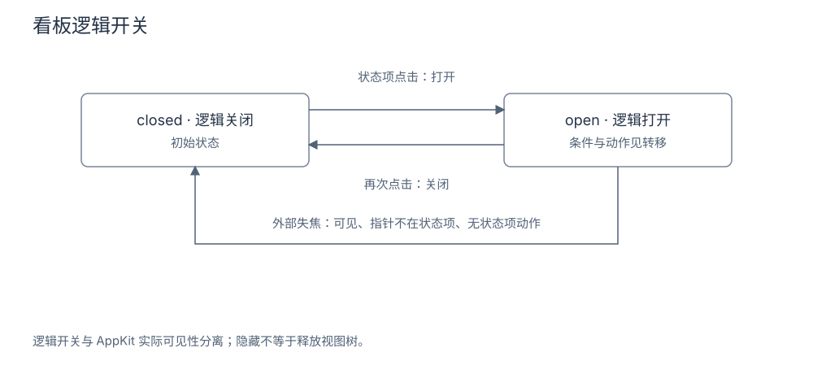

# 菜单栏与看板设计

菜单栏状态项常驻显示共享模型中的指标，看板则按需打开原生面板。呈现层负责点击、焦点、可见性与主题；采集调度、凭据存储和设置持久化由各自模块负责。总体关系见 [Bruce 设计文档](Bruce设计文档.md#dashboard)。

## 目录

- [1. 目标](#chapter-1)
- [2. 设计](#chapter-2)
  - [2.1 指标、额度环规与刷新呈现](#metrics)
  - [2.2 主题与原生材质](#theme)
  - [2.3 原生卡片折叠](#collapse)
- [3. 流程](#chapter-3)
  - [3.1 面板开关与可见性](#panel-toggle)
- [4. 数据与接口](#chapter-4)
  - [4.1 状态项与输入契约](#status-item)
- [5. 异常与边界](#chapter-5)
  - [5.1 隐藏、释放与异常边界](#visibility)
- [6. 验证要点](#chapter-6)
- [7. 参考文献](#chapter-7)
  - [7.1 原始资料与实现入口](#original-references)
  - [7.2 相关文档](#related)

## 1. 目标

**功能需求**：用户通过常驻指标打开看板；状态项控制器处理焦点和面板开关，卡片根据共享模型呈现内容。

**设计目标**：
- 布局稳定、重绘不跳变（满足：模型更新后读取新值重绘单张图像）；
- 逻辑状态与可见性分离（满足：避免失焦通知覆盖第二次点击）；
- 主题按系统能力回退（满足：不支持液态玻璃时回退经典）。

## 2. 设计

### 2.1 指标、额度环规与刷新呈现

**功能需求**：菜单栏要在有限宽度内稳定展示所选指标、刷新状态与剩余额度环规；仅图标模式也要保留额度与辅助功能状态。

**方案机制**：`MenuBarMetric` 提供最低剩余额度、平均剩余额度、今日 Token、今日费用、综合状态五项。内容构建器接收选择顺序、`MenuBarSummary`、刷新标记及仅图标标记，输出指标文本、辅助功能文案、状态图标名和可选剩余额度比例。选择包含最低剩余额度时优先取最低值并回退平均值，其余配置反向取值；结果限制在 0–100 后换算为 0–1。仅图标模式移除指标文本，仍计算额度与辅助功能状态。

控制器按实际菜单栏宿主的明暗外观绘制单张图像。文本宽度按等宽数字字体测量，整体至少 64 点；仅图标时收缩为 28 点。刷新时每 0.05 秒推进扫掠相位，停止后销毁定时器。非刷新时按剩余比例绘制环规，比例小于 15% 或状态图标为警告三角形时使用红色；比例不大于 0.005 时以顶部小点代替弧线，无比例时只留底环。

**边界与非目标**：这些是当前绘制分支，不应套用原设计稿中的其它阈值。

依据：[`MenuBarMetrics.swift`](../../apps/macos/Sources/BruceAppCore/MenuBarMetrics.swift)；[`MenuBarStatusItemContent.swift`](../../apps/macos/Sources/BruceAppCore/MenuBarStatusItemContent.swift)；[`MenuBarStatusItemController.swift`](../../apps/macos/Sources/BruceApp/MenuBarStatusItemController.swift) 的 `targetStatusItemLength`、`makeStatusItemImage` 与刷新动画。

### 2.2 主题与原生材质

**功能需求**：界面偏好要结合持久化配置与系统能力解析，不支持液态玻璃时回退经典，Nothing 保留自身分支。

**方案机制**：`ThemeResolution.resolve(interfaceStyle:glassStyle:isSupported:)` 将持久化偏好和能力标记解析为 `ResolvedTheme`。

| 界面偏好 | 解析规则 |
|---|---|
| `classic` | 保留经典界面 |
| `liquidGlass` | 支持液态玻璃时采用，否则回退经典 |
| `nothing` | 保留 Nothing，不依赖液态玻璃能力 |
| 未保存 | 支持液态玻璃时默认使用，否则经典 |

玻璃变体默认 `regular`，`material` 不使用真实玻璃效果。明暗偏好作用于原生窗口呈现，主题变化由面板控制器更新材质。

**边界与非目标**：系统能力判定是静态分支，不能代替各系统版本和屏幕环境的视觉验收。

依据：[`ThemeResolution.swift`](../../apps/macos/Sources/BruceOnboardingCore/ThemeResolution.swift)；[`DashboardGlassPanelController.swift`](../../apps/macos/Sources/BruceApp/DashboardGlassPanelController.swift)；[原菜单栏设计](../devel/design/03-菜单栏状态与多风格原生渲染.md)。

### 2.3 原生卡片折叠

**功能需求**：卡片只在展开时挂载正文，折叠时保留标题与摘要，展开动画不拉伸迷你折线。

**方案机制**：Token 用量卡和 Agent 用量卡通过 `CollapsibleCardHeader` 保留标题与折叠摘要，只在展开时挂载正文。正文与容器裁切，展开内容采用透明度过渡，避免内容越过卡片边界。Agent 用量的迷你折线显式移除继承的动画事务，防止父级折叠动画拉伸图线。

**边界与非目标**：折叠状态来自模型/回调，卡片不自行改写采集结果；隐藏整个看板时的动画策略仍由面板可见性控制。

依据：[`UsageHeroCard.swift`](../../apps/macos/Sources/BruceApp/Views/UsageHeroCard.swift)；[`HourlyLineCard.swift`](../../apps/macos/Sources/BruceApp/Views/HourlyLineCard.swift)；[`AppModel.swift`](../../apps/macos/Sources/BruceAppCore/AppModel.swift) 的卡片配置状态。

## 3. 流程

### 3.1 面板开关与可见性

**功能需求**：点击开关与外部失焦各自决定面板开合，第二次点击不能被失焦通知抢先改变结果；打开设置前先关闭看板。

**方案机制**：看板由无边框 `NSPanel` 和 `DashboardGlassPanelController` 承载 SwiftUI 内容，消费注入的模型与协调器。打开设置前先关闭看板，避免状态栏层级面板盖住设置窗口。

点击开关使用同步的 `DashboardPanelToggleState`，与异步更新的 `NSPanel.isVisible` 分离。失焦关闭仅在面板可见、指针不在自身状态项且没有状态项动作正在处理时成立。关闭路径始终把 SwiftUI 可见性设为 false，是否额外 `orderOut` 则取决于面板实际可见性。

图：看板逻辑开关。表示点击与外部失焦的静态状态转移，AppKit 实际可见性和动画运行状态分别维护。

依据：[`MenuBarStatusItemController.swift`](../../apps/macos/Sources/BruceApp/MenuBarStatusItemController.swift) 的 `toggleDashboard()`、`closeDashboard()`、失焦处理；[`DashboardPanelVisibility.swift`](../../apps/macos/Sources/BruceAppCore/DashboardPanelVisibility.swift) 的开关状态、关闭转换和失焦策略。

## 4. 数据与接口

### 4.1 状态项与输入契约

**功能需求**：状态项由应用生命周期驱动安装、开关与拆除，控件不会自行启动 Collector；模型更新后在下一轮主线程读取新值重绘。

**方案机制**：`MenuBarStatusItemController` 接收 `AppModel`、`OnboardingCoordinator`、打开设置与退出回调。`install()` 幂等创建状态项，`toggleDashboard()` 处理面板开关，`teardown()` 解除订阅、观察和状态项。应用生命周期调用这些入口，控件不会自行启动 Collector。

状态项使用固定身份，将图标与指标绘成单张图像。模型的 `objectWillChange` 在值变化前发出，因此控制器把重绘安排到下一轮主线程读取新值。状态项可见性变化还会触发呈现恢复，避免内容缓存使系统重排后的按钮状态无法恢复；系统空间策略导致的隐藏与创建失败需要区分。

依据：[`MenuBarStatusItemController.swift`](../../apps/macos/Sources/BruceApp/MenuBarStatusItemController.swift) 的 `init()`、`install()`、`teardown()`；[`ApplicationLifecycle.swift`](../../apps/macos/Sources/BruceApp/ApplicationLifecycle.swift)。

## 5. 异常与边界

### 5.1 隐藏、释放与异常边界

**功能需求**：隐藏面板时保留视图树，持续动画按业务可见性与遮挡状态决定是否运行；关闭窗口和释放控制器是不同操作。

**方案机制**：隐藏面板保留视图树。业务可见性和遮挡状态向界面传递，持续动画及看门狗据此决定是否运行；关闭窗口和释放整个控制器是不同操作。状态项按钮不可用时，安装路径移除刚创建的状态项并恢复可重试状态。

面板定位通过状态项锚点计算，并由定位策略处理无效锚点。

**边界与非目标**：原生焦点、状态栏空间管理和辅助功能树变化依赖系统环境，当前源码中的恢复分支不构成设备验收结论。

依据：[`DashboardPanelAnimationPolicy.swift`](../../apps/macos/Sources/BruceAppCore/DashboardPanelAnimationPolicy.swift)；[`DashboardPanelPlacement.swift`](../../apps/macos/Sources/BruceAppCore/DashboardPanelPlacement.swift)；[`MenuBarStatusItemController.swift`](../../apps/macos/Sources/BruceApp/MenuBarStatusItemController.swift)。

## 6. 验证要点

按实现推演：选择最低剩余额度并打开仅图标模式后，指标文本为空，环规与辅助功能信息仍保留；连续两次状态项点击依次打开、关闭逻辑开关。若面板失焦时指针仍在状态项或动作正在处理，关闭守卫不成立，后续点击按同步开关继续处理。主题不支持液态玻璃时回退经典，不能据此断言所有系统上的材质已通过视觉验收。

## 7. 参考文献

### 7.1 原始资料与实现入口

- [03-菜单栏状态与多风格原生渲染.md](../devel/design/03-菜单栏状态与多风格原生渲染.md)：本主题的原始声明或实现入口。
- [MenuBarMetrics.swift](../../apps/macos/Sources/BruceAppCore/MenuBarMetrics.swift)：本主题的原始声明或实现入口。
- [MenuBarStatusItemContent.swift](../../apps/macos/Sources/BruceAppCore/MenuBarStatusItemContent.swift)：本主题的原始声明或实现入口。
- [MenuBarStatusItemController.swift](../../apps/macos/Sources/BruceApp/MenuBarStatusItemController.swift)：本主题的原始声明或实现入口。

### 7.2 相关文档

- [Bruce 设计文档](Bruce设计文档.md#dashboard)：菜单栏与其它设计的整体关系。
- [macOS 原生应用设计](macOS原生应用设计.md)：对象装配、模型映射与应用退出。
- [设置中心与价格校准设计](设置中心与价格校准设计.md)：界面偏好的编辑和保存边界。

最后更新：2026-10-20
