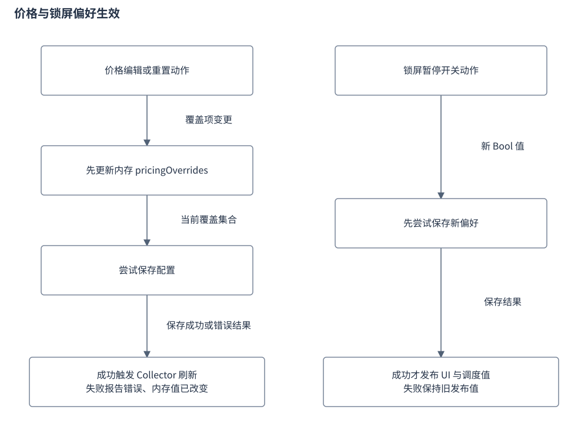
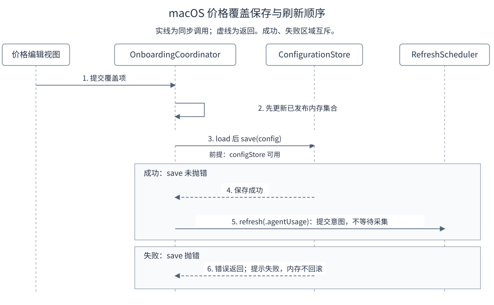

# 设置中心与价格校准设计

设置中心负责保存用户偏好与模型价格覆盖，并通知相应模块应用配置。本文以 macOS 的设置窗口、协调器和配置生效路径为主，说明 Windows 配置接入的边界。总体关系见 [Bruce 设计文档](Bruce设计文档.md#settings-pricing)。

## 目录

- [1. 目标与范围](#chapter-1)
  - [1.1 窗口入口与职责](#settings-window)
- [2. 配置模型](#chapter-2)
  - [2.1 刷新与展示配置的边界](#refresh-preferences)
- [3. 配置项设计](#chapter-3)
  - [3.1 分类、指标编辑与预览](#settings-navigation)
  - [3.2 模型价格表与校准交互](#pricing-editor)
  - [3.3 锁屏暂停订阅刷新配置](#lock-preference)
- [4. 加载与生效流程](#chapter-4)
  - [4.1 模型价格覆盖与生效路径](#pricing-activation)
- [5. 异常与安全边界](#chapter-5)
  - [5.1 Windows 设置接入](#windows-settings)
- [6. 配置示例](#chapter-6)
- [7. 参考文献](#chapter-7)
  - [7.1 原始资料与实现入口](#original-references)
  - [7.2 相关文档](#related)

## 1. 目标与范围

### 1.1 窗口入口与职责

**功能需求**：用户需要一个集中窗口编辑展示、刷新、模型计费、订阅和维护等配置；打开期间显示 Dock 图标，关闭后恢复菜单栏模式；窗口控制器只管窗口，不承担定价计算。

**方案机制**：`SettingsWindowController.present()` 创建或前置唯一受管窗口，取消最小化并激活应用。打开期间应用切换为 `regular`，显示 Dock 图标；`windowWillClose(_:)` 恢复 `accessory`。Dock 再次打开应用时，只有配置窗口会话仍活跃才前置窗口。

视图处理编辑交互，`OnboardingCoordinator` 保存配置并协调相应模块。窗口控制器只管理窗口，不承担模型定价计算；价格覆盖与订阅凭据分开管理。

**边界与非目标**：设置窗口、菜单栏面板和采集刷新各自维护生命周期。

依据：[`ApplicationBootstrap.swift`](../../apps/macos/Sources/BruceApp/ApplicationBootstrap.swift) 的 `SettingsWindowController`；[`SettingsView.swift`](../../apps/macos/Sources/BruceApp/SettingsView.swift)；[`OnboardingConfiguration.swift`](../../apps/macos/Sources/BruceOnboardingCore/OnboardingConfiguration.swift)。

## 2. 配置模型

**方案机制**：非敏感配置由 `OnboardingConfigurationStore` 保存到 `config/onboarding-v1.json`；敏感凭据走独立存储。视图调用协调器，协调器按字段通知主题、菜单栏或调度消费者。

### 2.1 刷新与展示配置的边界

**功能需求**：刷新间隔、界面风格与指标配置保存成功后通知各自消费者生效；保存失败保留旧间隔，不发布新值。

**方案机制**：刷新间隔保存成功后，协调器把分钟换算为秒，调用 `scheduler.updateRefreshInterval`，同时更新本地采集周期与 `quotaRefreshInterval`。初始化也同步加载值；保存失败时不发布新间隔。定时器重排只处理已启用、允许自动刷新且处于 idle 的模块，距上次成功已超过新间隔时延迟为 0。

界面风格保存后由主题解析与原生窗口呈现消费，菜单栏指标配置由状态项消费。

**边界与非目标**：429 冷却仍独立为 30 分钟。手动刷新、窗口边界和网络恢复也会改变请求时机，因此不能把设置周期当作所有网络请求的固定间距。

配置写入、主题能力回退、额度授权和服务端查询结果属于不同责任；用户选择某个 Provider 也不能替代其授权与凭据就绪判断。

依据：[`SettingsView.swift`](../../apps/macos/Sources/BruceApp/SettingsView.swift) 的刷新设置；[`OnboardingCoordinator.swift`](../../apps/macos/Sources/BruceApp/OnboardingCoordinator.swift) 的配置入口及 `reconcileScheduler()`；[`QuotaRefreshPolicy.swift`](../../apps/macos/Sources/BruceAppCore/QuotaRefreshPolicy.swift)；[`ThemeResolution.swift`](../../apps/macos/Sources/BruceOnboardingCore/ThemeResolution.swift)。

## 3. 配置项设计

### 3.1 分类、指标编辑与预览

**功能需求**：侧栏分六类组织配置；菜单栏指标可预览、选择、移除和拖拽重排，且不能移除最后一项、最多选择三项。

**方案机制**：侧栏分为通用、Agent 用量、模型计费、订阅额度、授权与隐私、维护六类，由 `paneContent` 选择右侧内容；配置保存错误在设置界面展示。Provider 配置和诊断使用各自的 sheet，窗口控制器只负责窗口会话。

通用设置中的菜单栏预览条读取当前指标和外观，帮助判断呈现效果。“仅显示图标”通过 `setMenuBarIconOnly` 保存；开启时隐藏指标重排区，文本隐藏后仍保留额度环规。关闭时可选择、移除和拖拽重排指标，拖拽经 `moveMenuBarMetric` 写入 `setMenuBarMetrics`。界面禁止移除最后一项，最多选择三项；配置归一化还会去重、忽略未知值、截取前三项，空列表恢复默认的最低剩余额度、今日 Token、今日费用。

**边界与非目标**：预览只说明当前展示配置，不代表额度数据刚完成服务端查询。

依据：[`SettingsView.swift`](../../apps/macos/Sources/BruceApp/SettingsView.swift) 的 `SettingsCategory`、`paneContent`、`menuBarPreviewStrip` 与重排区；[`MenuBarMetrics.swift`](../../apps/macos/Sources/BruceAppCore/MenuBarMetrics.swift) 的 `MenuBarMetricConfiguration`。

### 3.2 模型价格表与校准交互

**功能需求**：模型价格表支持搜索、用量/自定义筛选、单项校准与全部重置，并实时展示当前覆盖集合。

**方案机制**：模型表从内置目录与当前覆盖集合解析有效价格。搜索同时匹配模型名、展示名与厂商；筛选分为全部、有用量、自定义。有用量按模型归一化后的 Token 大于零判断，自定义按解析结果的 `isCustom` 判断。表中编辑打开单模型校准 sheet；全部重置先要求确认，单模型恢复基准只在已有覆盖时提供。

| 校准字段 | 输入与保存语义 |
|---|---|
| `inputPricePerMillion` | 每百万输入 Token 单价，文本用 `Double` 解析 |
| `outputPricePerMillion` | 每百万输出 Token 单价，文本用 `Double` 解析 |
| `cacheReadPricePerMillion` | 可选缓存读取单价，界面说明留空采用输入价格的 10% 默认折算 |
| `currency` | 取当前有效价格的币种，保存到覆盖项 |
| `note` | 备注去除两端空白，空字符串保存为 nil |

上述覆盖字段在配置模型中均可选。保存按钮把解析后的可选数值组装为 `ModelPricingOverride`，交给协调器后关闭 sheet。

底部配置卡实时编码当前覆盖集合，展示 `onboarding-v1.json` 中 `pricingOverrides` 的 JSON 形状，并提示可人工批量配置。

**边界与非目标**：这一入口未显式拒绝非法或负数文本，不能把界面描述为已完成严格价格校验。示例费用预览按一百万输入和二十万输出估算，解析失败时使用原有效价格；预览与持久化结果需分别理解。实际价格匹配及计算规则见 [本地会话解析与计费](本地会话解析与计费.md)。

空集合展示说明性样例；它是配置预览，保存成败仍以协调器及错误提示为准。模型用量费用也属于本地参考费用，不能视为服务商账单。

依据：[`ModelPricingSettingsView.swift`](../../apps/macos/Sources/BruceApp/Settings/ModelPricingSettingsView.swift) 的 `filteredModels`、编辑 sheet、`saveChanges()`、`configPreviewCard`；[`OnboardingConfiguration.swift`](../../apps/macos/Sources/BruceOnboardingCore/OnboardingConfiguration.swift) 的 `ModelPricingOverride`。

### 3.3 锁屏暂停订阅刷新配置

**功能需求**：锁屏暂停开关先保存成功才发布 UI 属性并通知调度器；失败保留旧发布值与旧调度值，不取消在途采集。

**方案机制**：通用设置的“锁屏暂停订阅刷新”写入 `pauseSubscriptionRefreshOnScreenLock: Bool`。默认 true，旧配置缺字段解码为 true；协调器启动时将加载值同步给调度器。

修改时先加载配置，再保存新值；只有保存成功才发布 UI 属性并调用 `scheduler.setPauseSubscriptionRefreshOnScreenLock`。

**边界与非目标**：存储不可用或保存失败时保留旧发布值与旧调度值，并写设置错误。修改不会取消在途采集，也不会立即触发刷新。执行与解锁条件见[锁屏门禁](刷新生命周期设计.md#screen-lock)。

依据：[`OnboardingConfiguration.swift`](../../apps/macos/Sources/BruceOnboardingCore/OnboardingConfiguration.swift) 的字段及解码；[`OnboardingCoordinator.swift`](../../apps/macos/Sources/BruceApp/OnboardingCoordinator.swift) 的 `setPauseSubscriptionRefreshOnScreenLock`；[`SettingsView.swift`](../../apps/macos/Sources/BruceApp/SettingsView.swift) 的通用设置开关。

## 4. 加载与生效流程

### 4.1 模型价格覆盖与生效路径

**功能需求**：模型价格覆盖先更新内存集合，保存成功才触发刷新，并把覆盖值交给 Collector 供下一轮重新聚合。

**方案机制**：

| 协调入口 | 作用 |
|---|---|
| `setPricingOverride(modelName:override:)` | 更新单个模型覆盖项 |
| `removePricingOverride(modelName:)` | 移除单个覆盖项 |
| `resetAllPricingOverrides()` | 清空覆盖集合 |
| `persistPricingOverrides()` | 保存到配置，并在成功后触发刷新 |

价格保存与锁屏偏好的生效顺序有所区别。

图：设置保存与生效。两条路径均由协调器负责，失败时的内存状态不同。

图：价格覆盖的调用时序。实线为同步调用，虚线为返回；成功与失败区域互斥。`refresh` 是同步提交刷新意图的入口，返回不表示采集结束。存储不可用时在调用 save 前退出并设置错误。

空覆盖集合保存为 nil；存储不可用或保存失败时写入设置错误。保存成功调用 `scheduler.refresh(.agentUsage)`，运行输入再把 `pricingOverrides` 交给 Collector 的定价路径。

**边界与非目标**：修改界面中的数值并不等于 Collector 已完成下一轮计算。

原设置设计声明“内存热重算、无需重新扫描”；当前实现通过 Collector 刷新生效，两者应分别理解。价格覆盖只改变参考费用口径，不改变 Token 原始用量，也不能作为服务商计费或剩余额度的实测值。

依据：[`OnboardingCoordinator.swift`](../../apps/macos/Sources/BruceApp/OnboardingCoordinator.swift) 的价格覆盖入口及 `persistPricingOverrides()`；[`CollectorRunInput.swift`](../../apps/macos/Sources/BruceAppCore/CollectorRunInput.swift)；[`collector-domain/src/pricing.rs`](../../core/collector/crates/collector-domain/src/pricing.rs)；[原设置设计](../devel/design/04-设置中心与价格校准交互.md)。

## 5. 异常与安全边界

**边界与非目标**：价格编辑入口把文本解析为可选 `Double`，与 Bridge 的数值校验是不同边界。价格覆盖入口先改内存集合再尝试保存，存储失败时显示错误，不能把界面关闭或配置预览当作落盘成功。

### 5.1 Windows 设置接入

**功能需求**：Windows 设置页经 Tauri IPC 独立读取和保存设置，与 macOS 协调器分别实现。

**方案机制**：Windows 设置页通过 Tauri IPC 读取和保存设置。价格编辑先校验覆盖集合，再调用 `save_settings_command`，发送 `settings-saved` 事件并重绘价格区。

**边界与非目标**：该路径与 macOS 协调器分别实现，不能把一端的窗口、刷新或保存失败语义直接套用到另一端。

详细字段、Provider 装配与平台限制见 [Windows 应用设计](Windows应用设计.md)。原设计中的预览、诊断和交互目标也必须对照各端当前代码，文档声明不自动表示均已实现。

依据：[`apps/win/src/settings.js`](../../apps/win/src/settings.js) 的 `persistOverrides()`；[`apps/win/src-tauri/src/settings.rs`](../../apps/win/src-tauri/src/settings.rs)；[原 Windows 设计](../devel/design/05-Windows平台适配.md)。

## 6. 配置示例

按实现推演：给已知模型只覆盖输入单价，保存成功后下轮 Collector 结合内置输出价重算；没有完整输入/输出覆盖的未知模型仍无法计价。锁屏开关保存失败时协调器保持旧发布值与调度值；保存成功后偏好立即传给调度器，随后执行的自动轮次才按当前锁屏状态选策略。

## 7. 参考文献

### 7.1 原始资料与实现入口

- [04-设置中心与价格校准交互.md](../devel/design/04-设置中心与价格校准交互.md)：本主题的原始声明或实现入口。
- [05-Windows平台适配.md](../devel/design/05-Windows平台适配.md)：本主题的原始声明或实现入口。
- [ApplicationBootstrap.swift](../../apps/macos/Sources/BruceApp/ApplicationBootstrap.swift)：本主题的原始声明或实现入口。
- [SettingsView.swift](../../apps/macos/Sources/BruceApp/SettingsView.swift)：本主题的原始声明或实现入口。
- [OnboardingConfiguration.swift](../../apps/macos/Sources/BruceOnboardingCore/OnboardingConfiguration.swift)：本主题的原始声明或实现入口。

### 7.2 相关文档

- [Bruce 设计文档](Bruce设计文档.md#settings-pricing)：配置和定价在系统中的位置。
- [本地会话解析与计费](本地会话解析与计费.md)：价格匹配与参考费用的计算规则。
- [菜单栏与看板设计](菜单栏与看板设计.md)：界面偏好如何参与主题和窗口呈现。
- [刷新生命周期设计](刷新生命周期设计.md)：配置生效后采集、额度策略和发布的顺序。

最后更新：2026-10-20
